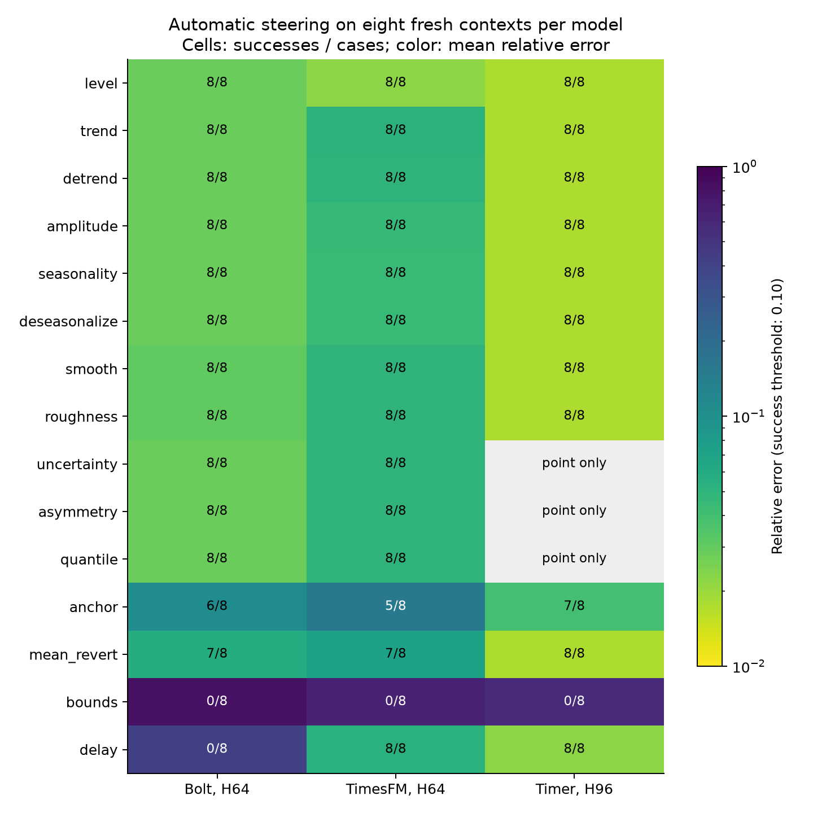
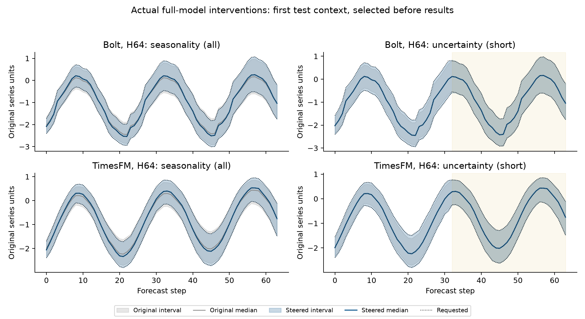

# Dynamic steering: implementation and evidence

A researcher can register a deterministic predictor and optional PyTorch module, train steering profiles,
and use the same API for unfamiliar models. Layer and token locations are discovered automatically.
The interface supports 19 behavioral requests, protected short/long/explicit forecast windows,
and operational context relevance policies. Successful control is measured, not assumed.

- [API and custom-model registration guide](../../tsfm_lens/docs/dynamic_steering.md)
- [Runnable custom-model example, no downloads](custom_model.py)
- [Persistent research log, including failed experiments](../../tsfm_lens/docs/dynamic_steering_research_log.md)
- [Source statistics](source_data.json), [artifact hashes](manifest.json), and [independent array audit](artifact_audit.json)



Success means full-output relative error ≤0.10, including protected coordinates. All cases are retained.
The three suites use eight fresh contexts, but different horizons/output contracts; this is not a ranked model benchmark.
Bolt/TimesFM use rank 256; Timer uses an exact discovered Linear row space within rank 128.
Large absolute bounds are a deliberate stress request and often exceed the radius 0.2 budget.
Point-only Timer does not receive invented quantile/uncertainty outputs.

| Experiment | Learned/additive successes | Explicit input policies | Mean learned error |
|---|---:|---:|---:|
| [dynamic_d01_bolt_pilot](dynamic_d01_bolt_pilot/findings.md) | 4/5 | 0 | 0.1456 |
| [dynamic_d02_timesfm_pilot](dynamic_d02_timesfm_pilot/findings.md) | 0/5 | 0 | 0.6123 |
| [dynamic_d04_timer_screened](dynamic_d04_timer_screened/findings.md) | 3/4 | 0 | 0.0718 |
| [dynamic_d05_timesfm_screened](dynamic_d05_timesfm_screened/findings.md) | 4/5 | 0 | 0.1308 |
| [dynamic_d06_bolt_long_pilot](dynamic_d06_bolt_long_pilot/findings.md) | 2/4 | 1 | 0.1352 |
| [dynamic_d07_bolt_full](dynamic_d07_bolt_full/findings.md) | 141/168 | 56 | 0.1026 |
| [dynamic_d08_timesfm_full](dynamic_d08_timesfm_full/findings.md) | 156/168 | 56 | 0.0828 |
| [dynamic_d11_bolt_joint_rollout](dynamic_d11_bolt_joint_rollout/findings.md) | 8/8 | 2 | 0.0646 |
| [dynamic_d12_timer_full](dynamic_d12_timer_full/findings.md) | 63/112 | 56 | 0.1998 |
| [dynamic_d13_chronos2_pilot](dynamic_d13_chronos2_pilot/findings.md) | 1/4 | 1 | 0.3709 |
| [dynamic_d14_timer_rowspace_poc](dynamic_d14_timer_rowspace_poc/findings.md) | 26/28 | 14 | 0.0633 |
| [dynamic_d15b_bolt_real](dynamic_d15b_bolt_real/findings.md) | 60/72 | 24 | 0.0668 |
| [dynamic_d16_timer_rowspace_fresh](dynamic_d16_timer_rowspace_fresh/findings.md) | 103/112 | 56 | 0.0596 |
| [dynamic_d17b_timesfm_real](dynamic_d17b_timesfm_real/findings.md) | 68/72 | 24 | 0.0356 |
| [dynamic_d18_bolt_context_windows](dynamic_d18_bolt_context_windows/findings.md) | 5/28 | 0 | 0.3955 |
| [dynamic_d19_bolt_context_fullspan](dynamic_d19_bolt_context_fullspan/findings.md) | 12/28 | 0 | 0.2781 |
| [dynamic_d20_response_transfer](dynamic_d20_response_transfer/findings.md) | 8/12 | 0 | 0.1700 |

Explicit full-horizon input policies are separated because their target is the native forecast on
the gated context by definition. They demonstrate operational relevance control, not internal steering ability.
For Bolt and TimesFM, all 64 ignore/focus sensitivity cases were exactly invariant to changes in removed regions.
Emphasizing input deviations increased output sensitivity in 27/32 cases; nonlinear response is not universally monotonic.



Every returned forecast in the completed steering experiments was independently replayed through the full predictor;
maximum replay discrepancy was zero. The forecast outputs were never substituted with target arrays.
The figures show the first preselected test context, including any residual error. Shading marks the protected half.

What changed during research:

1. A signed-effect screen rejects executed branches that do not affect the registered forecast.
2. Discovery handles reused module invocations and verified expanded batches in autoregressive prediction.
3. Exact Linear row spaces avoid wasting the intervention budget on invisible directions.
4. New doses/requests can reuse learned response maps with explicitly labeled online selection.
5. Input policies give exact ignore/focus semantics; partial-horizon policies remain measured, budget-limited interventions.

The strongest practical limit is target size and intervention geometry. Large clipping targets and some selective
width/context requests fail despite other controls succeeding. Bounded-search failure does not prove model-wide
impossibility. Successful late-head control also does not establish semantic neurons, a fixed reusable steering vector,
better forecast accuracy, or calibrated uncertainty. Real-source checks reuse earlier public datasets, with unknown
pretraining overlap. See individual protocols for exact samples, seeds and selection rules.

Reproduce from `tsfm_lens/` using the experiment entry points and each directory’s `protocol.json`:

```bash
python experiments/dynamic_steering_study.py --help
python experiments/dynamic_context_audit.py --help
python experiments/dynamic_real_audit.py --help
python experiments/dynamic_transfer_audit.py --help
python render_dynamic_steering_report.py
python audit_dynamic_artifacts.py
```

Use OMP_NUM_THREADS=2 MKL_NUM_THREADS=2 OPENBLAS_NUM_THREADS=2 for the reported CPU setup.
Portable artifacts include raw forecast arrays and per-case diagnostics. Learned profile arrays remain in the local
`tsfm_lens/runs/.../profiles` directories; researchers can retrain and save their own through the public API.
Early pilots predate improvements recorded in the log; final code is expected to improve or change their discovery paths.
