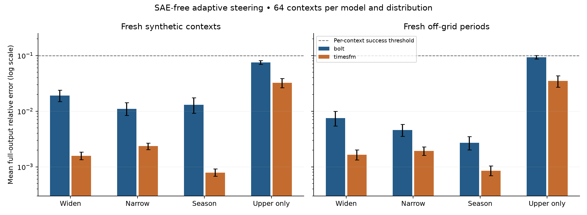
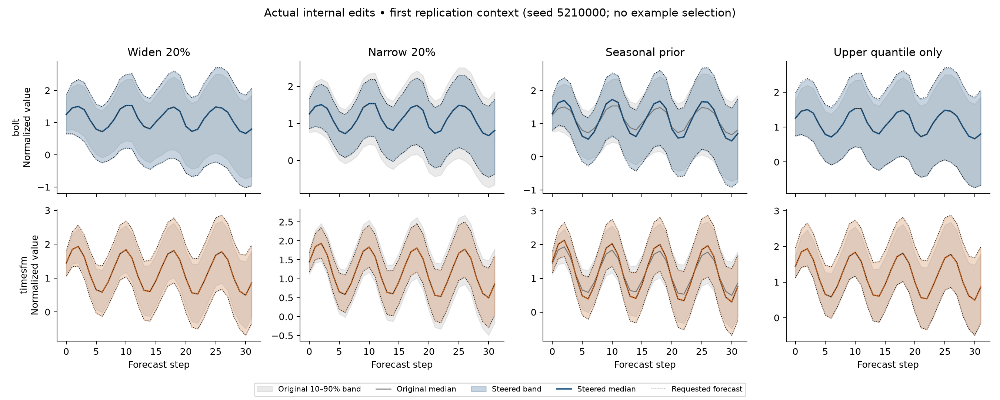
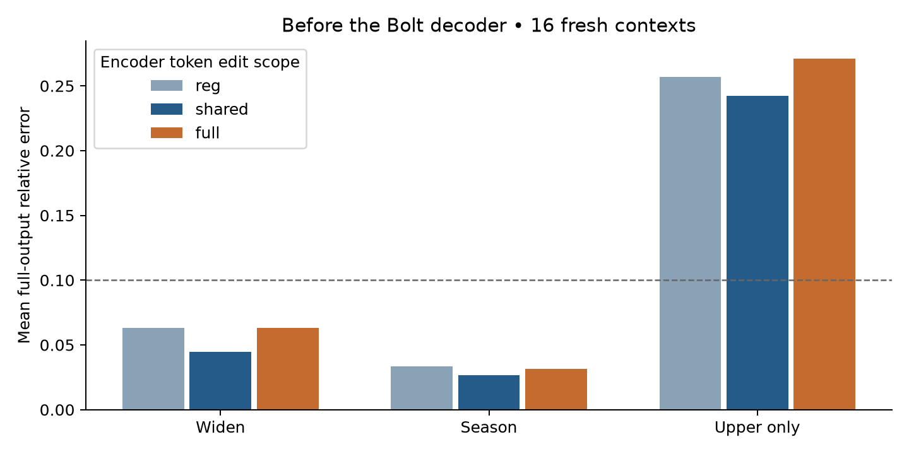

# Selective internal forecast steering

The opt-in controller works without an SAE. It measures the native response,
solves for a bounded hidden edit, and verifies the resulting nonlinear forecast.
It can also combine SAE decoder atoms or operate in a supplied subspace.

All rows below use frozen settings: dose0.2, total hidden radius0.2, ridge1e-5,
at most six correction steps. Success means full-output relative RMS error<0.1.
Intervals are bootstrap95% intervals over contexts, not forecast cells.

| Distribution / model | Task | Mean error [95% interval] | Successes |
| --- | --- | --- | ---: |
| fresh/bolt | widen | 0.01906 [0.01491, 0.02378] | 64/64 |
| fresh/bolt | narrow | 0.01106 [0.00842, 0.01422] | 64/64 |
| fresh/bolt | season | 0.01300 [0.00920, 0.01742] | 64/64 |
| fresh/bolt | upper | 0.07501 [0.06968, 0.08118] | 57/64 |
| fresh/timesfm | widen | 0.00157 [0.00135, 0.00184] | 64/64 |
| fresh/timesfm | narrow | 0.00236 [0.00204, 0.00268] | 64/64 |
| fresh/timesfm | season | 0.00079 [0.00068, 0.00092] | 64/64 |
| fresh/timesfm | upper | 0.03221 [0.02636, 0.03872] | 63/64 |
| offgrid/bolt | widen | 0.00753 [0.00541, 0.00995] | 64/64 |
| offgrid/bolt | narrow | 0.00458 [0.00353, 0.00580] | 64/64 |
| offgrid/bolt | season | 0.00272 [0.00202, 0.00350] | 64/64 |
| offgrid/bolt | upper | 0.09301 [0.08709, 0.10032] | 45/64 |
| offgrid/timesfm | widen | 0.00165 [0.00134, 0.00203] | 64/64 |
| offgrid/timesfm | narrow | 0.00192 [0.00161, 0.00228] | 64/64 |
| offgrid/timesfm | season | 0.00085 [0.00069, 0.00104] | 64/64 |
| offgrid/timesfm | upper | 0.03485 [0.02698, 0.04358] | 60/64 |

These are adaptive output-control results, not proof of a fixed semantic vector,
monosemantic neurons, improved forecast accuracy, or calibrated uncertainty.
Upper-only control remains harder and quantile crossings are reported separately.
SAE comparisons are discovery experiments with one training seed; modern signed
and batch-adaptive variants improved reconstruction but not consistently steering.

- [API and reproduction guide](../../tsfm_lens/docs/steering.md)
- [Persistent experiment log, including failures](../../tsfm_lens/docs/steering_research_log.md)
- [Current literature and design motivations](../../tsfm_lens/docs/steering_literature.md)
- [Exact plotted statistics and source hashes](source_data.json)

Every experiment directory includes protocol.json, results.json and findings.md.
Full local arrays/checkpoints are under tsfm_lens/runs/steering_*. The four
replication datasets also ship their intervention arrays and independent audits here.

## Upstream boundary

The longer encoder-output replication used the same frozen decoder and a20%
whole-state Frobenius edit budget. Widening passes15/16(REG),14/16(shared),
13/16(full); seasonal control passes15/16,16/16,16/16. Upper-only passes0/16
for every scope, including independent control of every encoder token.
This is a restriction-specific negative, not proof of global impossibility.
Head and encoder norm budgets are not directly comparable.

## Real contexts

On twelve cached real evaluation windows (four each electricity,M4,pedestrian),
passes for widening/narrowing/season/upper are12/11/12/8 for Bolt and12/12/12/12
for TimesFM. Settings were unchanged and all public API predictions were verified
through full-model internal hooks. Sources were reused from earlier research;
pretraining overlap is unknown. Future outcomes were not evaluated.
