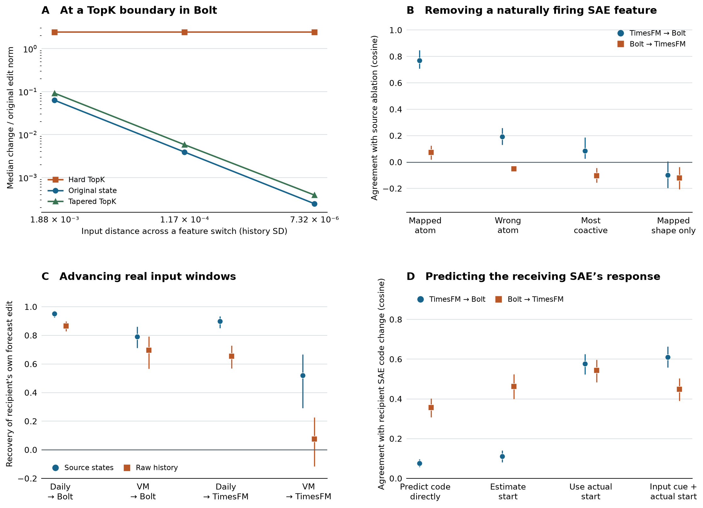

# Which SAE features and steering directions transfer between time-series forecasters?

**20 November 2026 · TSFM-Lens research report**

**22 November continuation.** On the same forecast checkpoint, a fixed group of independently learned SAE directions reproduced individual removal effects more faithfully than matching one atom by its activations. The result replicated within MOMENT, Chronos-Bolt and TimesFM. Across MOMENT checkpoints and from TimesFM into Bolt, maps trained on unedited daily series reproduced part of the receiving model's response to a physical temperature ramp on different stations and dates. In the latter pair much of the early effect survived rearranging the ramp's interior. The native MOMENT adapter, baseline forecast errors, references for both intervention outcomes and physical effect sizes are documented together. [MOMENT findings](moment/README.md) · [Other forecaster replications](shape_transfer/cross_seed_groups/README.md) · [MOMENT ramp confirmation](moment/dictionary_transfer/input_deltas/new_dates/README.md) · [Cross-family ordering result](shape_transfer/physical_ramp/new_dates/order/README.md)

**Follow-up.** A translation that uses how each checkpoint reads the current history reproduced the *shape* of source SAE ablations in other architectures. On a prospectively frozen daily cohort, centered recovery was .858 from TimesFM into Bolt and .971 in the reverse direction. Four signed target SAE coefficients could implement much of this transfer on the original daily cohort. Blind continuation past the eight controlled leads remained difficult. [Why level traveled, and when shape travels too](shape_transfer/README.md)

**21 November continuation.** A three-checkpoint self-control shows how much of a feature's continuation vanishes when its write is summarized by eight early effects. Independent interval, two-feature and moving-origin experiments distinguish shared readouts, reusable directions and identifiable sparse features. [New experiments and independent tests](shape_transfer/NOV21.md)

A small change to a time series can leave a model’s hidden state almost unchanged while swapping two of its sparse autoencoder (SAE) features. We observed this directly in Chronos-Bolt-small, TimesFM 2.5-200M and Chronos-2. The most reliable of our donor-model methods for predicting sparse feature changes was to translate the **dense hidden-state change**, apply it to the receiving model’s **actual starting state**, and ask its own SAE which features changed. Clean-state alignment also carried naturally shifting input windows between models. Translating a specific feature’s forecast effect was harder. One pair of SAE features reproduced each other’s overall removal effect with **.846 and .819 recovery** on a second daily cohort and **.816 and .798** on weekly series. Across features, agreement was much more dependable for a forecast’s overall level than for its time profile or the size of the edit.

This study follows the repository’s earlier finding that features from different models can fire on the same histories even when their forecast effects are difficult to match. Three TSALM workshop papers used SAEs to identify temporal patterns or steer individual pretrained forecasters. Earlier studies also compared representations and steering across models. Among the papers reviewed, we found no direct test of a naturally active feature’s source and recipient forecast effects against matched controls. [Research gap and primary literature](GAP.md)

*The first panel follows 32 Bolt trajectories deliberately chosen to cross a feature boundary. The next panels use held-out real series. B compares 16 source features on 160 daily histories. C compares flexible maps from model states and raw histories on 160 daily series and 128 machines. D compares four ways to predict hard SAE code changes for two input edits on 80 weekly histories. For the final control, only the known input edit and the true receiving state are supplied. Error bars are 95% bootstrap intervals resampling series, or pairs of series in the matched-donor studies, conditional on the fitted models and selected features. [Figure code](figure.py)*

## 1. The discontinuity is measurable, and some SAE information survives it

For each of 32 weekly Bolt series, we found two nearby inputs on opposite sides of a TopK feature switch. Narrowing the gap 256-fold reduced the original hidden-state displacement by roughly 256-fold. The hard SAE reconstruction still jumped **2.43 times** the entire original hidden edit. At the narrowest gap, applying the hard decoded difference in Bolt changed its median forecast by **0.00955** history standard deviations. The actual hidden change produced **0.00000226**. TimesFM and Chronos-2 showed the same phenomenon. At a TopK tie with positive activation, the size of the jump depends on the difference between the entering and leaving decoder vectors. In Bolt their median cosine was .019, so exchanging them could move the reconstruction substantially. These are conditional measurements at a crossing. An ordinary 0.03-SD perturbation replaced 4.75% of Bolt’s winning features and 0.64% of TimesFM’s. [Crossing protocol](boundary/CROSSING_PROTOCOL.md) · [Bolt](boundary/crossing_bolt.json) · [TimesFM](boundary/crossing_timesfm.json) · [Chronos-2](boundary/crossing_chronos2.json) · [Ordinary perturbations](boundary/README.md)

Two interventions isolated the cause. Holding the clean winners fixed improved agreement with the original Bolt displacement from **0.294 to 0.497**. Gradually tapering coefficients near the cutoff kept the same winning IDs and made individual swaps continuous. In a rank-32 map trained on paired source and recipient perturbations from 128 daily histories, this also improved actual cross-model forecast agreement on fresh weekly series. The gain in forecast cosine was **+0.164** [0.068, 0.271] into TimesFM and **+0.112** [0.012, 0.218] into Bolt. Both weekly gains also appeared in the first retrained dictionary pair. In the second pair the gains fell to +.000 and +.076, and both intervals included zero. The original Bitbrains intervals also included zero. Smoothing improves local geometry more consistently than it improves downstream forecasts, and it can sacrifice clean reconstruction fidelity. [Forecast and reconstruction controls](boundary/README.md)

We trained two SAEs on identical rows while holding each backbone fixed. Matching features by their training activation profiles gave clean-code cosines of **.883 in Bolt and .983 in TimesFM** on held-out histories. For *changes* in those same codes the cosines fell to **.120 and .367**. In TimesFM the matched features identified 90.5% of the clean winners. Even a good match for what is present can miss what changes. A fixed set of learned SAE axes still carried useful information. Thirty-two frequently active TimesFM encoder axes beat equal-dimensional random orientations for predicting Bolt’s forecast edit by **0.289** cosine [0.188, 0.384]; the reverse advantage was **0.038** [−0.016, 0.093]. [Bolt seed comparison](boundary/seed_identity_bolt.json) · [TimesFM seed comparison](boundary/seed_identity_timesfm.json) · [Matched-basis forecast controls](boundary/fixed_forecast_audit.json)

**Can we recover the receiver’s own SAE response?** We kept the dense edit map fixed and changed where we applied its prediction. With the true clean recipient state, we encoded both endpoints using the recipient’s own SAE. In symbols the estimate is `E_target(h_target + T(Δh_source)) − E_target(h_target)`. This arm fits `T` on paired hidden-state changes. At test time it uses the edited source and the ordinary recipient forward pass. The edited recipient forward pass is reserved for scoring. On 80 weekly series, hard-code cosine for TimesFM → Bolt was **.576**, versus **.111** when the starting state was estimated from the donor and **.077** when predicting code changes directly. The reverse scores were .543, .463 and .356. The actual start identified **129 of 245** entering Bolt features, versus 14 with the estimated start. In TimesFM only 6 of 44 entering features were identified. This method requires an ordinary recipient forward pass, and on weekly Bolt the known input perturbation plus the same recipient state reached **.610** cosine. [Re-encoding experiment, feature IDs and live forecast patches](reencode/README.md)

## 2. Hidden states transfer natural changes. A source atom poses a different test

First, align model states on **384 unmodified M4 daily histories** with a ridge regression. For a new history, take real windows ending one or four observations before and after its center. Translate half the difference between their source states. On the central history, add and subtract that translated vector at the receiving block’s final 32 observed steps and measure the signed change in its live 16-step forecast. The reference is what the **recipient itself** does with its native displacement. Recovery is one minus squared forecast error divided by the reference response energy. One means exact agreement, zero is the score for doing nothing, and negative values are possible.

| Frozen source → recipient | M4 daily · 160 series | M4 weekly · 70 series | Bitbrains · 128 VMs |
|---|---:|---:|---:|
| TimesFM → Bolt | .937 | .862 | .826 |
| Bolt → TimesFM | .917 | .688 | .611 |

In that last cell the mapped *whole hidden displacement* scored **−0.464** despite **0.611** forecast recovery. The map preserved directions that mattered to the recipient’s forecast more accurately than it recovered the entire state. With the source’s native forecast response as the reference, natural-window recoveries were still positive in all six cells, ranging from .494 to .831. On the VMs one machine contributed roughly a quarter of the reference energy; the TimesFM recovery interval was [0.389, 0.765]. Randomized pretrained connectivity and wrong-history donors weaken transfer. A flexible raw-history comparison nearly tied the source model on some artificial cues, yet on natural VM shifts its recovery was **0.076 versus 0.519** for the source-state estimator into TimesFM. These latter two scores use the same nonlinear model-selection protocol. The table uses the original linear map. [Linear map and nulls](transport/RESULTS.md) · [Nonlinear input controls](input_baseline/README.md)

Next, remove the contribution of **one naturally firing source SAE atom**, preserving its model’s reconstruction error. For source coefficient 𝑧, decoder vector 𝑤 and clean-state map 𝑇, subtract 𝑧𝑤 from the source state and 𝑧𝑇(𝑤) from the recipient state. The reference is now the **source’s** actual eight-lead forecast change. Sixteen features per source were chosen from training prevalence before any forecast was scored.

| Source → recipient · M4 daily | Mapped atom cosine | Wrong source atom¹ | Most coactive target atom² | Mapped cosine after removing level | Mapped recovery at its original dose |
|---|---:|---:|---:|---:|---:|
| TimesFM → Bolt | **.769** | .192 | .085 | −.099 | −.007 |
| Bolt → TimesFM | **.074** | −.051 | −.104 | −.121 | −5.756 |

¹ Same source amplitude, history and mapped edit length; average over four wrong-atom assignments. ² Disable the target atom using its own natural coefficient. Each result pools active histories and leads within an atom and then weights atoms equally. The .769 result exceeded both the wrong-feature and shuffled-map controls. Across resampled histories *and* feature IDs, the TimesFM-source advantage over a wrong atom was [0.372, 0.791]; the Bolt-source interval was [−0.311, 0.546]. The first electricity check had only two of the 16 TimesFM features firing and seven Bolt features, making the daily result the more informative population comparison. [Primary protocol and outputs](atoms/README.md) · [Two-way uncertainty](atoms/results/joint_uncertainty.json)

**A specific SAE match did work.** For each source, we picked the pair with the highest *training* coactivation among its selected features, then ran the matched target removals on 192 other daily series. TimesFM feature **742** fired on 110. Removing Bolt feature **5432** at its own natural strength recovered **.846** [.817, .871] of the source forecast change. The dense translation scored **−.035** despite a higher cosine. Both features tracked an interpretable input statistic. A high mean of the final 32 observations relative to the full 480-step history predicted their firing with held-out AUROCs of **.944** and **.985**, respectively. We then reversed the roles of **these exact two features**, including all 91 Bolt firings. TimesFM 742 reproduced the overall effect of Bolt 5432 with **.819** recovery [.777, .856]. Their detailed waveforms differed: TimesFM’s centered response was about 16 times larger in the reverse comparison. A *different* pair selected by searching from Bolt, 4813 → TimesFM 742, had .847 full cosine and **−44.43** recovery because of its dose. The original 742/5432 pair also gave **.816 and .798** recovery on 80 weekly series without recalibration. Neither TimesFM 742 nor Bolt 4813 fired on the 128 VMs. Bolt 5432 fired only five times. A strongly coactive pair can therefore be functionally useful, but that evidence belongs to the specific pair, direction and population. [Matched-feature replication](replication/README.md#can-a-single-matched-sae-feature-work) · [The two removals, lead by lead](replication/results/selected_feature_pair.png)

**What if we hold the experiment fixed and change only which direction is written?** For each firing atom on those same 160 daily histories, we took a real window ending one observation earlier. We scaled its source hidden-state change to exactly the norm of that atom’s removal. Both used the same postblock sites, clean alignment, active histories, recipient checkpoint and eight-lead source-response scoring. Equal hidden norms still produced differently sized source forecast changes. For Bolt → TimesFM, full cosine jumped from **.074** for the atom to **.898** for the window direction, a paired gain of **.824** [.767, .883]. Original-dose recovery moved from **−5.756 to .551**. For TimesFM → Bolt the cosine gain was smaller and uncertain, **.769 to .856**, but original-dose recovery still improved from **−.007 to .404**. Neither window direction had positive centered-shape recovery at the original dose. This result concerns a local write derived from an observed window change. Each edit has its own measured source forecast response. [Matched-window comparison, item pairs and uncertainty](atoms/matched_windows/README.md)

The third-checkpoint test gave a different outcome on the same daily histories. TimesFM → Chronos-2 and Chronos-2 → TimesFM achieved full cosines of **.496 and .514**, against wrong-feature controls of .130 and .143. Only the former had positive average full skill (.110, 95% interval [−.0003, .226]). In reverse, **all 16** mapped features had negative full skill, averaging −9.387. The correct direction can be detectable in both architectures while its actual forecast amplitude generalizes in only a subset of cases. [Chronos-2 extension, per-feature estimates and replay checks](atoms/third/README.md)

Feature coverage changes the answer. We screened on 64 previously unused electricity customers’ clean states and tested on 96 further customers. All 16 selected features per model fired on test. The original M4-trained map then beat the wrong-feature control on **horizon-centered cosine** in both directions: .301 versus .173 into Bolt and .252 versus .020 into TimesFM. Scale-sensitive shape recovery was .049 and −.067, respectively. A detectable feature-specific direction can thus coexist with little ability to reproduce the source waveform at its original dose. [Electricity selection protocol](replication/ELECTRICITY.md) · [TimesFM source](replication/results/electricity_timesfm.json) · [Bolt source](replication/results/electricity_bolt.json)

The map itself costs information. Mapping each atom back into its *own* checkpoint with the same regularizer retained daily centered-shape cosines of .499 in TimesFM and .734 in Bolt. Across checkpoints the corresponding values fell to −.099 and −.121. Lowering the penalty to the clean-validation optimum did not rescue shape on a new daily cohort. Across the archived dictionary and two new fits per model, the TimesFM → Bolt full cosine remained higher than the reverse, while all six source/dictionary combinations had negative uncalibrated shape recovery on frequently firing daily features. A single matched target feature was especially weak, although a signed combination of 16 target SAE directions could implement an already mapped write. For that latter task, 16 clean target PCA axes attained higher recovery in all four original comparisons (daily into TimesFM, .963 versus .331 for SAE directions); every ridge-mapped write lies in the receiving training-state span by construction. [Regularization sweep](replication/results/bolt_penalty.json) · [Reverse sweep](replication/results/timesfm_penalty.json) · [Dictionary controls](controls/DICTIONARY_RESULTS.md)

## 3. A transferable forecast direction needs both a readout and a dose

On fresh M4 daily series, one recipient direction fitted solely to raise forecast level, with one signed amplitude per source atom calibrated on 96 separate histories, scored **0.895** full-response recovery for TimesFM → Bolt and **0.580** in reverse among sufficiently frequent archived atoms. The corresponding atom-specific mapped directions, with the same dose supervision, scored **0.658** and **0.54**. A different recipient direction fitted per feature to the source’s full eight-lead waveform recovered some **horizon shape** (.362 and .240). A source-amplitude-only output template predicted even more of that shape (.497 and .395). The actual writes demonstrate feasible supervised control. The template shows how much of the effect was already predictable from feature amplitude alone. [Feature replication, coverage and dose comparisons](replication/README.md)

The repository’s **ActivationContrast** API also supports amplifying the part of a feature already present. We separated two operations. A *read* estimates how much of the source contrast is present; a *write* changes the receiving model. A read fitted on clean paired states explained **68–82%** of held-out source-score variance. Using that predicted score recovered **64–83%** of the recipient response produced by giving it the true donor score. Even supplying the true score yielded only **6–8%** of the source reversal’s size in one direction and **10–12 times** its size in the other. A reusable score and a reusable forecast effect are different empirical claims. [Amplification experiment using the public API](steering/amplify/README.md)

For fixed input-cue directions, the quarter-depth site had the highest mean recipient-native recovery among the three tested sites. Daily scores were **.773, .637, .601** at quarter, middle and three-quarter depth; weekly scores were **.828, .651, .571**. The sinusoidal cue drove much of this difference. Bolt’s last token is a registration token, while TimesFM’s is a data patch. In a separate output-targeted experiment on **Bolt, TimesFM and Timer**, scalar calibration on 32 examples achieved **.734** daily recovery for lifting all forecast leads, **.008** for a tilt and **.005** for a sinusoid. Per-model native directions attained .922, .218 and .133 respectively. This supports testing levels and shapes separately before calling a layer or a direction transferable. [Layer comparison](steering/README.md) · [Three-model steering](forecast_requests/README.md)

A follow-up uncovered an avoidable source of asymmetry. The original gain could be at most eight times the *donor’s mapped vector*, which was small for TimesFM → Bolt. At the middle layer we first rescaled every direction, including shams, to the norm of the recipient’s own fitted direction for the same request. With the same 32 calibration series and the same gain bounds, daily level recovery rose **.321 → .822** into Bolt. The reverse stayed **.987 → .987**. This closed 75% of the directional gap. The corrected TimesFM → Bolt lift matched or slightly exceeded Bolt’s own fitted lift, which had hit its fit-time norm limit. Both models’ native tilts and sinusoids had positive recovery, but those shapes still transferred poorly under the corrected units. Recipient normalization uses the norm of a supervised native direction. [Dose convention, symmetric controls and residual gap](forecast_requests/units/README.md)

How long does a level edit last? We replayed the frozen eight-lead directions through lead 32. Across the six model pairs and two sites, the mapped lift retained **56% of the requested magnitude** during leads 9–32 on daily series and **50%** on weekly series. On daily data the receiving checkpoint mattered: TimesFM retained 98%, Timer 50% and Bolt 20%. The same daily intervention scored **.669** when a sustained lift was desired and **−.688** when the lift was supposed to end at lead eight. Each monitored layer ran once at both horizons. [Per-lead forecasts, shuffled controls and layer checks](forecast_requests/horizon/README.md)

## Scope and materials

These experiments measure interventions on frozen forecasters. They use median forecasts, selected token sites, standardized univariate histories and short horizons. We assessed the response to edits; improved accuracy against future observations is a different endpoint. The geometrical map needs paired training examples. Hidden vectors from independently trained models have arbitrary coordinates before alignment. Some corpora may overlap checkpoint or SAE pretraining. Different studies use different windows, dates, labels and sometimes overlapping dataset populations. Reported intervals generally condition on the trained models and sampled features; rare or dormant features restrict external-domain conclusions. The project’s private evaluation was left sealed.

Four independent SAE training replays reproduced the fitted dictionaries byte for byte. A fresh three-model steering refit changed pooled daily level recovery by less than .000001, with larger numerical differences on some individual responses. [Reproduction and data access](REPRODUCE.md) · [Literature and earlier repository evidence](GAP.md) · [Independent output-only and persistence baselines](controls/README.md)
