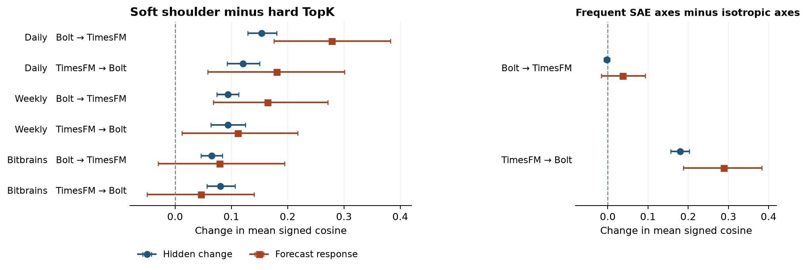
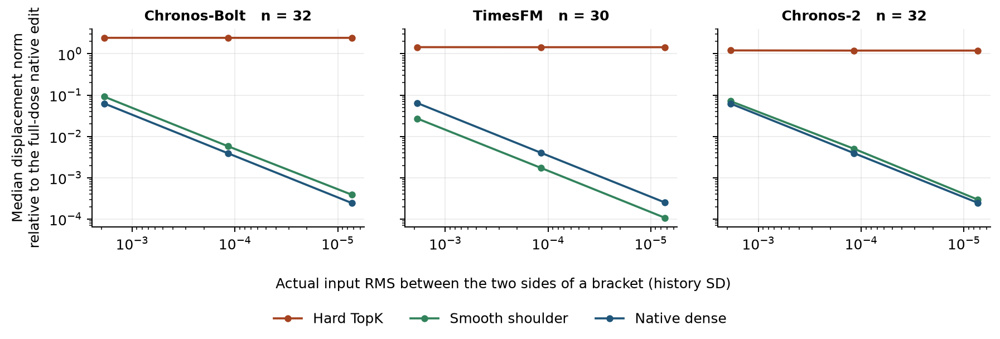

# What TopK boundaries cost in time-series model transfer

On small, controlled edits to real histories, a hard TopK sparse autoencoder (SAE) sometimes replaced one active feature with another while its backbone’s hidden state moved smoothly. A few replacements could dominate the decoded edit. Keeping the same learned weights and making the selected coefficients approach zero as they left the support improved cross-model prediction. The strongest sparse-encoder results still left room for dense activations, and the known input edit explained a substantial fraction of transfer. [Primary protocol](PROTOCOL.md) · [Smooth-gate protocol](SMOOTH_PROTOCOL.md) · [Fixed-axis protocol](FIXED_PROTOCOL.md)

## Does strong cross-seed agreement survive an edit?

Two independent SAE fits on each *identical* frozen backbone provide a control for the entire cross-model comparison. On 80 reserve items, atoms matched by their clean calibration activation profiles gave clean-code cosine **.883 in Bolt and .983 in TimesFM**. For the change induced by the same small input edit, cosine fell to **.120 and .367**. The paired clean-minus-edit gaps were .763 [.740, .786] and .616 [.575, .658]. In TimesFM, 90.5% of the active IDs agreed after matching. Aligning decoder directions independently showed the same drop. Smooth and clean-locked encodings recovered part of the lost agreement. The two fits used identical 34,515-state training samples and 720 steps per dictionary. [Two-seed assignments, many-to-many controls and forecast results](SEEDS.md)

Across the archived pair and both fresh pairs, shoulder’s hidden-transfer cosine exceeded the hard gate’s in all 18 direction-by-domain comparisons. In 17 of 18 the paired interval excluded zero. The forecast improvement depended on the dictionary. On weekly TimesFM the three shoulder-minus-hard forecast cosines were +.164 [.068, .271] for the archived source, +.182 [.085, .278] for seed 1 and +.00014 [−.066, .071] for seed 2. Seed 2’s mean direction improvement was inconclusive on both weekly and hardware targets. Its pooled relative RMSE did improve for the Bolt target on both cohorts. [Full seed sensitivity and native forecast scales](SEEDS.md)

## Experiment

The repository’s earlier seven-model panel established that features can activate on similar inputs across models, and benchmarked how closely coarse hidden states align. Here we evaluate finite changes in those states and the forecast produced by patching them. [Research gap and prior studies](../GAP.md) · [Earlier repository findings](../../../FINDINGS.md)

The dated protocols are local design records. Each identifies which prior results motivated its follow-up and which cohort or model remained unexamined at that point. The study has no external registration timestamp.

We evaluated the public TimesFM 2.5 200M and Chronos-Bolt-small checkpoints at `stacked_xf.10` and `encoder.block.3` respectively. Each archived SAE has 6,144 atoms and selects up to 32. We standardized one 480-observation history per series. For each we added a signed, tapered pulse and a tapered sinusoid to the last 64 points, with independently prescribed item-level shape parameters and RMS sizes of 0.01, **0.03** or 0.10 history standard deviations. These are synthetic cues on real backgrounds. We read the mean hidden state over the final aligned 32 input steps after the chosen block. This contains one TimesFM token or two Chronos-Bolt tokens.

We hash-split the 256 M4-daily items into 128 calibration, 48 validation and 80 test items. Both perturbation families and all amplitudes of an item stay together. We froze those maps before testing on 80 hourly Bitbrains fast-storage machines. A second prospective hypothesis used 80 additional M4-weekly series. A final fixed-axis comparison used 80 further M4-daily items with disjoint IDs, also excluding the concurrent experiments’ known daily IDs. The study excluded the repository’s archived external-real IDs for each matching dataset. M4 frequency splits share a benchmark lineage. Historical pretraining exposure is unknown. [IDs, versions, dictionary fingerprints and primary outcomes](m4.json) · [Bitbrains results](fast.json) · [Weekly IDs](weekly_smooth.json) · [Reserve IDs](fixed.json)

For cross-model prediction the observed source input is a change induced by a known time-series edit. The common supervised target is the other model’s actual dense change on the same history and edit. Every arm uses its own training-only rank-at-most-32 linear ridge and selects one of six penalties on the same validation set using mean squared error. The full-state arm learns its source rank-32 basis on hidden *edit* responses. The input-only arm uses the 64-point waveform. A shuffled calibration control permutes paired histories while preserving cue family. Signed cosine measures directional agreement of a predicted change with the true change and is invariant to positive rescaling. All reported means first average the two cue scores per item. Intervals are marginal, paired 95% percentile intervals over 4,000 resamples of evaluation items. They condition on the training split and checkpoints. [Analysis](analyze.py)

## A small number of switching atoms can overwhelm a local edit

On the 80 daily test histories at the primary dose, the dense state moved about 3.0% of its original norm in Bolt and 2.6% in TimesFM. Ordinary SAE encoding chooses the top 32 independently for clean and edited states. The fixed-support variant applies the continuous rectified encoder scores to the clean active IDs at both endpoints. Both decoders start from the identical clean hidden state and use only the decoded displacement, which removes the clean reconstruction residual from this comparison.

| Daily test, 0.03 SD | Any active ID switched | Mean fraction of 32 replaced | Hard decoded cosine | Fixed-support cosine | Paired improvement, 95% interval | Hard → fixed relative error | Clean-train PCA32 cosine |
|---|---:|---:|---:|---:|---:|---:|---:|
| Bolt | 81.9% | 4.75% | .294 | .497 | +.204 [.178, .230] | 2.808 → .858 | .881 |
| TimesFM | 20.6% | 0.64% | .290 | .336 | +.046 [.030, .065] | 1.511 → .940 | .475 |

The natural and fixed-support decodes agreed exactly on edits with unchanged support. Among the 131 Bolt and 33 TimesFM switches, fixing support gained .249 and .224 mean cosine. At the smaller 0.01 dose, absolute switching rates fell to 48.1% and 11.2%, while the average relative error of hard decoding rose to 4.246 and 2.093. When a switch occurred on a small edit, it could be large compared with the true displacement. Unrelated daily series lost 70.7% of Bolt feature IDs and 10.3% of TimesFM IDs, so the identity stability of the two dictionaries differs materially. Identical clean replays produced zero hidden-state and code change. The hardware-domain fixed-minus-hard gains at 0.03 SD were +.195 for Bolt and +.026 for TimesFM. [Dose curves, conditional counts and paired intervals](m4.json) · [Bitbrains](fast.json)

## Smooth coefficients with the same active IDs

Let \(r\) be the nonnegative encoder scores, \(t\) their 33rd-largest value and \(u\) their 16th-largest. In the **shoulder** encoder, each score becomes `r * clip((r-t)/(u-t), 0, 1)`. The strongest half of the 32 winners retain their ordinary coefficient and the weakest go to zero at the cutoff. The **subtract** encoder uses `max(r-t, 0)`. Both use the same dictionary, width and active feature IDs as the hard encoder on every observed clean and edited archived-checkpoint state at the primary dose. Their fitted cross-model maps see only differences of separately encoded endpoints. Fixed support also uses the clean endpoint as an anchor. [Implementation and tie handling](smooth.py) · [Prospective follow-up design](SMOOTH_PROTOCOL.md)

| Test cohort | Source → target | Hard SAE | Shoulder | Subtract | Fixed support | Dense | Input | Shuffle |
|---|---|---:|---:|---:|---:|---:|---:|---:|
| Daily | Bolt → TimesFM | .152 | .306 | .357 | .361 | .460 | .337 | .035 |
| Daily | TimesFM → Bolt | .553 | .673 | .687 | .702 | .795 | .768 | .033 |
| Weekly | Bolt → TimesFM | .144 | .238 | .278 | .289 | .346 | .300 | .093 |
| Weekly | TimesFM → Bolt | .571 | .665 | .680 | .692 | .764 | .798 | .092 |
| Bitbrains | Bolt → TimesFM | .052 | .117 | .145 | .153 | .261 | .259 | .011 |
| Bitbrains | TimesFM → Bolt | .458 | .539 | .568 | .577 | .643 | .669 | .077 |

These are held-out **hidden-change** cosines. On the fresh weekly set, shoulder improved on hard by +.094 [.074, .113] from Bolt and +.094 [.064, .125] from TimesFM. Hard codes rescaled to exactly the shoulder code’s per-state L2 norm gave .146 and .573. The remaining shoulder advantage was +.092 [.070, .113] and +.093 [.063, .123]. A symmetric alternative applying continuous coefficient differences to the union of both supports gave .290 and .692, with a possible budget up to 64 coordinates per edit. These controls implicate the treatment of individual winners at the boundary. [Daily](m4_smooth.json) · [Weekly](weekly_smooth.json) · [Bitbrains](fast_smooth.json) · [Norm and union controls](gate_controls.json)

Smooth encoding trades off against faithful reconstruction of the original states using the original decoder. On weekly TimesFM, clean fraction of variance unexplained (FVU, lower is better) was .558 for hard, .865 for shoulder and 1.033 for subtraction. Fitting only a decoder bias on the 128 clean daily calibration points yielded .528, .702 and .659. Bolt’s uncalibrated errors were .243, .223 and .381 and bias-calibrated errors .185, .169 and .269. Bias fitting leaves every decoded difference unchanged. The decoder retained its original directions. [Calibration results](calibration.json)

A full affine residual correction used only the same 128 clean daily training points and selected its penalty on the 48 validation series. For TimesFM, shoulder FVU fell from .970 to .374 daily and from .865 to .559 weekly. Equally refitting the hard decoder yielded .358 and .499. On Bitbrains, the daily-trained adjustment worsened shoulder FVU from .822 to 1.054 and hard FVU from .595 to .766. For Bolt, the refitted shoulder outperformed refitted hard on daily and weekly clean states (.074 vs .090, .099 vs .111), with a small reversal on Bitbrains (.339 vs .321). Decoder calibration moved individual atom directions and could overfit the source domain. Code-space maps and their forecast effects are invariant to this decoder-only operation. [TimesFM refit](decoder_refit_timesfm.json) · [Bolt refit](decoder_refit_bolt.json)

## Does the predicted change produce the target forecast?

We patched each predicted state change into the clean target model and ran its actual eight-step median forecast. The reference forecast change is the one produced by patching the **actual target hidden change at the same site**. In Bolt we added the same predicted displacement to each of the final two tokens, preserving the original within-window difference. Ordinary input edits can also affect other paths. The full forecast vectors for both the native patch and ordinary input intervention are in the linked JSON. All zero-displacement forecast replays reproduced the clean forecasts. A cosine near one can still accompany large errors in magnitude. [Patch implementation](patch_forecast.py) · [All item-level bootstraps for direction, gain, error and energy](forecast_audit.json)

| Test | Target | Hard | Shoulder | Subtract | Fixed support | Dense | Input | Shoulder minus hard, 95% interval |
|---|---|---:|---:|---:|---:|---:|---:|---:|
| Daily | TimesFM | .178 | .456 | .539 | .548 | .581 | .645 | +.278 [.176, .382] |
| Daily | Bolt | .394 | .575 | .608 | .619 | .641 | .747 | +.181 [.058, .301] |
| Weekly | TimesFM | .237 | .401 | .433 | .465 | .622 | .568 | +.164 [.068, .271] |
| Weekly | Bolt | .571 | .682 | .656 | .712 | .655 | .849 | +.112 [.012, .218] |
| Bitbrains | TimesFM | .108 | .187 | .218 | .231 | .269 | .296 | +.079 [−.030, .195] |
| Bitbrains | Bolt | .550 | .596 | .664 | .663 | .656 | .742 | +.046 [−.050, .140] |

Forecast effect sizes were small. Mean native RMS was .00528 and .00752 history SD on daily TimesFM and Bolt, .00796 and .01015 on weekly, and .00471 and .00522 on Bitbrains. On weekly TimesFM, shoulder changed pooled relative RMSE from .968 to .896, a reduction of .072 [.038, .107]. Pooled reference-aligned gain rose from .043 to .132 and predicted/native energy from .022 to .067. On weekly Bolt, relative RMSE changed from .811 to .752, with a paired interval for the change of [−.173, +.071]. Gain rose from .365 to .693 and energy ratio from .387 to .953. The forecast direction improvement in both weekly targets coexisted with a downstream magnitude shortfall, especially for TimesFM. [Weekly forecast audit](weekly_forecast_audit.json)

## What a fixed set of learned axes contributes

We used a fourth set of 80 daily items, excluded from fitting and earlier boundary studies, to ask if learned encoder orientations add anything at a strict budget of 32 fixed coordinates. Learned directions were the 32 most prevalent training-set winners or eight random sets of 32 axes drawn from all training-active atoms. Each linear projection used unit-length axes. Other controls used eight isotropic orthonormal 32-dimensional bases, clean-calibration PCA32, adaptive 6,144-coordinate SAE codes and the original full-state predictor. Every arm predicted the same dense displacement and selected its penalty by validation. The random baseline is the mean *score* of eight individually evaluated bases. [Protocol](FIXED_PROTOCOL.md) · [Results and random-seed dispersion](fixed.json)

| Reserve hidden-change cosine | Hard | Shoulder | Frequent SAE axes | Random SAE axes | Isotropic axes | Clean PCA | Dense | Input |
|---|---:|---:|---:|---:|---:|---:|---:|---:|
| Bolt → TimesFM | .170 | .302 | .435 | .431 | .437 | .453 | .469 | .297 |
| TimesFM → Bolt | .616 | .701 | .727 | .674 | .548 | .683 | .798 | .764 |

The fixed frequent-vs-isotropic difference was −.002 [−.009, +.005] from Bolt and +.180 [.157, .203] from TimesFM. For TimesFM these axes gave higher hidden-change agreement than clean PCA and random training-active atoms. The same qualitative distinction appears on the earlier daily and weekly cohorts. Bitbrains gave +.017 [.011, .023] from Bolt and +.239 [.221, .255] from TimesFM. The data support a learned orientation useful for this task at the TimesFM site; arbitrary 32-dimensional projections captured most of the recoverable Bolt signal on these daily histories. These fixed projections are signed preactivation differences. Establishing common feature meanings would also require independent semantic or interventional validation.

The same reserve predictions were patched into actual forecasts. From TimesFM into Bolt, the frequent axes gave .651 forecast cosine, the isotropic baseline .362 and the input-only predictor .808. Frequent minus isotropic was +.289 [.188, .384], and pooled relative RMSE fell from .872 to .655. In the reverse direction, frequent axes gave .597, isotropic .559 and input .595. The paired cosine change was +.038 [−.016, .093]. The eight random projections were each patched separately before averaging scores. Orthogonalizing the learned axes or randomly rotating their entire 32-column configuration preserved the asymmetry. Both backbones’ learned spans captured about 2.8 times the source edit energy of a random span, so retaining more total energy alone was insufficient to predict the downstream advantage. [Reserve forecast effects](fixed_forecast_audit.json) · [Span and Gram-matrix controls](fixed_geometry.json)



## What happens at an actual threshold crossing?

We bracketed a change in the set of winners by repeatedly running each real model on an intermediate time-series input. Each lower endpoint retained the original support and each upper endpoint differed. We followed the pulse when it crossed, otherwise the sine, on the first 32 eligible weekly series per model, using all 30 for TimesFM. Eligibility was 73/80 for Bolt, 30/80 for TimesFM and 80/80 for Chronos-2. This experiment conditions on a known crossing. The relevant prevalence for an arbitrary input edit comes from the unconditioned dose experiment. [Protocol](CROSSING_PROTOCOL.md) · [Actual model-forward bisection](crossing.py)



At the final bracket the typical input distance was **0.00000732 history standard deviations**. Every final bracket exchanged exactly one atom. The native displacement had shrunk to about 0.00025 of the corresponding full .03-dose native displacement. The hard-decoded displacement remained 2.434 times that full native displacement in Bolt, 1.445 times in TimesFM and 1.197 times in Chronos-2. The two exchanged atoms’ median decoder cosine was .019, .114 and .012, respectively. At an isolated swap of two features with common positive score `s`, the limiting decoder jump is `s * (decoder_entering − decoder_leaving)`. The small decoder cosines explain how two tied encoder scores can yield a large jump. Repeated endpoint forwards and zero patches produced zero error.

| Target, crossing-selected samples | Ordinary input | Native dense patch | Hard decoded patch | Shoulder decoded patch |
|---|---:|---:|---:|---:|
| Bolt, 32 | 0.00000090 | 0.00000226 | 0.00955 | 0.00000279 |
| TimesFM, 30 | 0.00000140 | 0.00000165 | 0.03236 | 0.00000340 |
| Chronos-2, 32 | 0.00000124 | 0.00000137 | 0.00481 | 0.00000205 |

Entries are the median eight-step forecast RMS in units of the original history’s standard deviation. The rigid decoder’s finite displacement can produce a forecast edit thousands of times larger than the native patch at the selected crossing. This directly measures the geometry that freezing or smoothing the support addresses. [Bolt](crossing_bolt.json) · [TimesFM](crossing_timesfm.json) · [Chronos-2](crossing_chronos2.json)

## A third backbone

The third preselected site was the public Chronos-2 checkpoint at `encoder.block.5`, width 768, with another repository-trained 6,144-atom, k=32 dictionary. Chronos-2 uses forecast-placeholder tokens whose number affects earlier context states. We retained the 64-step placeholder configuration used to train its SAE and measured the first eight forecast steps. The calibrated linear maps used the same 128 M4-daily items and validation criteria. [Protocol](THIRD_PROTOCOL.md) · [Chronos-2 dictionary](../../../tsfm_lens/runs/panel7_v3_ablcheck/sae/Chronos-2/encoder_block_5.pt)

| Weekly source → target | Hard → shoulder hidden cosine | Subtract | Dense | Input | Hard → shoulder forecast cosine | Paired forecast improvement, 95% interval |
|---|---:|---:|---:|---:|---:|---:|
| Chronos-2 → Bolt | .349 → .455 | .536 | .842 | .798 | .334 → .415 | +.081 [−.068, .234] |
| Chronos-2 → TimesFM | .154 → .181 | .232 | .391 | .300 | .100 → .387 | +.287 [.164, .417] |
| Bolt → Chronos-2 | .253 → .404 | .480 | .638 | .569 | .339 → .453 | +.114 [−.022, .252] |
| TimesFM → Chronos-2 | .419 → .482 | .517 | .593 | .569 | .367 → .581 | +.215 [.099, .332] |

On weekly Chronos-2, support switched in 98.75% of the .03-dose cue pairs and the native fixed-minus-hard decoded cosine difference was +.126 [.109, .143]. Shoulder improved hidden prediction in all four new directions on both weekly and Bitbrains, with all eight marginal intervals above zero. Some transfers remained weak in absolute terms. On Bitbrains, Chronos-2 as source gave .029 hard, .047 shoulder and .058 subtraction when predicting TimesFM’s hidden change, while the waveform-only predictor gave .259. For the four new weekly *forecast* comparisons, two paired intervals included zero. [Weekly state outcomes](weekly_third.json) · [Bitbrains state outcomes](fast_third.json) · [Weekly patched forecasts, scale and paired intervals](third_forecast_audit.json)

## Reproduction

Run from the repository root with the repository’s `tsfm_lens` dependencies and the original Hugging Face weights and GIFT-Eval Arrow snapshot available in the local cache. Both scripts set `PYTHONPATH` to include the repository root and its `tsfm_lens` directory. Set `PYTHON` to a compatible interpreter if the login shell uses a different environment. In this workspace the tested interpreter is `/common/users/djk255/conda_envs/cudaPy/bin/python`. Model revisions, cohort hashes and all calibration, validation and initial test IDs are in the numerical reports. The original SAE files are [Bolt](../../../tsfm_lens/runs/panel7_v3_ablcheck/sae/Chronos-Bolt/encoder_block_3.pt) and [TimesFM](../../../tsfm_lens/runs/panel7_v3_ablcheck/sae/TimesFM/stacked_xf_10.pt).

```bash
export PYTHON=/common/users/djk255/conda_envs/cudaPy/bin/python
export PYTHONPATH="$PWD:$PWD/tsfm_lens${PYTHONPATH:+:$PYTHONPATH}"
run=research/activation_transfer/boundary/reproduce.sh
bash "$run" /tmp/tsfm-boundary-fresh /tmp/tsfm-boundary-results primary
bash "$run" /tmp/tsfm-boundary-fresh /tmp/tsfm-boundary-results fixed
bash "$run" /tmp/tsfm-boundary-fresh /tmp/tsfm-boundary-results replicas
bash "$run" /tmp/tsfm-boundary-fresh /tmp/tsfm-boundary-results third
```

A separate run recaptured Bolt and TimesFM histories from the checkpoints on two CPU threads and reran all three final forecast batteries for both models. Maximum absolute difference in mean hidden-transfer cosine across cohorts and arms was 0.00000175. Maximum forecast component difference was 0.00000501 history SD. Source identifiers and hashes matched. The first replay process stopped before the last jobs; those computations resumed from its independently generated captures. [Full per-array replay comparison](replay_verification.json)

Local binary materials are regenerated in the scratch directory specified above. In this workspace they are also persisted under [local_artifacts](local_artifacts), including the paired hidden capture arrays, prediction arrays and new SAE weights. The [artifact manifest](artifacts.json) records SHA-256 and byte length. For example, [weekly predictions](local_artifacts/weekly_smooth_predictions.npz) contains evaluation IDs, calibrated per-item target displacements for all arms, and native target displacements. [Bolt capture](local_artifacts/weekly_bolt.npz) and [TimesFM capture](local_artifacts/weekly_timesfm.npz) give the original histories, cue shapes, clean tokens and all dose responses. Large regenerable binaries follow the repository’s existing Git ignore rules. Source, lightweight result JSONs, figures and protocols are versionable.

Fifteen regression tests passed in an isolated source copy. Each test caught at least one deliberately introduced error, across 23 independently checked mutations. The finished-run integrity audit verified all 39 binary and training artifacts against their hashes, the series splits, matched native forecast references, unchanged dense/input control predictions across SAE seeds, and identical training rows for the two fresh seeds. [Mutation outcomes](MUTATION_CHECK.md) · [Numerical integrity results](integrity.json) · [Validation script](validate_results.py)
