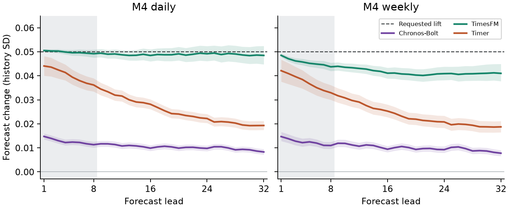

# An eight-lead steering request can move all 32 forecast leads

A lift fitted only on the first eight leads persisted through lead 32. Across six ordered model pairs and two sites, the transported action produced 56% of the requested lift on leads 9–32 on daily M4, and 50% on weekly M4. The recipient mattered: TimesFM retained close to the full lift on daily histories, Timer's effect decayed with lead, and Chronos-Bolt showed a smaller effect from the beginning. [Frozen protocol](PROTOCOL.md)



The gray region indicates the eight leads used in the original fit and dose calibration. Each line averages the two source models and two target sites. Shaded bands are pointwise 95% series-bootstrap intervals conditional on the models and histories.

## Persistence and spillover

We used the first 64 daily and 64 weekly histories from the original evaluation populations, with the original inputs, sites, native directions and scalar doses. The goal was a +0.05 change in clean-history standard deviations. Each genuine mapped direction was compared with four norm-matched, shuffled-correspondence directions, each with its own independently fitted original dose. The reported null averages their scores. Each pair and depth has equal weight.

| Cohort | Intervention | Fitted leads 1–8 recovery | Late signed gain | Late energy | Late sustained recovery | Full sustained recovery | Full localized recovery |
|---|---|---:|---:|---:|---:|---:|---:|
| Daily | Target native | .925 | .657 | .523 | .791 | .824 | −.645 |
| Daily | Calibrated transfer | .741 | .560 | .476 | .645 | .669 | −.688 |
| Daily | Calibrated shuffle | .338 | .264 | .252 | .276 | .291 | −.418 |
| Weekly | Target native | .901 | .597 | .460 | .735 | .776 | −.479 |
| Weekly | Calibrated transfer | .716 | .497 | .382 | .612 | .638 | −.430 |
| Weekly | Calibrated shuffle | .325 | .243 | .216 | .270 | .284 | −.322 |

Late signed gain divides the mean 9–32 response by 0.05. Late energy divides its mean squared response by 0.05². Recovery is one minus squared forecast-change error divided by the squared energy of the scoring request. Neither original fit specified leads 9–32. The sustained evaluation requests +0.05 for every lead; the localized evaluation requests zero beyond lead eight. Both evaluate the same intervention. A perfect sustained lift would score −2 on the localized request, since the 24 extra affected leads contribute three times the energy requested over the first eight.

For late sustained recovery alone, the true map beat the mean of the equally calibrated shuffled maps by .369 [.350, .390] daily and .341 [.320, .362] weekly. Full 32-lead calibrated transfer scored .669 [.643, .693] daily and .638 [.615, .660] weekly against the sustained request. Against the localized request it scored −.688 [−.852, −.547] and −.430 [−.578, −.308]. A negative score means the transported lift produced more total error than leaving the forecast alone under that particular request. These are forecast-change comparisons and do not measure future observation accuracy. [Full per-pair, depth, recipient and control results](results/summary.json)

| Receiving checkpoint | Early gain, daily / weekly | Late gain, daily / weekly | Sustained recovery, daily / weekly | Localized recovery, daily / weekly |
|---|---:|---:|---:|---:|
| Chronos-Bolt-small | .254 / .250 | .204 / .198 | .369 / .356 | .254 / .233 |
| TimesFM 2.5 200M | .997 / .915 | .978 / .829 | .943 / .925 | −2.096 / −1.274 |
| Timer-base-84M | .805 / .749 | .500 / .464 | .694 / .633 | −.221 / −.250 |

The high sustained score in TimesFM coincided with the greatest penalty under the localized request. For Chronos-Bolt, the smaller early effect also left less late spillover. Both original sites carried late lift: gain at the middle/three-quarter sites was .524/.597 daily and .466/.527 weekly.

## Live-forward verification

We monitored the actual middle and three-quarter block inputs on every forecast invocation during this follow-up. Both executed exactly once per model forecast at horizons 8 and 32. Per recipient and site, the monitors recorded five clean 32-lead calls (one probe and four batches) and 88 edited 32-lead calls, plus one clean and two edited eight-lead calls. The model did not repeatedly apply the edit in an autoregressive loop for this 32-lead query. The audited clean hidden inputs and first eight unedited forecasts agreed exactly between horizons on the four probe histories. Across every edited history and native, mapped or shuffled action, the maximum absolute first-eight difference from the frozen original forecasts was 0.000003337860107421875 history SD. The largest absolute change in any compared arm's mean eight-step recovery across the 128 histories was 0.0000016492552053545134. Timer supplies a deterministic point forecast at its median interface. [Bolt replay checks](results/bolt_replay.json) · [TimesFM](results/timesfm_replay.json) · [Timer](results/timer_replay.json)

## Reproduction

Use the environment and immutable forecast fits from the [original output-request experiment](../README.md). Each recipient rerun reads its fit from the original scratch location and its selected doses and archived eight-lead responses from the original results directory. The horizon runner also accepts `--cache` and `--original` for alternate locations. The 32-lead NPZ files included here store every action's per-item forecast response; `summarize` reads those files without loading checkpoints.

```bash
export PYTHONPATH=.:tsfm_lens:tsfm_benchmark
export HF_HUB_OFFLINE=1
export HF_MODULES_CACHE=/tmp/tsfm_requests_hf_modules
export OMP_NUM_THREADS=2 MKL_NUM_THREADS=2 OPENBLAS_NUM_THREADS=2
pkg=research.activation_transfer.forecast_requests.horizon
for target in bolt timesfm timer; do python -m "$pkg.run" "$target"; done
python -m "$pkg.summarize"
python -m "$pkg.plot"
python -m pytest -q research/activation_transfer/forecast_requests/horizon/test_horizon.py
```

Both focused tests passed on the actual implementation and each failed on an independently planted regression in a temporary copy. Dividing localized-request error by 32 lead amplitudes instead of the eight requested ones failed the known sustained-versus-stopped skill calculation. Permitting a second hook invocation failed the test that requires the monitor to reject its repeated execution. An independent direct array calculation reproduced all 576 per-cell point metrics across models, depths, domains and controls.
