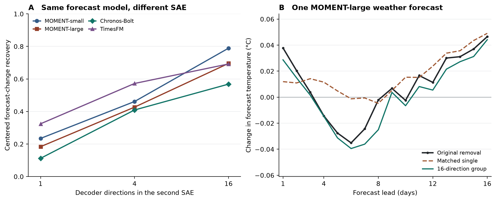

# MOMENT as a test of cross-model feature correspondence

**Use MOMENT-1-large as an architectural control. Keep Chronos-Bolt and TimesFM as primary short-horizon forecasting references.** MOMENT's masked encoder lets us hold the observations fixed while changing the forecasting readout, the number of future placeholders, or the dictionary used to name a hidden direction. Those interventions expose several ways two feature explanations can agree or diverge. Forecast skill varies by checkpoint, task head, dataset and requested horizon. [Native adapter, tested Lens configs and mixed-model run](adapter_check/WORKFLOW.md) · [Forecast quality](forecast_quality/README.md) · [Scientific precedents](RELATED.md)

The left panel scores centered days 1–8 on held-out M4 daily histories with the originally designated source dictionary in each checkpoint. Rank one is a signed decoder projection, distinct from a natural one-atom match. The right panel shows the removal of feature 187 at Las Cruces on July 10, 2026, selected at the donor feature's median response size. [Group comparisons and qualifications](dictionary_transfer/README.md) · [Independent Bolt and TimesFM experiments](../shape_transfer/cross_seed_groups/README.md) · [Temperature values](dictionary_transfer/weather/results/example.json)

## Findings to carry forward

- **A time-series feature can be easier to reproduce than to identify as one atom.** On raw temperatures, two independent MOMENT-large SAEs' most activation-correlated single matches scored −.060 and −1.425 for the forecast change caused by an original feature removal. A fixed signed group of 16 decoder directions scored .806 and .786 and was positive for every eligible donor. With the source fixed and three separately trained receiving SAEs, group scores were .806, .758 and .640. The group beat the natural single for 35 of 36 eligible feature/receiver comparisons. An individual pair failed even when both gates were open on every source-firing case. The group advantage also reproduced within Chronos-Bolt and TimesFM, including over a rotated and refitted group on both primary daily cohorts. On 35 fresh weather stations, supplying the actual donor dose yielded .859 [.688, .897] for four frequent features; a receiver-only estimate yielded .639 [−.837, .715] including erroneous writes. [Dictionary study](dictionary_transfer/README.md) · [Three receiving seeds](dictionary_transfer/more_seeds/README.md) · [Receiver-only station/date confirmation](dictionary_transfer/weather/new_dates/README.md)
- **A nonlevel response travels across model families, with a limit on what it encodes.** On 35 fresh weather stations at eleven additional dates, a state map trained on ordinary M4 series transferred the TimesFM response to an eight-day rising ramp into Chronos-Bolt. It scored .621 against Bolt's own early centered forecast change. A constant warming step at matched hidden norm scored .471. Enforcing calendar availability, a mean ramp direction built only from earlier observations at other stations scored .650 against .637 for the current map on the same 350 eligible histories. Reversing the six interior ramp values preserved both endpoints and the increment histogram. Choosing the correct interior order improved early skill by just .0028 [−.0010, .0066] on average, even though Bolt's own two responses differed by .052°C RMS. Small→large MOMENT also transferred the ordinary ramp (.669). Its smooth donor direction outperformed the reversed one for both receiver references. A diagnostic subtracting the two order-specific outputs found modest discrimination in TimesFM→Bolt and uncertain early difference recovery in MOMENT. Freezing the original normalization statistics changed the MOMENT receiving contrast by .57%. [Cross-family geographic and calendar replication](../shape_transfer/physical_ramp/new_dates/README.md) · [Strictly past template](../shape_transfer/physical_ramp/new_dates/past_only/README.md) · [Interior-order comparison](../shape_transfer/physical_ramp/new_dates/order/README.md) · [MOMENT ramp](dictionary_transfer/input_deltas/new_dates/README.md) · [Fine-order difference and both receiver references](dictionary_transfer/input_deltas/order/README.md)
- **The group result has a simple geometric explanation.** For four frequent MOMENT-large features, we kept the learned group's length and angle to its donor exact and randomized only its perpendicular error. These dense controls averaged .893 H16 recovery versus .859 for the sparse group. The second SAE supplied a sparse way to express a useful direction. Several different hidden vectors produced a similarly accurate forecast change. [Matched-angle intervention](dictionary_transfer/angle_control/README.md)
- **Grounding the score in observable units changes the interpretation.** One donor's removal changed individual daily temperature forecasts by less than .05°C in the illustrated case. Its group reproduced the waveform closely. Ordinary weather forecast errors were several degrees. Adding 2°C to the entire history moved small and large forecasts by 2°C via reverse normalization alone; adding it only to the latest eight days moved the large near-term mean by .864°C through different hidden paths. [Physical waveform](dictionary_transfer/weather/results/example.json) · [Input pathways](input_paths/README.md)
- **The forecast request and readout are experimental conditions.** With 480 identical observed values, requesting 16 days instead of eight changed the large checkpoint's days 1–8 by 1.89°C RMS at previously studied stations and 2.12°C at new stations across eleven new origins. A position/attention intervention recovered the eight-day forecast. The better request varied with date. Different heads can also assign a different forecast effect to the very same hidden removal. [New-date comparison](horizon_prefix/new_dates/README.md) · [Readout intervention](head_interventions/README.md)
- **Published forecast quality sets the scope of inclusion.** The released large masked head's H16 MASE was 2.91× a history-only classical selector across six domains. Native forward replays agreed at every scalar and adding an external z-score changed essentially nothing at these scales. A local probe using the authors' separate forecasting architecture still trailed persistence on the primary daily task. [Forecast scores](forecast_quality/RESULT_TABLES.md) · [Supervised head matched to raw lag models](forecast_probe/README.md)

## What we can test directly

| Question | Experimental contrast | Evidence |
|---|---|---|
| Does choosing the public checkpoint matter? | Same native masked reconstruction path in small, base and large, exact publisher weights, two historical software stacks, separate real futures and original units. | [Checkpoint validation](adapter_check/README.md) · [Six historical domains and weather](forecast_quality/README.md) · [Three official M4 calendar-frequency cutoffs](calendar/README.md) |
| Are the smaller models' encoders uninformative? | Hold encoder fixed; fit an eight-output decoder solely on interior gaps in 1,024 other daily histories. Compare a true random encoder, recalibration of the eight published scores, the orthogonal complement, raw lag regressions and standard baselines. | [Fitted and published head results](head_test/README.md) · [Independent weight substitution and SVD replay](head_test/independent/README.md) |
| Does the same hidden feature still have the same effect under another head? | Repeat a real feature removal through five different heads without changing the encoder, dictionary, dose, token or history. Test two SAE seeds, split-trained heads, tiny derivative probes and natural-state displacement controls. | [Readout changes and independently fitted heads](head_interventions/README.md) |
| What does the number of requested days do? | Compare the same first eight outcomes with H8/H16/H24/H32. In H16 factor out the position shift and attention to an extra future mask and verify the resulting native H8 forecast. | [Same observed-token deletion across horizons](horizon_identity/README.md) · [Weather prefix results and independent date confirmation](horizon_prefix/README.md) |
| Is an output change evidence that the receiving checkpoint has the donor feature? | Compare a matched atom, a fixed signed group of receiving atoms, a dense map estimated on ordinary series, and a controller using only the first eight forecast derivatives. Evaluate actual removals on the same histories and on withheld leads. | [Physical single and group substitution results](dictionary_transfer/README.md) · [Geometric multi-atom hypothesis](dictionary_transfer/GROUPS.md) · [Independent station confirmation](dictionary_transfer/weather/README.md) |
| Can different hidden writes produce the same early forecast? | Write to the last observed patch, first forecast patch or second forecast patch; compare the middle encoder with the terminal, shared pointwise decoder. Use separate, genuinely nonzero writes as routing controls. Also compare 32 fixed forecast-sensitive directions against the native active features in two other architectures. | [MOMENT token experiment](token_paths/README.md) · [Final-readout positive control](token_paths/positive.py) · [Frozen cross-model receiving subspaces](../shape_transfer/steering_budget/README.md) |
| Where does a real-unit level response travel? | Add two degrees to all historical temperatures or just the latest eight, hold out the entire true future, then swap middle observed states, future mask states and reverse-normalization factors independently. | [Forecast mediation in °C](input_paths/README.md) |

Two definitions prevent confusion. **Forecast error** compares predictions with subsequent observations, and smaller is better. **Intervention recovery** compares changes in predictions induced by two hidden writes. A recovery of 1 is exact agreement, 0 corresponds to leaving the forecast untouched, and a negative value means the attempted substitution produced more squared error than doing nothing. Centered recovery removes the mean across the scored leads before it compares shapes. It provides no measurement of real-world predictive accuracy.

Historical datasets may appear in checkpoint pretraining. New dates after checkpoint publication address future-label leakage in the weather test, but nearby stations, repeated seasons and overlapping historical contexts limit population inference. Estimands for feature transfers condition on enough independent firing histories and on the specific selected features, checkpoint releases and layers. Natural jointly observed features, manually forced decoder writes and supervised response-calibrated controllers have different evidentiary uses. [Weather panel source and selection](forecast_quality/post_release/results/manifest.json) · [Existing feature transfer study](../README.md)

[Reproduction guide and dependency order](REPRODUCE.md) · [Independent numerical and provenance review](review/REVIEW.md) · [Compact archive verification](verification.json)

The two new-station ramp-versus-step comparisons share the same 385 histories. A retrospective geographic and multiplicity check recomputed their early paired differences from the finite waveforms. Positive signs held in all four US Census regions for both directions. Across 10,000 crossed station/date draws, two-comparison Bonferroni intervals were [.014, .693] for small→large MOMENT and [.133, .167] for TimesFM→Bolt. These intervals concern this pair of ramp/step contrasts. The many other hypotheses in this research program include exploratory follow-ups. [Regional, calendar and simultaneous sensitivities](confirmation.json)

## Paper-sized question

**When do independently learned sparse features produce interchangeable interventions in a forecaster?** The most diagnostic experiment holds the raw series, model weights, layer, token, task head and source removal fixed while varying how the second dictionary supplies the hidden direction and its dose. The two scientific predictions differ. A truly interchangeable individual feature should detect the event and recreate its forecast effect at its natural strength. If what is shared is a broader direction, a fixed group may reproduce the effect even when the single feature misses, but a second detector must still decide when and how strongly to use that group.

The strongest primary claim is that a learned sparse dictionary can express another dictionary's forecast intervention much more consistently than its most coactive single feature. Its evidence includes three receiving MOMENT dictionaries for a fixed donor, independent replications within Bolt and TimesFM, raw-degree examples and a matched-angle control. The donor's known activation strength is a real informational advantage. The strongest secondary claim is that physically defined edits give a measurable cross-encoder target and that shared, coarse responses account for much of their early transfer. The head and horizon experiments identify conditions a replication should hold fixed. [Independent methods review](review/REVIEW.md) · [Cross-family physical comparison](../shape_transfer/physical_ramp/README.md)

The most valuable next paper experiment is a **receiver-only detector on a separate task**, scoring every occasion it could act. The frozen group's measured recovery at the true donor dose provides a reference for that comparison. A detector trained on one domain must recover the effect on a second domain while also keeping false-positive forecast changes small. The 35-station confirmation shows exactly how restricting evaluation to source firings would overstate that ability. [All 1,540 feature opportunities](dictionary_transfer/weather/new_dates/README.md)

The runs use local written protocols, including explicitly labeled follow-ups prompted by earlier results. Existing work established reproducible cross-seed subspaces and causal SAE substitutions in language models, steering on MOMENT, and affine state-space stitching. The more specific time-series contribution is the measured forecast waveform, its scale in natural units, and the conditions under which one dictionary or model can reproduce it. [Related work](RELATED.md) · [Hard case, favorable case and absolute temperature effects](dictionary_transfer/weather/README.md)

A subsequent paired-crosscoder study compares the same source-active coordinate's effect on the observed patch with its effect on the native forecast. It includes a full TimesFM–Chronos-Bolt replication, physical edits to the input, and a test of four fixed target gates on weather. [Crosscoder experiments, controls and figures](crosscoder/README.md)
