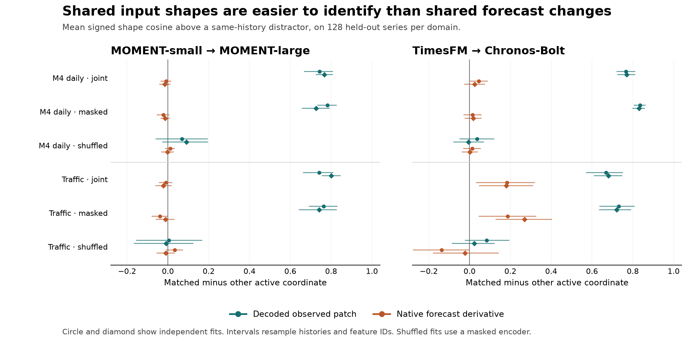

# What does a crosscoder transfer between time-series forecasters?

**A crosscoder can match how two models represent the shape of the recent past. That match predicts much less about what happens when the same feature is removed from their forecasts.** This result holds for two sizes of MOMENT and for the architecturally different TimesFM 2.5 and Chronos-Bolt. Traffic supplies a useful exception: the learned pairing carries some forecast direction across architectures, while the size of the resulting change still differs substantially. All shape comparisons below remove the per-patch or per-forecast mean.

## The same coordinates face two tests

We trained 1,024-coordinate TopK crosscoders on ordinary hidden states from 768 M4 daily histories. At test time only the source model chose the 32 active coordinates. Each coordinate supplies one decoder direction in each model. One measurement asks what moving along those directions does to a linear readout of the **observed** patch. Each model's readout was trained separately against actual observations. The other measures what those exact directions do to the models' own **next 16 forecasts**. We compare a correctly paired direction to all 31 other active target directions for that same history. This control preserves both the input and the set of features. Each model pair had 128 disjoint M4 daily and 128 Monash traffic evaluation series. The TimesFM–Bolt windows align in physical time, with one 32-sample TimesFM token corresponding to two 16-sample Bolt tokens. [Design and alignment](cross_family_directions/PROTOCOL.md) · [MOMENT direction test](DIRECTION_PROTOCOL.md)

The entries below are improvements in **signed, time-centered cosine** from matching the correct coordinate. Zero means it performed like another active coordinate. Each cell gives two independent initialization seeds of the crosscoder trained with the target input hidden on half its batches.

| Source → target | Evaluation | Observed-patch shape | Native forecast shape, local derivative |
|---|---|---:|---:|
| MOMENT-small → MOMENT-large | M4 daily | .782 / .726 | −.023 / −.013 |
| MOMENT-small → MOMENT-large | Traffic | .763 / .741 | −.039 / −.013 |
| TimesFM → Chronos-Bolt | M4 daily | .836 / .830 | .015 / .018 |
| TimesFM → Chronos-Bolt | Traffic | .730 / .721 | .186 / .269 |

For TimesFM–Bolt, the paired difference between the two measurements on traffic was .544 [.378, .706] and .452 [.284, .611]. Those 95% intervals resample both series and feature IDs within each fitted dictionary. The older joint-only crosscoder produced the same qualitative split. Permuting whole training histories largely erased the observed-shape match. Fitting the two observed-patch readouts on **different series from one another and from all crosscoder training** also preserved the result. The observed patch has 8 values for MOMENT and 32 for TimesFM–Bolt, so absolute scores across pairs refer to different physical windows. [All estimates and crossed intervals](results/overview/comparisons.json) · [Disjoint probe fits and clean accuracy](results/disjoint_probes)

**What does a shared shape look like?** As an illustration, we asked which frequently active coordinate in MOMENT-small had a decoded input pattern closest to a rising ramp. We chose it without consulting MOMENT-large. In the two seeds the selected small directions had cosine .99/.98 with a ramp; their large partners scored .97/.96. Repeating the exercise with a final-sample spike gave .89/.82 in small and .91/.88 in large. An alternating up-down waveform was much harder to describe with one coordinate even in the source, .49/.47, and its partners reached only .19/.03. These labels refer to what an external observed-patch readout measures. A ramp-shaped coordinate does not establish a steering direction for an increasing forecast. [All three motifs, source-only nomination rule and shapes](results/overview/motifs.json) · [Motif figure](results/overview/motifs.png)

**The small traffic signal is real under finite interventions.** We physically subtracted four naturally active features per held-out history in six TimesFM–Bolt dictionaries, yielding 6,144 matched intervention sets. Across the two masked seeds, correctly paired edits improved traffic forecast-shape cosine over a different norm-matched active edit by **.230 [.004, .446]** and **.306 [.102, .491]**. At the source's natural dose, their squared-error skill in reproducing the entire source change was **.002 and −.143**, where doing nothing scores zero. The gains in directional agreement on M4 daily were .066 for both seeds, and both intervals included zero. Three different notions of success are therefore empirically distinguishable: assigning the same input meaning, moving the forecast in a related direction, and reproducing its waveform at a usable strength. [Finite forecast changes, effect sizes and independent replay](cross_family_directions/README.md)

## Does the sparse representation buy anything over activation space?

A linear map trained to predict the other model's ordinary hidden state was a strong competitor. Applied to the **same source decoder row** and scaled to the learned target direction's norm, it gave observed-patch shape cosines around .94–.97 on the paired MOMENT fits. On M4 daily, the TimesFM–Bolt masked crosscoder also yielded higher patch cosines under dense translation than under its learned pairing. The crosscoder supplies a sparse list of candidate coordinates with measurable input sensitivities. These comparisons supply little reason to prefer it for translating a direction when both hidden spaces are available. [MOMENT patch probes and dense controls](results/patch_probe) · [Across-family comparison](cross_family_directions/README.md)

We tested the user's concern about the jagged TopK gate separately. Here **every** method had the exact same four target SAE write directions. The only job was to estimate from MOMENT-small when to use them and how strongly. On 385 US weather histories there were 568 true target firings and 972 opportunities for a false alarm. A simple endpoint state map followed by the **original target SAE encoder and its competition against all 4,096 coordinates** gave .708 native forecast-shape skill. Raw small hidden-state dose prediction gave .557, the independent small SAE .509, the ordinary joint crosscoder .397 and the masked crosscoder .508. The endpoint map beat the ordinary joint crosscoder by .311 [.040, 2.351]; its .200 advantage over the masked crosscoder had interval [−.011, 1.148]. The endpoint map made 130 false writes versus 367 for direct raw dose prediction. Several features' native energy was concentrated on one date and the intervals are correspondingly wide. A separate TimesFM–Bolt test did not give a general ranking in favor of state mapping. [Weather native interventions](CAUSAL_RESULTS.md) · [Across-family dose results](architecture_check/README.md)

## What explains the gap?

- **The shared signal includes within-patch temporal shape.** We changed seven independent, zero-mean patterns in the actual input, bypassing the learned readouts. In the MOMENT pair, correctly paired coordinates had more similar physical sensitivity profiles than the other active coordinates across both doses, domains and seeds. The matched advantage was .199–.303 at the primary dose. All correctly paired intervals excluded zero and all corresponding shuffled-training intervals included zero. [Controlled input perturbations](input_sensitivity/README.md)
- **Better reconstruction need not produce better steering.** Training with the target view hidden half the time raised MOMENT-large hidden-state reconstruction from MOMENT-small alone from .498/.518 to .825/.822 on 256 held-out M4 endpoints. Under the same masking schedule, shuffling pair identity reduced R² to .349/.301. Yet the correctly paired masked model's four-feature native steering score on weather differed from the masked shuffled control by only −.028 [−.471, .129]. [Reconstruction and support stability](DICTIONARY_FIDELITY.md) · [Matched masking control](CAUSAL_RESULTS.md)
- **What the model reads out matters.** On a separate 288-case weather panel, we took the identical final MOMENT hidden perturbations at the edited token and changed only how we measured them. With M4-trained observed-patch probes the pairing advantage was .591 [.507, .668]. With the published reconstruction heads it was −.043 [−.111, .025]. Changing readout on the same two states shifted measured correspondence by **.634 [.529, .736]**. Shared information remained available at the final layer even where the native heads used it differently. [Depth trace, screen for transferable features and traffic rhythm control](MECHANISMS.md) · [Separate weather year and independent graph checks](fresh_readout/README.md)

One plausible reason a crosscoder succeeds on input shape is that aligned hidden variation about a shared input is exactly what its reconstruction objective rewards. The two forecasters can assign different future consequences to the same observed variation. These experiments locate part of the difference and show that output-informed feature selection can find limited exceptions. They leave room for a model pair or steering method trained on an explicitly shared forecast effect to do better.

## Does adding layers help?

We trained a second sparse model with **four views**: the middle and final observed-token states of each MOMENT checkpoint. At inference it saw exactly the same small-model middle state as the two-view masked baseline. An auxiliary control retained the correct pairing of the two middle states and of the two final states, while shuffling the history correspondence between depths. The four-view dictionaries recovered the large final hidden state from the small middle state at R² .850/.852. Shuffling the history across depth reduced that to .326/.277. The aligned extra layers therefore carried predictable information. The four-view fits also used about twice as many trainable parameters. [Training and control](multilayer/DICTIONARY_RESULTS.md)

The same matched middle directions still had a **.766/.754** advantage for the observed patch on M4 daily and **−.020/−.026** for the native forecast. On traffic the figures were .753/.766 and −.020/−.061. In the separate fixed-four-target weather intervention, the four-view fits scored .529/.536, compared with .505/.510 for two views and .708 for the endpoint map plus the exact target gate. The mean four-minus-two-view difference was **+.025 [−.443, .206]**. The correctly aligned four-view fits exceeded the auxiliary-depth shuffle by .082 [−.093, .782]. Adding final-layer reconstruction was effective at its training objective and left the input-versus-forecast gap intact. This trial tests a specific missing-view TopK design at the last observed token. A dictionary trained to predict a shared forecast response would be a different hypothesis. [Evaluation design](multilayer/EVAL_PROTOCOL.md) · [Paired native forecast comparisons](multilayer/results/native_scores.json)

## Relation to the earlier negative result

The repo's earlier TimesFM–Chronos-T5 crosscoder lost to independently matched SAEs on a different, preregistered ground-truth alignment score, .279 versus .320. Here the comparison fixes the source-active coordinate and measures two uses of its decoder directions, including a real native forecast write. The contribution suitable for a paper is the **paired measurement and controlled divergence**, including the positive traffic exception. Shared dictionaries, sparse feature instability, and cross-model time-series intervention each have prior art. None of the tests here requires a priority claim for those ideas. [Earlier scorecard](../../../../FINDINGS.md#sh-10--the-joint-crosscoder-loses-to-independently-trained-post-hoc-matched-saes-pre-registered) · [Original crosscoder work](https://www.transformer-circuits.pub/2024/crosscoders/index.html) · [Crosscoder sparsity artifacts](https://proceedings.neurips.cc/paper_files/paper/2025/hash/9902a53031ebbbab73898028073d4790-Abstract-Conference.html) · [TSFM representation and intervention study](https://openreview.net/pdf/989d18ca2b85c5f417e95ea55e4b1a693c1c2b94.pdf)

The results concern fixed checkpoints, window, horizon, source direction, and two initialization seeds. Series and feature resampling quantifies variability conditional on these fits. Intervals are pointwise; the follow-ups on readout, rhythm and feature selection were prompted by earlier outcomes. Traffic series share a domain and observation period. Forecast-change agreement measures how two published models react, independently of which one forecasts the real future better. Machine-readable outputs, input provenance and commands are available with the experiment. [Reproduce the studies](REPRODUCE.md)
