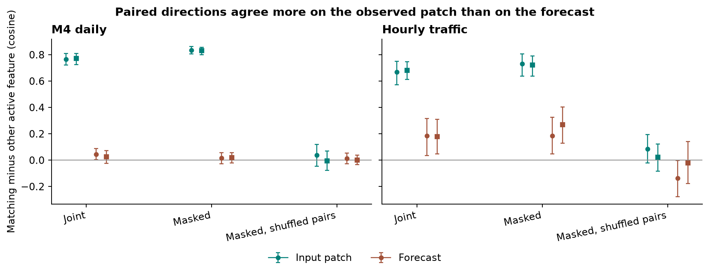
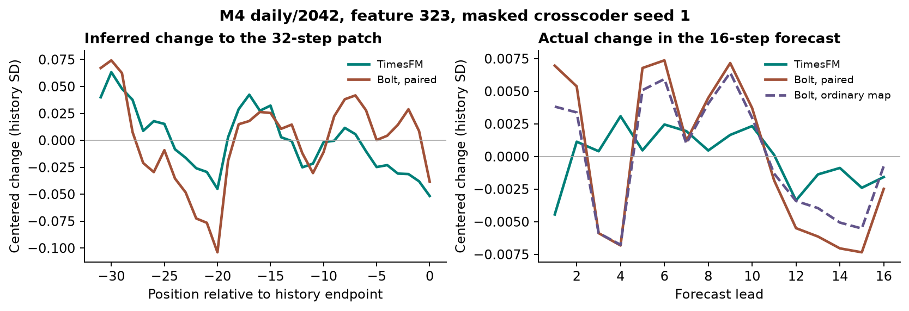

# The same crosscoder feature can describe the past and change two forecasts differently

TimesFM 2.5 and Chronos-Bolt-small learned corresponding directions for the shape of a recent 32-observation patch. **On held-out M4 daily histories, matching a coordinate added .833 to patch-shape cosine but only .017 to forecast-shape cosine** for a crosscoder trained with 50% target-view masking, averaged over two seeds. On hourly traffic the respective gains were **.726 and .228**. Some forecast-direction correspondence carried across models on traffic. Even there, writing the paired direction at the feature’s natural source dose generally failed to reproduce the source’s forecast change in magnitude and shape together. [Preregistered design](PROTOCOL.md) · [Two-seed estimates](results/methods.json)



## What was compared

Each of 768 M4 training histories supplied 15 nonoverlapping 32-observation intervals. The middle-block representation was one 32-step TimesFM token or the mean of the corresponding two 16-step Bolt tokens. We checked native token boundaries at every position. Another 256 M4 histories selected ridge penalties; the 128 M4 daily and 128 hourly traffic test histories were disjoint by item and raw context hash. Each dictionary learned 1,024 coordinates with TopK = 32. At test time only TimesFM selected the 32 active IDs. There was no recipient gate, forecast fitting, test-set normalization adjustment, or target-dependent sign choice. [Capture and alignment](data.py) · [Training objective](train.py)

Two independently fitted ridge probes predicted the actual 32 history values from each model’s state. Applying each probe to a decoder direction gives the change in the patch that its probe would report. This is an interpretation of an internal write; the observations stay fixed. We also applied each model’s native 16-step forecast Jacobian to the same direction. After centering a waveform over time, we compared its shape between models using signed cosine. For each TimesFM source direction, the null averaged over **all 31 other active target coordinates on the same history**. The matching advantage uses precisely the same event in both measurements. We additionally passed the very same TimesFM direction through a supervised ordinary linear hidden-state map. Physical interventions always broadcast a single additive write to both constituent Bolt tokens. [Patch probes and map](ridge.py) · [Directional scoring](directions.py)

## Matching the measured patch transfers across architectures

Each cell below gives seed 1 / seed 2. Values are **matching minus within-history other-active cosine**, so an advantage of zero means the coordinate ID supplied no extra alignment. The two-seed shuffled control has exactly the same target-view masking as the paired masked crosscoder. Its fixed history permutation preserves physical patch index and breaks historical pairing.

| Training condition | M4 patch shape | M4 forecast shape | Traffic patch shape | Traffic forecast shape |
|---|---:|---:|---:|---:|
| Ordinary paired joint training | .767 / .770 | .045 / .026 | .669 / .681 | .184 / .180 |
| 50% target-view masking, paired | .836 / .830 | .015 / .018 | .730 / .721 | .186 / .269 |
| 50% target-view masking, shuffled | .037 / −.006 | .013 / .001 | .085 / .022 | −.137 / −.022 |

For masked paired training, the **within-feature patch advantage minus forecast advantage** was .820 [.772, .869] and .812 [.765, .859] on M4, versus .544 [.378, .706] and .452 [.284, .611] on traffic. These intervals resample both the 128 histories and the active coordinate IDs, holding each fitted dictionary fixed. The same contrast was positive in both ordinary joint seeds and both domains. Equal weighting of coordinates that fired on at least eight histories yielded .817/.847 on M4 and .587/.466 on traffic for the masked pair. The point estimates are consequently not driven solely by a few frequently recurring coordinates. [Masked seed 1 crossed estimates](results/masked_22112401_clustered.json) · [Masked seed 2 crossed estimates](results/masked_22112402_clustered.json)

Holding the masking schedule fixed, correct training pairs increased patch-shape matching advantage over shuffled training by .818 [.806, .829] on M4 and .672 [.662, .683] on traffic. The corresponding difference in forecast-shape matching was .009 [−.010, .029] and .307 [.285, .328]. These **history-only** paired intervals average the two fixed seeds for each method. A matched numerical coordinate ID has no fixed identity between separately trained dictionaries, so this cross-method contrast pairs the histories, not the IDs. Four centered eight-sample bin means yielded paired-minus-shuffled gains of .824 on M4 and .636 on traffic. This result involves variation within the patch after removing its level. [Method and four-bin comparisons](results/methods.json)

The ordinary hidden-state map was also effective for interpreting the input. Translating the masked crosscoder’s source directions by this map gave mean patch-shape cosine **.939 on M4 and .921 on traffic**. Those same mapped directions had forecast-shape cosine **.021 and .215**. A conventional dense map can preserve an input readout at least as well as the paired coordinates in this experiment. It does not automatically reproduce the recipient’s forecasting computation. These are unadjusted corresponding-direction cosines, distinct from matching-minus-other gains in the table.

## Could the clean probes read the input?

Clean held-out R² uses each training-label mean as its baseline. The TimesFM probe’s level estimate generalized poorly to traffic. Its centered-shape probe retained signal there with reduced fidelity, limiting interpretation for traffic. The strong M4 result has two clean shape probes with R² above .84. [All clean fidelity metrics and locked penalties](results/ridge.json)

| Test histories | Model | 32-sample shape R² | Four-bin shape R² | Level R² |
|---|---|---:|---:|---:|
| M4 daily | TimesFM | .846 | .907 | .966 |
| M4 daily | Bolt | .864 | .901 | 1.000 |
| Hourly traffic | TimesFM | .400 | .481 | −1.448 |
| Hourly traffic | Bolt | .625 | .683 | .961 |

On held-out M4 validation endpoints, the two masked paired crosscoders reconstructed Bolt’s true ordinary state from TimesFM-only codes at R² .906/.903. Training with shuffled pairs yielded .209/.274. The ordinary jointly encoded dictionaries gave .336/.342 from TimesFM alone and .958/.959 when both input states were supplied. The source-only masked model therefore recovered much of the ordinary hidden state while reproducing very little of the daily forecast response. [Masked validation, seed 1](results/masked_22112401_training.json) · [Ordinary validation, seed 1](results/joint_22112401_training.json)

## What happened under an actual decoder deletion?

The registered pilot included one active feature on 32 histories per domain. Its intervals were wide. We then locked four distinct random active source coordinates on **every** history before running that larger check. This precision follow-up reuses the same histories. It measures 512 events per method, seed and domain, 6,144 event sets in total. Each set used four real H16 calls: the natural-dose TimesFM deletion, the paired Bolt write at that dose, a different active Bolt direction, and the ordinary-map Bolt direction. Both controls matched the paired Bolt write’s length. All interventions acted on the clean native forecasting graph. [Precision follow-up design](FINITE_PRECISION_PROTOCOL.md) · [Finite case-level source and receiving waves](results/masked_22112401_precision.npz)

| Masked seed, domain | Finite paired cosine | Paired minus wrong coordinate [95%] | Actual source response recovered, squared-error skill | Source / paired RMS, history SD |
|---|---:|---:|---:|---:|
| 1, M4 | .035 | .066 [−.058, .194] | −.075 | .0082 / .0025 |
| 2, M4 | .029 | .066 [−.048, .183] | .015 | .0075 / .0034 |
| 1, traffic | .193 | .230 [.004, .446] | .002 | .0155 / .0099 |
| 2, traffic | .268 | .306 [.102, .491] | −.143 | .0128 / .0081 |

The finite matching-minus-other intervals above resample whole histories and source-active IDs. Cosine rewards matching direction at any amplitude. The squared-error skill instead uses the complete centered finite waveform, in units of each history’s SD, without post-hoc amplitude or sign fitting. Zero corresponds to predicting no forecast change. The actual cross-model effect is small in absolute history-SD units. On traffic a paired coordinate can beat a wrong direction in shape while scoring around zero or below at its native dose. The ordinary joint dictionaries also showed little daily finite alignment (.025/.023) and more on traffic (.184/.114). Across all six dictionaries and both domains, median cosine between the actual finite paired write and its local Jacobian prediction was at least .996. The daily discrepancy persists with genuine finite interventions. [Masked finite effects and per-arm energy intervals, seed 1](results/masked_22112401_precision.json) · [Seed 2](results/masked_22112402_precision.json)



The example is masked feature 323 on M4 daily item 2042. Among the first masked seed’s daily events it was closest to the median source-only centered forecast RMS (.00211 history SD). Its input-patch cosine was .643 and its actual forecast cosine .270. Different vertical scales reflect the measured sizes of these two effects. [Selection rule](FIGURE_RULE.md) · [Exact waveforms](results/example.json)

## Reproduction and scope

Four scientific regression tests caught planted errors involving temporal alignment, inclusion of the matched ID in its distractor, loss of the decoder’s physical scale and repeated sampling of the same feature. A separately implemented audit reconstructed positive source coefficients, checked both independent patch and native-Jacobian cosine calculations against all 31 distractors, and directly added vectors to fresh native model calls for six cases per dictionary. All 144 direct intervention waveforms reproduced the saved results within .00000191 history SD. Small symmetric direction probes verified the H16 native derivatives separately for short and long leads (relative errors .00025/.00021 TimesFM; .00330/.00358 Bolt). All six method/seed combinations were independently trained a second time, reproducing the original parameter, selected-coordinate and dose arrays exactly. The archives retain both encoders, biases, physical view scales, decoder banks, fitted means, IDs and the finite responses. [Direct replay](results/independent_replay.json) · [Mutation checks](MUTATION_CHECK.md) · [Original test panel provenance](../../../shape_transfer/blind_frequency/results/manifest.json)

This comparison uses a fixed direction of transfer, two model checkpoints and one pair of middle sites. The measured agreement is defined by a linear readout of a particular recent patch. The result does not establish that every shared feature has an identifiable forecasting role or that no alternative sites or transfer map could transport that role. Standardized input histories keep forecast perturbations comparable within this experiment; the scores do not estimate real-world forecast accuracy. With the original local models and M4/traffic materials staged, reproduce the study from the repository root:

```bash
PYTHON=python bash research/activation_transfer/moment/crosscoder/cross_family_directions/reproduce.sh /tmp/fresh-cross-family-captures /tmp/fresh-cross-family-results
```
