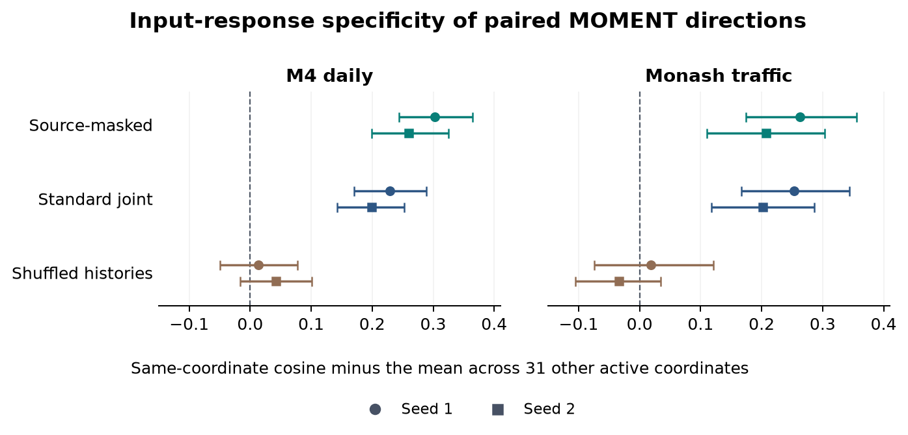

# Paired MOMENT coordinates respond to the same real input changes

We changed the last eight observations of 64 M4 daily histories and 64 Monash traffic histories, then measured the actual middle states of MOMENT-small and MOMENT-large. With correctly paired crosscoder training, **the same coordinate in the two models had more similar signed input sensitivities than the other 31 active coordinates on that history**. The matched-minus-alternative cosine was .199–.303 over the two domains, two initializations and two correctly paired training methods. The shuffled-history control ranged from −.034 to .042. This agreement survives a measurement that uses neither a learned patch-readout probe nor a forecast label. It concerns how physical input changes move the hidden states along the decoder axes. [Prospective protocol](PROTOCOL.md) · [Full primary results and uncertainties](results/summary_0.15.json)

Each point is a mean over 64 histories and 32 source-selected active coordinates per history. Bars are 95% intervals that resample histories and feature identities. All eight intervals for correctly paired training excluded zero. Each of the four shuffled intervals included zero. The two sets of intervals condition on the listed receivers, sites, dictionaries and sampled domains. [Figure data](results/summary_0.15.json)

| Training and seed | M4 daily, same ID | Other IDs | Dense map | Traffic, same ID | Other IDs | Dense map |
|---|---:|---:|---:|---:|---:|---:|
| Standard joint 1 | .231 | .002 | .277 | .257 | .004 | .301 |
| Standard joint 2 | .206 | .007 | .279 | .212 | .010 | .272 |
| Small-only masking 1 | .301 | −.002 | .327 | .266 | .003 | .284 |
| Small-only masking 2 | .258 | −.002 | .294 | .199 | −.009 | .207 |
| Shuffled + masking 1 | .010 | −.003 | .320 | .018 | −.001 | .300 |
| Shuffled + masking 2 | .038 | −.004 | .305 | −.039 | −.005 | .255 |

Each table entry is a signed cosine before subtracting its alternative-coordinate control. A dense state map trained on ordinary, paired M4 hidden states did at least as well by point estimate in all eight correctly paired comparisons. It exceeded the crosscoder by .008–.073 for the same small decoder and receiving length. Some paired intervals span zero. Despite statistically clear same-ID specificity, the matched scores themselves, .199–.301, show only partial agreement in the seven-dimensional input-shape subspace. [All paired dense differences](results/summary_0.15.json)

**Repeated features and weak responses do not explain the gain.** Giving each distinct active coordinate one vote yielded margins .183–.274, with positive crossed intervals for all eight correctly paired cells. Pooling signed inner products and weighting larger signature norms more strongly gave margins .280–.370. The same-ID cosine beat the within-history alternative average on 67.5%–75.6% of individual events. No shape or level signature was exactly zero in any fit. Median seven-shape signature lengths were 17.4–29.7 for small and 23.1–36.5 for large, in each model’s native hidden units per unit of the already standardized input. Median magnitudes, all five-number norm summaries, sign counts and the eight-history minimum-frequency check are archived. Under the separate level pulse, the matched axes agreed in sign on 65.6%–76.1% of events; most alternative-coordinate sign scores were close to half. [Norm and repeated-coordinate diagnostics](results/summary_0.15.json)

The comparison with identical masking at training is especially informative. Subtracting each shuffled fit’s own same-minus-alternative margin from the corresponding correctly paired fit’s margin gave **+.290 and +.218** for the two daily seeds and **+.244 and +.242** for traffic. The four paired whole-history intervals excluded zero. A matched control averages all 31 alternatives on each history, avoiding random foil sampling and keeping the activation state fixed. [Paired versus shuffled contrasts](results/summary_0.15.json)

For the primary intervention, each of seven mean-zero Helmert profiles had RMS one and was applied at ±.15 clean-history SD on the final eight *observed* values. The eighth, constant profile measured level sensitivity separately. Each backbone ran its ordinary native H16 graph and RevIN. We projected its paired positive-minus-negative hidden states onto unit decoder rows and divided by twice the actual input amplitude. All candidate coordinates came from the clean small-only crosscoder activation. A coordinate can describe shared input sensitivity while the two native forecast heads still use it differently. [Measurement, controls and reproduction](METHODS.md) · [Native forecast-direction experiment](../DIRECTION_PROTOCOL.md)

## Did smaller input changes give the same result?

At ±.075 history SD the correctly paired matched-minus-alternative margins remained positive in all eight cells, **.171–.277**, with every crossed interval above zero. Shuffled margins ranged from −.043 to .039, with all four intervals spanning zero. Halving the pulse reduced each correctly paired margin by .021–.036. For the same history and coordinate, median shape-signature cosine between pulse sizes ranged from .975 to .986 in the small and large models. Amplitudes still mattered. The RMS difference between the two *amplitude-normalized* sensitivity vectors was 29%–38% of the primary sensitivity RMS across the correctly paired cells. These measurements establish directional agreement across two finite doses. [Half-dose results](results/summary_0.075.json) · [Same-history, same-coordinate pulse-size comparisons](results/amplitudes.json)

The primary and half-dose sweeps used 8,192 physically perturbed model inputs in total. An independent implementation rebuilt the basis and sign order and completed all 16 forecast leads on 256 additional checkpoint/input combinations. Its greatest relative error in the checked projected shape signatures was .00151%. The three synthetic tests passed, and each load-bearing assertion failed against its designated isolated regression: reversed level sign, incorrectly centering the seven basis coefficients, or counting repeated events as independent features. [Small full-network audit](results/replay_small.json) · [Large full-network audit](results/replay_large.json) · [Checks and replay](METHODS.md)
