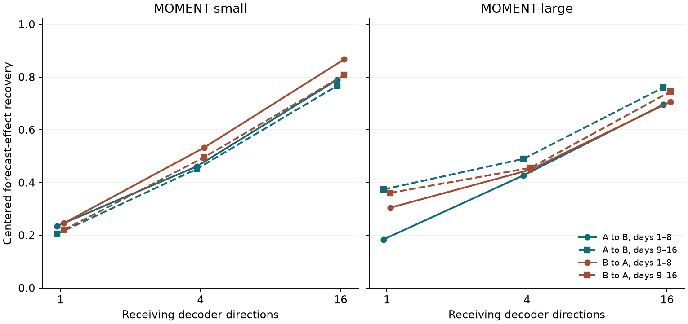

# Can a different dictionary reproduce the effect of removing one feature?

**Keep the encoder fixed and the answer depends on how a feature is represented in the second dictionary.** Choosing one atom because it fires on similar histories was unreliable. A fixed signed combination of 16 decoder directions usually reproduced much more of the original atom's forecast effect. Across different MOMENT checkpoint sizes a state-space map that predicted ordinary activations well could still fail to transfer that intervention. The experiment distinguishes recognizing an input, constructing a hidden edit and reproducing its forecast effect.

## Same weights, different sparse dictionaries

The two dictionary seeds per checkpoint used identical hidden states from 1,024 M4 daily histories, 60 observed patches per history. Each dictionary selected 32 positive coefficients per patch; its width was four times the encoder width. We fixed 16 source atoms on training data. A matched single was chosen using the largest sparse-code correlation on paired training histories. A group was chosen using decoder geometry alone and was fixed across all evaluation histories. Each donor naturally fired on the location being edited; all forecast changes were physically measured at the last observed patch of the middle block. No fitted group saw a test intervention outcome. [Primary design](PROTOCOL.md) · [Signed group follow-up](GROUPS.md)

On the 128 held-out daily histories in MOMENT-small, the training correlation of the matched atoms was .58/.60 (median in the two directions between dictionaries). Those natural single-atom removals scored −.89/−1.50 against the source's early forecast *shape*. Applying the same geometric source dose to the single matched atom raised those scores to −.30/−.43. Allowing an optimistic choice of nonnegative gain, separately for every tested waveform, still gave only .31/.28 on the originally naturally gated matches. Gate closure and amplitude account for part of the discrepancy. Different shapes across forecast leads account for another part. [Absolute effects, gate overlap, matched controls, two seeds](results/small_22112201_to_small_forecast.json) · [Dose upper bound](results/small_22112202_to_small_gain.json)

With a signed group, the early small-checkpoint scores rose from .23/.25 with one geometry-selected direction to .46/.53 with four and **.79/.87 with sixteen**. Late scores reached **.77/.81**. If the group's own terms were restricted to those naturally active in the second dictionary, early skill fell to .41/.36. Simply shrinking the full group to the same norm gave .69/.72, evidence that removing terms can change orientation as well as dose. The group represents a reproducible **constructed intervention**. The model need not naturally turn on all sixteen atoms together. [First-seed group outcomes](results/small_22112201_to_small_group_scores.json) · [Reverse dictionary direction](results/small_22112202_to_small_group_scores.json)

The large first seed gave .18, .43 and .70 on the same daily early endpoint at ranks 1, 4 and 16. Rotating the entire receiving dictionary preserves norms, pairwise angles, the number of candidates and the pursuit algorithm. On daily, a 16-term rotated group adjusted to match the trained group's norm scored .17 in small and .26 in large, versus .79 and .70 with the learned directions. The paired learned-minus-rotated differences had crossed history/feature 95% intervals [.40, .81] and [.17, .73]. These were follow-up controls on the first seed. Large's SAE reconstruction R² on the final observed patch was .836 daily and .418 on traffic for that seed. High intervention recovery and preservation of arbitrary hidden states are distinct measurements. [Large rotation controls](results/large_22112201_to_large_rotation.json) · [Small rotation controls](results/small_22112201_to_small_rotation.json) · [Training evaluation](../horizon_identity/results/large_22112201_dictionary.json)

Across the two large-encoder dictionary directions, 16-term group skill on daily was .70/.71 early and .76/.74 late. In traffic it was .70/.80 early and .66/.77 late, with six eligible donors per direction. The matched groups constructed across checkpoint sizes scored −.12 large→small and −11.93 small→large on daily. The latter comparison asks a larger, more sensitive forecast head to reproduce a small source response. Its very large negative value partly reflects amplitude. Even with the actual evaluation outcomes to choose the optimal positive scale per event, the ordinary dense map scored only .08 in that direction. Swapping both models to independently trained interior heads also yielded negative cross-size group skill (−.33 and −3.79). The within-encoder positive result therefore extends across data and readouts, while the cross-checkpoint negative depends on the specific map and source intervention tested. [Large reverse direction](results/large_22112202_to_large_group_scores.json) · [Small-to-large signed groups](results/small_22112201_to_large_group_scores.json) · [Amplitude and orientation diagnostics](results/small_22112201_to_large_gain.json)

On 35 additional stations, a stricter control held the group's hidden norm, angle to the donor, and total geometric reconstruction error exactly fixed for four frequent source features. Randomizing only the perpendicular residual gave .893 mean H16 skill, compared with .859 for the real group. The learned dictionary supplies a sparse route to sufficient alignment with the donor; the forecast gives little evidence that this exact group is uniquely functional. [Matched-angle control, source-wise heterogeneity and raw degrees](angle_control/README.md)

## A concrete temperature forecast and a failure with both gates open

On 46 US weather stations with the released large checkpoint, four post-release forecast origins per station and the two dictionary directions, fixed groups reached **.806 and .786** centered H16 recovery. Matched single removals at their own dose achieved **−.060 and −1.425**; their per-feature medians were **.007 and .010**. Forcing the matched single to the donor's norm produced **.013 and −.127**. The group outperformed the equal-norm single by .793 and .912 with crossed station/feature intervals [.416, 1.442] and [.544, 1.771]. Every eligible feature (12 and 15) had positive group recovery. Weighting by the measured donor effect energy in raw °C gave centered group scores .905/.918, natural singles .123/.129, and norm-forced singles .436/.388. Thus larger effects do carry some useful single-feature signal; the group advantage survives this weighting. Scores above or below zero describe accuracy in reproducing another **forecast change** and imply no improvement in weather prediction. [Weather protocol, full result and individual cases](weather/README.md)

Holding the source dictionary and its 663 eligible weather firings fixed, two newly trained receiving dictionary seeds produced .758 and .640 centered group skill. Including the original recipient, skill for the best naturally coactivating single was −.060, −4.228 and .075. The group beat the single in 35 of 36 feature/receiver cells and the equal-norm match in 34 of 36. A small number of receiver seeds gives direct replication over those fits. It places limited constraints on the population of possible dictionaries. [Per-seed and per-feature outcomes](more_seeds/README.md)

The second dictionary's atom 423 and its first-dictionary match 3017 both fired on **all 12 source-firing station events**. Their training correlation was .664, their decoder cosine .175, and the median receiving dose was 4.90 times the source dose. Their own-dose centered recovery was −21.29; matching the norm gave −.47, and the fixed group gave +.73. Thus a discontinuous TopK boundary is one possible failure mode, but this pair failed even with both gates open. A different feature, 187 at Las Cruces, shows why the negative average should not erase individual successes. Here the single recovered .599 and the group .955. The actual change to any forecast temperature was under .05°C, much smaller than ordinary weather forecast errors. The series and date were selected using only the donor response. [Measured 16-day curves](weather/results/example_weather.png) · [Raw values and selection](weather/results/example.json)

## Can the receiving dictionary recognize the feature by itself?

On the four most frequent historical donor atoms, a ridge predictor trained only on M4 used the second dictionary's complete sparse code to choose whether and how much to apply the frozen group. On **all** 184 weather histories, counting mistaken writes when the donor was closed, receiver-only recovery was **.420**, natural matched single **−.430**, and donor-dose group **.817**. The receiver-only policy caught 258 of 270 firings but also made 217 false-positive writes. Individually its four skills were .347, .892, −.297 and .739. Even though it improved on the single match, its contrast to zero had a crossed station/feature interval reaching below zero. Four deliberately frequent donors cannot represent the distribution of all SAE features. [Training, detection errors and physical interventions](weather/detector/README.md)

Two training-only nominations give precise, limited meanings to individual sources. Large feature 1236 favored a **low recent level relative to the history** (weather firing AUC .890). Raising the last eight temperatures by 2°C suppressed it on all 81 histories where it changed. A simple level statistic mostly predicted the common mean decrease; after removing that mean its skill was .015 [−.065, .082]. Feature 3181 favored a **falling recent trend** (weather AUC .774), and a rising ramp suppressed it. Its fitted slope statistic retained .120 [.074, .162] skill for differences between individual code responses. Both atoms also responded to the other intervention. The signed groups reproduced early/late weather forecast shapes for these two atoms at .981/.955 and .977/.918, showing that a reproducible downstream effect can coexist with a partial descriptive label. [Train-selected features, alternative labels and tests in degrees Celsius](semantics/README.md)

On 35 other stations and eleven new dates, the same frozen four groups achieved .859 [.688, .897] at the supplied donor dose. At the receiver-only dose their skill was .639 [−.837, .715] across all opportunities, rising to .799 [.578, .845] when scored only on actual donor firings. The detector made 424 false positives. The latter conditional result omits the cost of these mistaken writes. [New station/date confirmation](weather/new_dates/README.md)

## Does the result depend on using MOMENT?

On primary daily histories in **Chronos-Bolt and TimesFM**, the independent receiving dictionary's signed group of 16 scored .603 and .709 on the complete centered 16-lead waveform. A matched single at its own dose scored −4.770 and −1.275. Norm-matched rotated and refitted groups scored .125 and −.272. The group's advantage over the rotation had crossed series/feature 95% intervals [.223, .790] and [.542, 1.579]. We held each forecasting checkpoint fixed for this test. Some individual matches and some high-energy subsets did work well. [Independent architectures, positive and negative cases, full native replays](../../shape_transfer/cross_seed_groups/README.md)

## What changes between checkpoints?

The ordinary hidden map used 128 paired training items, 64 for regularization, and another 128 to test its predictions, before a separate 128 daily plus 128 traffic items tested interventions. Ordinary held-out R² was **.735 small→large and .808 large→small**. On daily histories, applying the large first-seed feature direction through that map directly to small gave early centered recovery −.17; approximating the map by 16 **small** decoder directions gave −.12. Even letting a different positive scalar be chosen retrospectively for every mapped waveform only raised the dense score to .09. Reusing the exact source direction in its original encoder is the identity positive control. A different checkpoint gives the edit a different downstream computation and a different published output head. [Ordinary-state map](results/large_to_small_map.json) · [Finite removals](results/large_22112201_to_small_forecast.json) · [Per-event gain diagnostic](results/large_22112201_to_small_gain.json)

A different use of the **same frozen map** succeeded for temperature edits with a known meaning. When a zero-mean ramp was added to the final eight observed days, the small donor's mapped last-patch change recovered .655 of the large receiver's own early shape; a norm-matched warming-step edit recovered .140. The target here is the receiver's independently measured change at that same patch. This gives a direct way to test sharing of a physically defined input response across checkpoint sizes. [Activation changes caused by physical inputs](input_deltas/README.md)

A translation using the receiving model's local sensitivity to the current history can recover early shape. In large→small, using the *same maximum hidden norm* as the ordinary map gave early .678 daily and .589 traffic. Substituting the sensitivity from a different history at exactly the same realized dose gave .184 and .371. The comparisons lose strength on the withheld next eight leads. This explains a route to functional steering and establishes why matching the first eight values alone is insufficient to identify a common feature. [Same-budget physical tests](functional/results/large_22112201_to_small_budget.json) · [Fixed versus current-history directions in both checkpoints](functional/README.md) · [Other architectures and withheld continuations](../../shape_transfer/steering_budget/README.md)

The historical samples were standardized using each observed history and may overlap the encoders' unknown pretraining data. The raw weather points and dates postdate both releases. All scores condition on the chosen checkpoints, sites, dictionary class, seeds and feature coverage. Single-atom removals can be small, and a signed constructed group can include directions the recipient would not use naturally. These controls support a specific formulation of forecast-effect correspondence. [Primary-source precedents and gap](../RELATED.md) · [Reproduction](../REPRODUCE.md)
