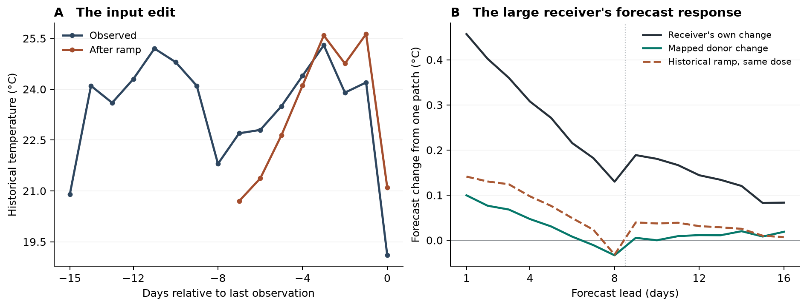

# Confirming cross-size ramp transfer on different stations and dates

The map from MOMENT-small to MOMENT-large reproduced **.669 [.617, .724]** of the large receiver's early centered response to an eight-day ramp, versus .655 in the original 46-station, four-origin experiment. This confirmation used 35 previously unused stations and eleven additional origins, with every site and date distinct from the first input-edit study. No map, dose parameter or group was refitted. We wrote down the direction, comparison edits and primary outcome before measuring these ramp effects. [Frozen design](PROTOCOL.md) · [First study and definition of the receiving reference](../README.md)

| Response of the large receiver | Mapped correct ramp | Same ramp at other station | Warm step at same station | Correct minus warm step, crossed 95% |
|---|---:|---:|---:|---:|
| Days 1–8, centered | .669 | .615 | .411 | .258 [.035, .632] |
| Days 9–16, centered | .426 | .288 | −.200 | .626 [.186, 1.482] |
| Days 1–8, mean retained | .619 | .507 | −.398 | 1.017 [.433, 2.187] |
| Days 9–16, mean retained | .504 | .274 | −2.142 | 2.646 [1.150, 5.002] |

We kept the raw 480-day history and the rest of the large model's H16 computation fixed. The receiving reference replaced its final observed token at the middle block with that same token's value under the actual −2 to +2°C input ramp. Its centered RMS was .149°C on leads 1–8 and .047°C on leads 9–16. A mapped edit from the wrong station retained much of the early score. The primary paired advantage of the correct station over that control was .054 [−.004, .121]. These results favor edit identity and give weaker evidence for the added value of the correct station's shape. Replays using the entire native graph on 12 station/dates in each arm matched within .000006°C. The 95% percentile intervals resample stations and dates separately, with each station/date cell and forecast lead pairing intact. [Waveforms and paired intervals](results/summary.json) · [Live model and scoring code](run.py)

For a concrete example, the receiving early response nearest the panel median occurred at Watkinsville, Georgia, at the June 1, 2026 origin. Both the mapped change and a historical ramp direction produced a declining early forecast response. Both underestimated its magnitude on this history. The choice of case used only the reference response. [Exact raw °C values](results/example.json)

A single mapped vector averaged over the original 46 stations achieved .500 early centered skill on these new stations. Giving it the current mapped vector's norm raised it to .565. Compared with this control, the history-specific map's early advantage was .104 [−.00036, .179], and its later advantage was .260 [.144, .397]. Much of the early effect therefore admits a common ramp explanation. The later shape carried clearer evidence for information specific to the current history. [Frozen historical-template test and native replays](../template/README.md)

Holding the histogram and both endpoints fixed while reversing the interior increments made the interpretation narrower. The smooth donor direction was a better substitute even for the reversed target in MOMENT. [Both target references and a direct test of their difference](../order/README.md)

A separate implementation then re-ran **all** 385 histories and seven intervention conditions through the official MOMENT package. It independently padded and masked the raw observations, rebuilt both models’ native hidden displacements and the frozen state translation, and wrote the absolute measured state for each native reference. It used the complete receiving encoder per write. Across all 43,120 forecast changes the largest discrepancy from the compact archives was .00001145°C. This check includes the actual smooth and reversed references, both mapped directions and the swapped controls. [Complete upstream-model replay](results/official_replay.json) · [Independent implementation](official_replay.py)

On the dependency versions pinned by the original package, a second interpreter repeated all seven conditions for one date per station, cycling across the eleven origins. The 3,920 values matched the modern-environment archive within .00000954°C. This repeat used Torch 2.0.1 and Transformers 4.33.3, while the complete 385-history replay used Torch 2.12.0 and Transformers 4.57.6. [Cross-version results](results/legacy_replay.json) · [Sampling and independent call](legacy_replay.py)
