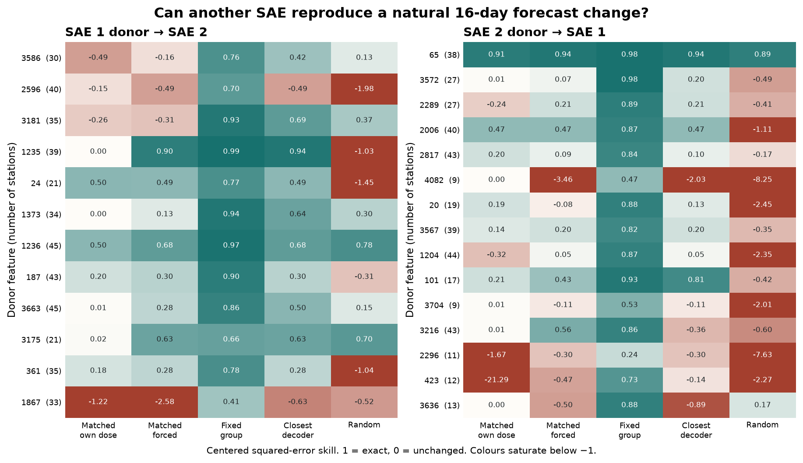
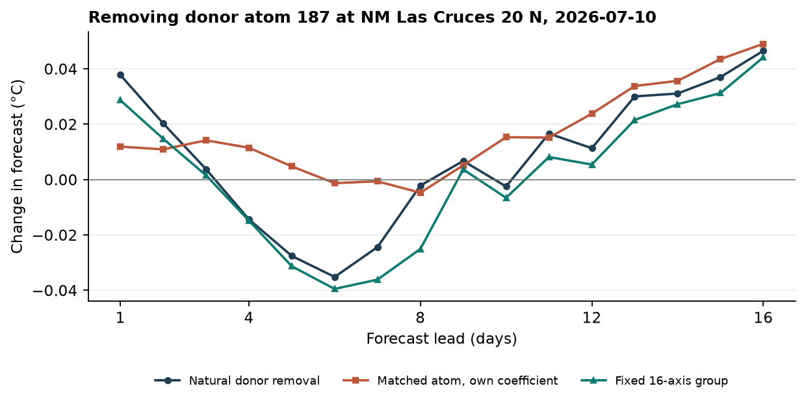

# Do two independent MOMENT-large dictionaries agree on a feature’s forecast effect?

Both dictionaries saw the same hidden states from the same frozen encoder. We tested whether a target atom matched by its natural activations on M4 can reproduce the *measured removal effect* of the donor atom on US weather. An effective intervention changes the recipient forecast in the same way as deleting the donor contribution. The original trained dictionaries, checkpoints and matching vectors were fixed before this weather experiment. [Study protocol](PROTOCOL.md) · [Historical matching rule](../match.py) · [NOAA station sample](../../forecast_quality/post_release/PROTOCOL.md)

## Which recipient intervention reproduced the donor’s removal?

Across the two directions of this same pair of dictionaries, the individually matched feature was a poor physical substitute on average. A fixed signed 16-axis approximation measured entirely on training geometry reduced normalized squared error for the centered waveform by about 80% on average across eligible donors. This group uses the actual donor dose on each source firing. It is a constructed intervention in a recipient dictionary and requires access to that dose. A reader looking for an independently identified corresponding feature should distinguish those two results.

| Recipient intervention | SAE 1 → 2 skill | Median atom | Signed cosine | SAE 2 → 1 skill | Median atom | Signed cosine |
|---|---:|---:|---:|---:|---:|---:|
| Matched single, own dose | −.060 | .007 | .291 | -1.425 | .010 | .408 |
| Same single, forced donor norm | .013 | .278 | .525 | −.127 | .068 | .435 |
| Closest decoder, donor norm | .370 | .494 | .717 | −.049 | .101 | .434 |
| Random training-eligible, donor norm | −.324 | −.090 | .264 | -1.831 | −.599 | −.016 |
| Fixed 16-axis group, donor dose | .806 | .821 | .925 | .786 | .867 | .900 |

The outcome is the full 16-lead native forecast change after subtracting its per-event horizon mean, expressed in units of that weather history’s observed SD. Squared-error skill compares to doing nothing. A score of 1 exactly reproduces the donor and 0 ties an unchanged forecast. Signed cosine describes the direction of the pooled waveform for each eligible atom, then averages across atoms with measurable estimated effects. The primary skill includes all eligible donors, including naturally gated matched counterparts producing zeros.

The 16-axis intervention beat the equal-norm single by .793 for SAE 1 donors (paired station 95% interval [.631, 1.056], crossed station/feature [.416, 1.442]) and .912 for SAE 2 donors (paired [.720, 1.308], crossed [.544, 1.771]). All 12 and all 15 eligible individual source atoms respectively had positive group skill. The paired station intervals for each own-dose single were [−.374, .068] and [−2.654, −.787]. The crossed intervals were [−.639, .193] and [−5.499, .189]. High error on particular features moved the latter macro-average substantially, and the median natural-match skills in both seed directions were near zero.

The SAE 1 donor list had 12 of 16 atoms firing on at least eight distinct stations, contributing 663 of 669 natural events. The matched atom fired in 239 of those events (36.0%). SAE 2 produced 15 eligible donors, 484 of 487 events and 205 cofires (42.4%). The median historical activation Pearson correlations of the eligible pairs were .596 and .605. Normalizing the matched axis to donor dose helped on average but still produced centered skills of .013 and −.127. For SAE 2, among the eight source donors whose matched feature also fired at eight separate sites, conditional own-dose skill was −2.515, equal-dose .218 and group .880. Thus closed target gates explain a part of the transfer failure. The physical dose and output direction also vary among co-firing pairs.

The fixed group also preserved amplitude. Pooled centered donor RMS was .0682°C and .0651°C in the two directions, versus .0607°C and .0561°C for the constructed groups. In source-history SD the corresponding donor/group values were .00751/.00671 and .00742/.00647. Uncentered full-waveform group skills were .825 and .694.

One pair shows why shared firing is insufficient. SAE 2 atom 423 and its training-matched SAE 1 atom 3017 co-fired in all 12 observed source events across 12 stations. Their training-code correlation was .664, but their decoder cosine was .175. The recipient’s natural hidden dose was 4.90 times the donor’s at the median. Its own-dose centered skill was −21.29, equalizing the hidden norm raised it to −.47 and the fixed group achieved .73. The donor’s centered physical RMS was .0356°C, against a .00000137°C noise estimate.

All donor references passed the registered precision check. Eligible individual centered RMS ranged from .0260 to .1035°C for SAE 1 and .0109 to .1268°C for SAE 2. The largest per-atom centered RMS noise estimate was .00000137°C. Raw Celsius subtraction and an independent float64 calculation from each physically changed native final hidden state agreed to within .000009°C on all reported policies. The two directions share the same checkpoint and station panel, and reverse donor and recipient dictionaries. The figure prints exact per-atom skill to two decimal places for all eligible donors. [All metrics, amplitudes and intervals](results/summary.json) · [SAE 1 donor case-level forecasts](results/22112201.npz) · [SAE 2 donor case-level forecasts](results/22112202.npz)

## Participants and patching

The 46 stations are at least 200 km apart. Each contributes four raw 480-day histories for forecast origins January 10, April 10, July 10 and October 10, 2026. The model receives the raw temperatures in °C and uses its released normalizer and reconstruction head. Date and site identify sampling blocks and illustrative cases. The model receives only the observed values, and no comparison uses the subsequent observed weather. The forecast outcome is the physical change to the model’s 16 predicted days. Each intervention acts on the last observed eight-day patch at the output of encoder block 11 of 24. For this native horizon, the derived slot is 61, followed by forecast placeholders 62 and 63. An independent check rolls the adapter's actual observed mask and locates its final fully observed patch.

Each SAE has 4,096 decoder rows with 32 selected per patch. Its training data comprised 60 observed positions per item for 1,024 historical M4 inputs. Sixteen donor atoms per seed were chosen before the weather data. The matched recipient was its highest training sparse-activation correlation among target atoms firing on at least eight training items. The archived single-geometry control instead selects the highest decoder cosine. The sixteen-term group greedily approximates the donor decoder, with orthogonal matching pursuit and a least-squares coefficient refit at each step. The group is a fixed signed mixture of recipient decoder vectors and uses the observed *donor* dose. Weather observations do not select its atoms, predict its coefficients or open its individual target gates. [Training](../../horizon_identity/train.py) · [Group construction](../groups.py)

The ordinary feature match keeps the recipient’s actual coefficient, including zero when its gate is closed. A second write forces the same matched decoder to have the exact donor-removal norm, isolating the contribution of this dose and gate. The other single-feature controls use the same norm. The group uses the precomputed signed reconstruction with its original fitted norm. Each removal subtracts a decoder contribution from the observed hidden state. Re-encoding the edited state can produce a different TopK support. All candidates use an identical current history.

Each eligible donor feature fired in at least eight separate stations. We average its squared-error skill on source-firing cases, giving equal weight to each eligible feature. Same-station events remain together across the four dates in 3,000 paired bootstrap draws. Joint station/atom intervals test sensitivity to this finite feature sample. Both directional comparisons use the same checkpoint, stations, historical data and pair of dictionaries. These intervals do not estimate variation over years. The external weather inputs, training activation match and natural firing rules did not use forecast intervention outcomes.

## A weather station seen by both dictionaries

The donor-only illustration rule chose atom 187 in the first dictionary. It fired on 107 histories. The median centered response RMS among those histories selected Las Cruces, New Mexico, at forecast origin July 10, 2026. Removing its natural decoder contribution moved individual forecast leads by −.0351°C to +.0465°C (centered RMS .0242°C). The matched recipient atom also fired. Its own-dose change ranged from −.0047°C to +.0490°C and reproduced the donor waveform with centered skill .599. The fixed 16-axis group reached .955. The selection rule had no access to either counterpart outcome. [Illustration rule](example.py) · [Exact Celsius waveform](results/example.json)

## Can the receiving dictionary supply the dose?

For four donors chosen solely by historical frequency, we trained the receiving code to estimate their continuous coefficients. The resulting recipient-only group scored .420 on all 184 weather origins, including dates on which the donor was off, compared with −.430 for the actual matched receiving atom and .817 for the true-dose group. High recall came with many false positives. [Receiver-only detector, physical results and uncertainty](detector/README.md)

## Numerical replay

A separate implementation ran all 24 encoder blocks on individual station histories, replaced the live final observed hidden slot, and reconstructed each donor, matched natural, matched equal-norm, random, decoder-cosine and 16-axis write from the saved dictionaries. Across 48 physical shifts on eight selected station/feature events, the largest discrepancy with the batched forecast archive was .00000549°C. The largest ordinary singleton versus archived discrepancy was .00000382°C. The main sweeps reused exact ordinary full-sequence middle states when making many edits on the same station histories. Each shortcut policy also checked a four-item complete native forward. An isolated copy of the audit source and result archives reproduced the singleton audit JSON byte for byte. [Per-case full replays](results/replay.json) · [Prefix-state reuse and checks](prefix.py) · [Reproduction in an isolated source and archive copy](replay_isolated.sh)

## Reproduction

    PYTHON=python bash research/activation_transfer/moment/dictionary_transfer/weather/reproduce.sh \
      /tmp/tsfm-moment-weather-new /tmp/tsfm-moment-weather-results

The [reproduction script](reproduce.sh) uses the official weights and the locally trained SAE weights described in [the parent experiment](../PROTOCOL.md). Model and cache paths follow the [geometry setup](../../token_paths/geometry.py). The [experiment code](study.py) and [station-level scoring](score.py) specify the finite additions, raw/public forecast definition and waveform metrics. [Independent singleton audit](audit.py) · [Tests and planted failures](MUTATION_CHECK.md)
