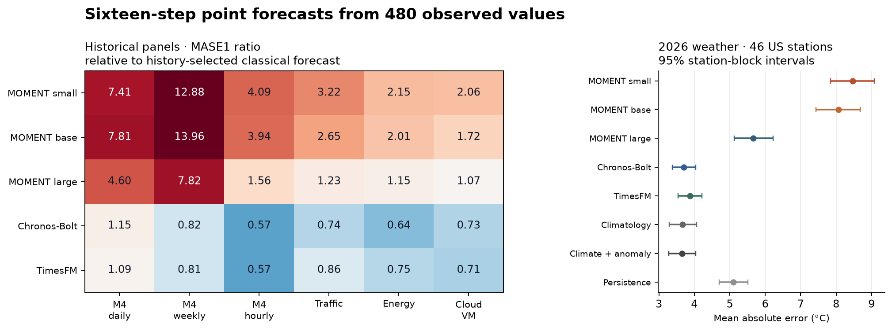

# Which released MOMENT checkpoints produce credible eight- and sixteen-lead forecasts?

This study measures actual future observations. It evaluates the fixed reconstruction head used by the official MOMENT short_forecast path. Explanations of what a hidden feature changes can be tested separately from the accuracy of the forecast it changes.

## Findings

The size distinction matters for using the native forecast as a causal endpoint. The large reconstruction head considerably improves on both smaller releases. It still loses to a history-only classical selector in all six domains on the primary H16 mean MASE1. The equal-domain error ratios against that selector are 5.30 [4.88, 5.88] for small, 5.35 [4.90, 5.95] for base, and 2.91 [2.65, 3.24] for large. At H8, they are 6.69 [6.12, 7.41], 6.72 [6.12, 7.46] and 2.48 [2.24, 2.75]. The worst large gaps at H16 are M4 weekly, 7.82× the selector, and M4 daily, 4.60×. Bitbrains, electricity and traffic are considerably closer at 1.07×, 1.15× and 1.23×. Small beats the selector on just 22 of 576 H16 evaluation items. On weekly data its median item MASE1 is 27.54, versus 2.45 for persistence. Large’s H16 loss is 3.54× [3.21, 3.93] Bolt and 3.50× [3.17, 3.90] TimesFM. For each of small, base and large, all 34,560 native forecast values at both historical horizons matched a separately written, instrumented driver bit for bit at float32 precision. A second 4,416 values per size matched on the weather panel. These findings extend prior evidence about patch reconstruction to real withheld forecasts.

For daily and weekly M4 the smaller head’s error has a specific signature. In direct H8, small’s forecast horizon-average levels correlate −0.73 and −0.67 with the actual future levels after centering and scaling by each origin’s history. Their between-origin SD is just 3.3% of the actual level SD. Small stays near the long-history mean with a faint adverse residual. Large has positive correlations of 0.89 and 0.97, though it recovers only 65% and 74% of the actual spread. Bolt recovers 93% and 100%.

On the deliberately later, 2026 weather panel, H16 MAE is 8.47°C for small, 8.06°C for base and 5.66°C [5.13, 6.22] for large. The pre-2024 station climate plus a decaying recent weather anomaly gives 3.65°C and persistence gives 5.10°C. Large's paired MAE ratio to climate plus anomaly is 1.55 [1.48, 1.63]. At H8 large reaches 4.63°C, below persistence's 4.93°C, but above the climate-plus-anomaly control's 3.63°C. At H16, Bolt reaches 3.70°C and TimesFM 3.87°C. The paired large/Bolt MAE ratio is 1.53 [1.47, 1.59]. Large’s 2.01°C gap to the climate-plus-anomaly forecast remains positive under a four-region block bootstrap [1.59, 2.47] and all four leave-one-date-out checks [1.22, 2.46]°C. The seasonal direction is visible in the signed error. Across stations at H16, large is 5.92°C too warm in January and 6.70°C too cool in July. Small is 12.70°C too warm and 10.44°C too cool, respectively. Climate plus anomaly has biases of +0.66°C and −1.21°C on those same dates. These are univariate retrospective historical forecasts on four fixed date intervals. No weather-physics model or forecast-time covariates enter the neural forecasts.

Asking for sixteen outputs also changes large’s first eight predictions. On the same eight future observations, H16-prefix to direct-H8 MASE1 ratios are 1.38 [1.31, 1.47] for daily M4, 1.27 [1.22, 1.32] for weekly M4, and 1.10 [1.07, 1.13] for NOAA. The other four domain intervals include one. Large’s weather H16 first eight average 5.13°C error, versus 4.63°C for a direct H8 request. The latter eight of H16 average 6.19°C. Specify the request horizon as part of any intervention and its baseline.

External observed-history z-scoring has negligible effect on large at the observed scales. Its six-domain H16 error ratio to raw input is 0.999999 [0.999988, 1.000009]. Across primary origins the median absolute forecast displacement is 0.0000059 prior SD, 95th percentile 0.000183, maximum 0.000782. The substantially larger change from requesting the second masked patch is visible at the same data scale.

On 48 diagnostic histories standardized to unit SD, multiplying by 3.7 and shifting by 11.2 changes the recovered H16 forecasts by only 2–4 × 10⁻⁶ prior SD on average across the three MOMENT sizes. Switching between single histories, shuffled batches and extreme companions changes any one entry by at most 2.3 × 10⁻⁶ prior SD. The positive-affine result fails when native input SD approaches RevIN’s fixed 10⁻⁵ floor. At SD 10⁻⁵, average discrepancies are 0.386, 0.323 and 0.320 prior SD for small, base and large; at 10⁻⁷ they are 37.0, 30.9 and 19.0. These are invert-to-original-units comparisons on the same trajectories. The smallest native history SD across the six historical archives was 0.00945, about 945 times that numerical floor. At the 10⁻⁷ stress point, Bolt’s average change was below 10⁻⁶ prior SD and TimesFM’s was 0.864, demonstrating that sensitivity to tiny native units also depends on the implementation.

For the repo’s benchmark, Bolt and TimesFM provide stronger native forecast references on this panel. MOMENT-large supplies a useful architectural contrast for studying how two-sided masked reconstruction turns into a forecast. The public small/base encoders can support representation studies with the readout explicitly identified. Matching an SAE intervention’s native output under either smaller head can reproduce a systematic forecast bias. A separately fitted readout defines a different causal endpoint and merits a separately labelled transfer measurement.

## Design

Six historical domains supplied 96 evaluation series and 24 distinct diagnostic series each. Every series contributed two 480-point histories followed by nonoverlapping 16-point futures. Each native horizon was requested separately. Models saw the observed raw history alone. The primary comparison divides each origin’s MAE by its own mean absolute lag-one change, averages the two origins by series, and compares methods within domain. Four thousand paired series resamples provide conditional 95% intervals for each reported contrast. The intervals are unadjusted across endpoints. History-based classical selection uses only eight preceding walk-forward folds. The same windows went through frozen Chronos-Bolt-small, TimesFM-2.5-200m and the three public MOMENT sizes. The base run was added after the small failure on the same frozen panel. No evaluation labels trained or chose a readout, normalization or donor. [Design](PROTOCOL.md), [source and checkpoint provenance](DATA_SOURCES.md)

The raw-series holdout is local to this evaluation. Nine named earlier repository rosters and a weekly dictionary roster were cross-checked. Earlier interventions used 66/96 M4 daily, 96/96 weekly and 19/96 traffic evaluation series IDs, usually at different windows. The parallel readout fitting and reserved support cohorts were disjoint. Historical pretraining exposure is possible. Traffic sensors, commercial VM traces and other related series may share shocks. Paired series-level intervals do not model every such dependency. [Membership audit](results/item_overlap.json)

The supplementary panel tests observations made after all five weight releases. It uses four contiguous sixteen-day periods in 2026, starting January 10, April 10, July 10 and October 10, each preceded by 480 daily temperatures. Forty-six contiguous-US stations were selected before model predictions from 132 candidates, with at least 200 km spacing, sufficient historic records and complete targets. The 2,944 targets were observed. A station-specific one-sided climate-plus-anomaly rule filled 220 of 88,320 input days. Calendar-aware comparisons include a pre-2024 station climatology and a decaying recent anomaly fit to historical residuals. These baselines know the station and day of year. The neural forecasts receive only its past temperature series. [Station protocol](post_release/PROTOCOL.md), [dates, candidates and data](post_release/results/manifest.json)

## Published reconstruction head

The eight small and base output biases are exactly zero. Across all entries the row Gram matrix differs from 1.41² I by at most 5.93×10⁻⁷ for small and 6.98×10⁻⁷ for base. That is the default orthogonal initialization geometry in the published PretrainHead. The large head has nonzero bias and adjacent-row dot products of 0.489–0.497. These observations identify a property of the archived tensors. The training and release history of those output rows remains unresolved. A prior independent report already demonstrated weak small/base reconstruction and the ability to recover patch information from the frozen base encoder. Its released base weight hash matches ours exactly. [Earlier empirical report](https://github.com/moment-timeseries-foundation-model/moment/issues/87), [diagnostic design](DIAGNOSIS_PROTOCOL.md)

On 72 real diagnostic holes the same eight observations produced native causal MAE/prefix-SD of 1.068 (small), 1.012 (base), 0.415 (large) and 0.562 (persistence). Small and base remained worse than the prefix mean even when the eight targets were physically visible to the model. For large, moving the masked slot 56 positions toward the interior with identical observed evidence and frozen prefix normalization reduced error from 0.415 to 0.314, paired change −0.102 [−0.158, −0.048]. At that position, using the true right flank rather than an unrelated rescaled flank changed 0.739 to 0.286, paired difference −0.453 [−0.552, −0.357]. In a post-hoc paired comparison with the same two flanks and fixed normalization, exposing the actual target patch raised large’s decoder MAE by 0.097 [0.064, 0.132] relative to masking it. Its official masked interior MAE was 0.260 versus 0.308 for two-sided linear interpolation; the paired interval for that difference includes zero. The masked-slot result is specific to the controlled evidence and token alignment. [Diagnostic predictions for large](results/moment_large_reconstruction.npz)

The normalization used for imputation explains a misleading positive correlation. The published head returns a normalized patch level, then RevIN converts it to physical units by multiplying by the visible-point SD plus 10⁻⁵ and adding the visible-point mean. The latter already moves with the right flank. Small and base appear to track these holes’ horizon-average levels with correlations of 0.773 and 0.760. Predicting the mean of visible observations on both sides already gives 0.824. That simple mean also has lower MAE than small by 0.095 [0.068, 0.123] prefix-SD, and lower than base by 0.063 [0.034, 0.090]. Once that observed mean is removed from the native predictions, residual level correlations are −0.214 (small), −0.050 (base) and 0.978 (large). The true right flank is legitimate information in imputation. The raw correlations alone credit the two smaller decoders with an effect their normalization can produce. [Flank-mean decomposition](results/flank_normalization.json)

The MOMENT paper’s short-horizon appendix evaluated held-out M3/M4 series at frequencies with greater support and describes difficulty obtaining promising daily, weekly and hourly results. This experiment deliberately targets the frequencies used by this repo’s causal studies. [Original paper, Appendix D.1.2](https://moment-timeseries-foundation-model.github.io/assets/pdf/2402.03885.pdf)

## Reproduction

An independent loop reproduced all 60 historical mean MASE1 endpoints to within 1.43 × 10⁻¹⁴. An independent source reader matched both origins from 12 historical raw series and all 91,044 measured weather context/target values. Separate official native short_forecast calls on ten holdout histories per MOMENT size (six historical domains and four weather regions, with different batch shapes) agreed within 1.02 × 10⁻⁶ prior SD over both horizons. [Raw and numerical audit](results/audit.json), [full-cohort native replay](results/cross_replay.json)

See [the numerical appendix](RESULT_TABLES.md), [all historical scores](results/summary.json), [all weather scores](post_release/results/summary.json), [H8 versus H16 comparisons](results/horizon.json), [commands and artifact schemas](REPLAY.md), [the source registry](DATA_SOURCES.md), and [mutation checks](MUTATION_CHECK.md). The stable context hashes are b2890ba165ff3a8aff03ac7617844d1f71e1e0c92621fc7a774aabea256d7965 for the 720 historical series and 53c57574063cb50ddf300b6490c383c4f7d1a6c7866e16ae515b48b5300334fb for the 46 weather stations.
