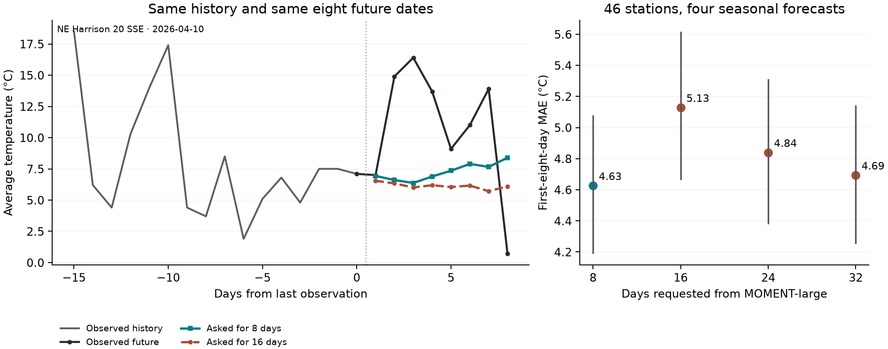

# Asking for more days can change the forecast for tomorrow

With the **same 480 observed temperatures**, the forecast from MOMENT-large for days 1–8 differed depending on whether we requested eight or sixteen days. Across 46 stations and four 2026 seasonal origins, the average station/origin RMS difference was **1.80°C**, station-bootstrap interval **1.66–1.94°C**. The 16-day request increased MAE over those *identical eight realized temperatures* by **0.50°C [0.37, 0.63]**. Every one of the 480 observed values fits in the native 512-step window at either horizon.

The example is the median-sized forecast disagreement among all 184 station/origins; the actual future and which forecast won played no role in choosing it. The right panel uses station-blocked intervals. The paired difference interval above uses the same stations under both horizons. [Example selection](results/weather_example.json) · [Physical forecast factorial and uncertainty](results/noaa_large_factorial.json)

## Why an extra patch changes the early forecast

The public short-forecast method reconstructs masked future patches of eight values. Within a fixed patch count, asking for 7 vs 8, 9 vs 16, or 17 vs 24 days produced the same overlapping requested outputs in the tested cases. Moving from H8 to H16 creates a second future token and shifts the observed tokens and first future token one slot earlier. A bidirectional encoder lets every attended token affect other token states. [Native implementation](https://github.com/moment-timeseries-foundation-model/moment/blob/main/momentfm/models/moment.py) · [Factorial driver](../horizon_identity/factorial.py)

On the actual H16 graph we independently (1) shifted the sinusoidal position embedding of the surviving token sequence back to its H8 coordinates and (2) prevented attention to the extra future token. Changing both reproduced the H8 first eight temperatures within **0.000007°C** on all 184 origins. With the two factors' marginal effects averaged over intervention order, attention accounted for +1.145 of the forecast difference along its observed direction, and position −.145. Those are signed contributions; cancellation explains a share above one. The interaction and absolute magnitudes are available in the raw results. The same graph reconstruction held in daily M4, traffic and the small checkpoint. Small's weather RMS difference was .339°C, and requesting sixteen improved the first-eight weather MAE by .114°C on the four dates. Each head has its own behavior. [Large weather data](results/noaa_large_factorial.npz) · [Small weather data](results/noaa_small_factorial.json) · [Historical cohorts](../horizon_identity/results/large_summary.json)

## Is there a best number of placeholders?

Each row scores the same eight future steps for all four requests. Historical numbers are mean per-series lag-one MASE and weather numbers are MAE in °C. We selected a horizon using 24 independent diagnostic items per historical domain and evaluated it on 96 holdout items. For weather, selection used only the six historical domains with equal domain weight.

| Cohort | H8 | H16 prefix | H24 prefix | H32 prefix | Length chosen before scoring this cohort | Held-out error change vs H8 |
|---|---:|---:|---:|---:|---:|---:|
| M4 daily | 6.81 | 9.39 | 6.14 | 4.74 | 32 | −2.07 [−3.19, −1.24] |
| M4 weekly | 12.78 | 16.19 | 9.19 | 7.35 | 32 | −5.44 [−6.78, −4.15] |
| M4 hourly | 1.46 | 1.50 | 1.11 | 1.07 | 24 | −.34 [−.49, −.20] |
| Electricity | 1.70 | 1.71 | 1.61 | 1.50 | 32 | −.20 [−.33, −.06] |
| Traffic | 1.06 | 1.06 | .94 | .98 | 24 | −.12 [−.21, −.04] |
| Bitbrains | 1.43 | 1.48 | 1.38 | 1.39 | 8 | .00 |
| Weather, four original dates | 4.63 | 5.13 | 4.84 | 4.69 | 32 | +.07 [−.004, +.142] |

H24 and H32 can also see all 480 observations. A different request length improved several historical-domain scores, but the historical policy failed to improve average weather error on these four dates. This experiment measures a property of the released masked forecasting graph; the original supervised forecasting head follows a different path. [All four arms, selection losses and head-specific results](results/summary.json) · [Additional calendar-date confirmation protocol](new_dates/PROTOCOL.md) · [Layer-wise attention intervention protocol](LAYERS.md)

## Independent dates and the role of encoder depth

At 11 disjoint new origins, the H16 request changed days 1–8 by 1.89°C RMS at 35 previously studied stations and 2.12°C at 35 additional stations. The average MAE penalty was .39°C in each cohort, but intervals that resample dates as well as stations include zero and the sign changes through the year. The forecast discrepancy is the result that generalizes across these dates. [New-date test and figure](new_dates/README.md)

We separately controlled access to the extra future token in blocks 1–8, 9–16 and 17–24 on the four original dates. With normal H16 positions, the middle eight blocks contributed **51.1% [50.0, 52.2]** of the all-open versus all-closed waveform along its observed direction, averaging marginal contributions over the six possible intervention orders. Early and late blocks contributed 21.9% and 27.0%. With positions aligned to H8, middle blocks contributed **51.2% [49.6, 52.9]**. All-open and all-closed controls exactly reproduced their reference forecasts in both position settings. This localizes a route by which a second mask influences the first forecast patch under these inputs. The units are signed shares of the attention intervention at fixed positions; they differ from a percentage of total forecast error. [H16-position factorial](results/noaa_large_layers_h16.json) · [H8-aligned factorial](results/noaa_large_layers_h8.json) · [Depth intervention protocol](LAYERS.md)
