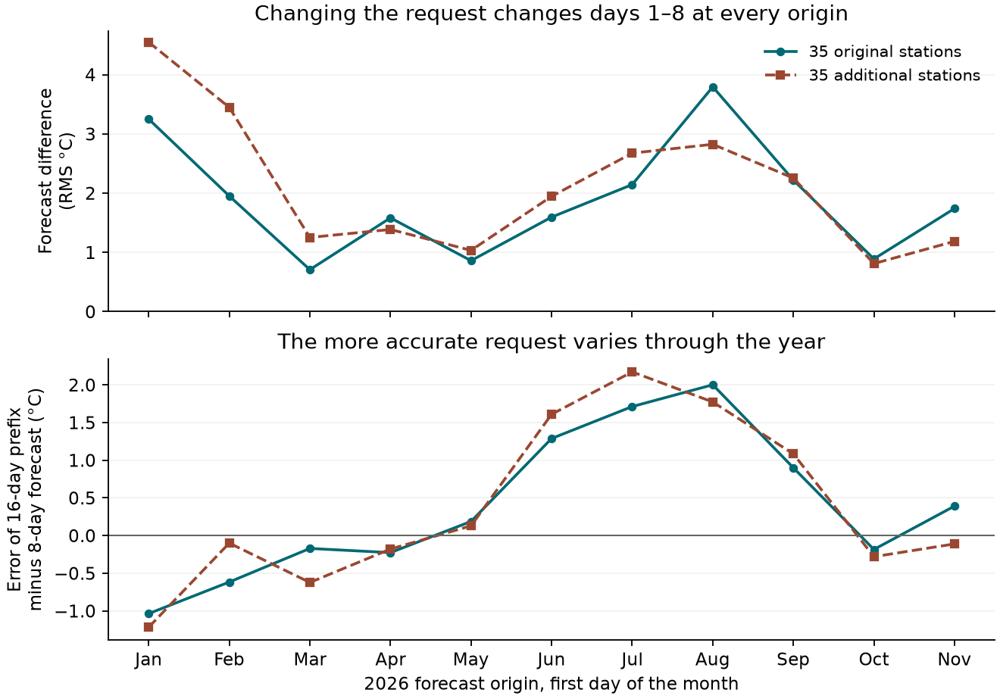

# Seventy stations, eleven new forecast dates

**The request-length effect replicated. Its accuracy penalty depended on the forecast date.** With the same 480 temperatures and the same first eight target days, a 16-day request changed MOMENT-large's first eight predictions by an average **1.89°C** at previously studied stations and **2.12°C** at additional stations. Both estimates measure the average station/date root-mean-square difference between the two forecasts. Compare this to the original four dates' 1.80°C. [Original study](../README.md) · [Frozen confirmation protocol](PROTOCOL.md)

| Large checkpoint, first eight days | 35 previously studied stations | 35 additional stations |
|---|---:|---:|
| H8 vs H16 forecast difference, RMS °C | 1.89 [1.34, 2.50] | 2.12 [1.48, 2.87] |
| H16 prefix MAE minus direct H8 MAE, °C | +.39 [−.16, .97] | +.39 [−.23, 1.06] |
| Dates with higher error from H16 | 6/11 | 5/11 |
| H32 prefix MAE minus direct H8 MAE, °C | +.01 [−.28, .25] | +.03 [−.20, .25] |
| MAE of H8 / H16 prefix / climatology plus recent anomaly, °C | 3.49 / 3.87 / 3.20 | 3.42 / 3.81 / 3.03 |

Intervals independently resample entire stations and entire forecast dates. For example, the first cohort's H16 request *improved* January MAE by 1.04°C and *worsened* August MAE by 2.00°C. These cohorts share dates and weather patterns. Grouping by station alone would miss much of the uncertainty about other dates. For the public small checkpoint H16 improved first-eight-day MAE on all eleven date averages in both cohorts, by .08°C and .10°C respectively; small's absolute MAE was above 6.9°C in both. [Complete scores, station-only and date-only intervals and leave-one-date-out sensitivity](results/summary.json)

The 11 monthly origins contributed 88 unique target dates with no date overlap with any of the original 64 target dates. There are 770 paired forecasts and 6,160 observed daily temperatures. The primary cohort retains the 35 of the original 46 stations with sufficiently complete records at all eleven origins, spanning 22 US states. The secondary cohort has 35 previously unused stations in 26 states, spaced at least 200 km apart within the cohort. All are contiguous-US sites in one year. Climatology and gap-fill parameters used data through 2023. Independent fixed-width parsing checks every observed target and retained raw history value against the dated NOAA archive. [Cohort, dates, checksums and exclusion reasons](results/manifest.json) · [Independent checks](audit.py) · [Forecast and scoring code](run.py)
