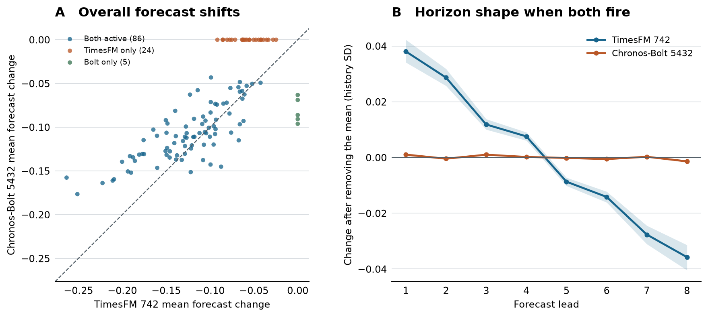

# Which parts of an SAE feature intervention reproduce?

We froze the original clean-state map, repeated feature sampling with newly fitted dictionaries, and intervened on fresh M4 daily and Bitbrains VM histories. The two archive-trained models and one cohort were also used to test whether a single recipient direction that raises the forecast can imitate many source atom removals. For this comparison the selected features still come exclusively from M4. A separate electricity experiment selects features independently in the new domain. [Primary follow-up protocol](PROTOCOL.md) · [Electricity protocol](ELECTRICITY.md)

## Usable dose and shape

The table scores the eight-lead **source effect** on 192 new M4 daily histories. To limit the influence of very rare features, it shows the pre-specified secondary subset with at least eight firing test histories, 14 TimesFM source atoms and 15 Bolt source atoms. Full and centered skill penalize squared error relative to a zero intervention. On average across these atoms, horizon shape accounted for only 4.3% of source-effect energy in TimesFM and 1.9% in Bolt. Removing the level therefore asks a harder question.

| Procedure | TimesFM → Bolt, full / shape | Bolt → TimesFM, full / shape | Extra information used |
|---|---:|---:|---|
| Original clean-state translation | −.104 / −.114 | −2.260 / −1.240 | Paired clean states, actual source firing amplitude |
| Same direction, calibrated gain | .658 / −.167 | .54 / −.51 | Signed scalar per atom fitted on 96 daily calibration series |
| One shared level direction, calibrated gain | .895 / −.120 | .580 / −.052 | Same scalar supervision; one target-wide level direction |
| One target direction fitted to each source waveform | .803 / **.362** | .59 / **.240** | Target directional derivatives and source ablation waveforms on the 96 calibration series |
| Output-only template per source atom | .934 / .497 | .59 / .395 | Source calibration waveforms and test source firing amplitude; no target intervention |

The waveform-trained target direction improved actual centered skill over the shared level direction by .482 and .292. The effects from these supervised interventions are measurable in the running target model. The output-only baseline shows how much of the source waveform could already be predicted from source amplitude. Using *all* firing atoms gave positive waveform-trained daily centered skills of .32 and .25. On the VM cohort, daily-trained waveform directions produced negative centered skill in both directions on the frequently firing subset, which contained only two and four archived atoms, respectively. [TimesFM source and paired intervals](results/timesfm_seed0.json) · [Bolt source and paired intervals](results/bolt_seed0.json)

## Can a single matched SAE feature work?

For each direction, choose the source–target pair with the largest clean-training activation correlation among the original 16 source features. A target feature can be selected by more than one source. Inspecting these pairs in the original 160 daily histories prompted this follow-up. We froze their identities before measuring the matched recipient ablations on the 192 separate reserve daily histories and 128 VMs. The target feature uses its own observed activation, permitting a true zero removal when it is dormant. No forecast supervision calibrates the target dose in either arm here.

| Source → recipient feature | Clean train correlation | Reserve daily source / joint firings | Matched feature full cosine / skill | Dense translation full cosine / skill | Matched feature centered skill |
|---|---:|---:|---:|---:|---:|
| TimesFM 742 → Bolt 5432 | .882 | 110 / 86 | .929 / **.846** | .963 / −.035 | .033 |
| Bolt 4813 → TimesFM 742 | .776 | 101 / 92 | .847 / **−44.432** | .970 / .091 | −895.481 |

The first native feature pair had full skill .834 on the original daily cohort and .846 [.817, .871] on reserve. Its reserve advantage over the mapped write was .882 [.740, 1.063]. Its centered-shape skill was smaller, .033 [.007, .056]. For example, on original daily series 792, chosen by proximity to the median firing amplitude, removing TimesFM feature 742 lowered the first and eighth forecasts by .079 and .124 history SD. Removing Bolt 5432 lowered them by .078 and .075. The same overall shift can have a different trajectory. Conversely, the Bolt-selected pair agreed on direction yet overshot the source effect. Neither selected source feature fired on the 128 VMs. Across daily features with at least eight firings, the descriptive Spearman correlations of the training match score with held-out coactive full cosine were .486 over 14 TimesFM features and .289 over 15 Bolt features. These exploratory rankings reuse receiving features and the same histories. [TimesFM measurements and intervals](results/timesfm_coactive.json) · [Bolt measurements and intervals](results/bolt_coactive.json) · [Selection and scoring protocol](PROTOCOL.md)

**Does the same pair work in reverse?** We ran Bolt 5432’s removal on all 91 daily histories where it fired, including five where TimesFM 742 was silent. Using TimesFM 742 to mimic it scored **.819** [.777, .856] in full skill and .940 in cosine. This pair therefore reproduced its *overall* edit at the two checkpoints’ native doses in both directions on daily series. In the reverse comparison the centered forecast RMS was .02726 for TimesFM and .00172 for Bolt, giving centered skill −242.80 despite centered cosine .302. On VMs, TimesFM 742 never fired and Bolt 5432 fired five times, so the reverse predictor had zero skill there. For the other exact pair, using Bolt 4813 to mimic TimesFM 742 gave .197 full skill, versus −44.432 when using TimesFM 742 to mimic Bolt 4813. This reciprocal check was specified after observing the reserve forward results and used no new fitting. [Exact TimesFM-selected pair and reciprocal ablation](results/timesfm_coactive.json) · [Exact Bolt-selected pair](results/bolt_coactive.json)

The same 742/5432 pair carried across **sampling frequency** without recalibration. On the boundary study’s 80 unselected weekly histories, TimesFM 742 fired on 38, Bolt 5432 on 44 and both on 35. Mimicking TimesFM’s removal using Bolt gave full skill **.816** [.727, .878]. Mimicking Bolt using TimesFM gave **.798** [.710, .869]. With level removed, the respective cosines were .605 and .610, yet original-dose shape skills were .244 and −6.954. The direction of the weekly shape was easier to recover than its amplitude. Recent-mean AUROCs were .905 and .926. A second run from independently captured weekly states reproduced all firing decisions. [Weekly live ablations](results/weekly_pair.json) · [Per-series effects](results/weekly_pair.npz) · [Independent replay](results/weekly_pair_replay.json)

What did the named features respond to? On 1,024 training histories we compared four single quantities: the final standardized value, mean of the final 32 observations, their linear change, and their standard deviation. All three atoms selected a **high recent mean relative to the full 480-step history**. On 192 reserve daily histories this statistic flagged TimesFM 742, Bolt 5432 and Bolt 4813 with AUROC .944, .985 and .939. A monotone calibration on the training set reduced coefficient-prediction error against the training-mean baseline by .804, .902 and .718 on reserve. Removing each feature’s estimated recent-mean response reduced the correlation between TimesFM 742 and Bolt 5432 from .877 to .312. Recomputing these readouts from the independently recaptured states selected the same statistic in all three cases and reproduced the three daily AUROCs exactly. The shared input cue explains much of their coactivation. The separate native ablations measure how each checkpoint uses the resulting activation. [Held-out input statistics and fit choices](results/feature_inputs.json) · [Readout implementation](feature_inputs.py)



*Each dot shows the mean eight-lead change on one daily history where either feature fired. Units are clean-history standard deviations, and the dashed line denotes equal effects. The second panel removes each edit’s mean across leads and averages the remaining profile across 86 histories where both features fired. Pointwise bands resample those histories. The flat Bolt profile explains how a pair can agree on the overall shift while giving a much larger reverse error on shape.* [Figure code](../figure.py)

## Which results survived a change of dictionary?

The same clean-state map was used for all six rows. Each retrain supplied a fresh panel of training-selected features. The two new dictionaries per checkpoint used identical training rows; the archive additionally saw 3,990 histories missing from the surviving training inputs. Counts are the numbers of features firing on at least eight distinct test series, out of 16 selected. Metrics use that subset of the 192 daily histories and the uncalibrated source dose.

| Source → receiver | Dictionary | Eligible features on daily / VMs | Daily full / centered cosine | Daily full / centered skill |
|---|---|---:|---:|---:|
| TimesFM → Bolt | Archive | 14 / 2 | .806 / −.257 | −.104 / −.114 |
| TimesFM → Bolt | Retrain 1 | 13 / 1 | .667 / .026 | −1.295 / −.015 |
| TimesFM → Bolt | Retrain 2 | 15 / 2 | .634 / −.096 | .350 / −.061 |
| Bolt → TimesFM | Archive | 15 / 4 | .064 / −.058 | −2.260 / −1.240 |
| Bolt → TimesFM | Retrain 1 | 15 / 6 | .171 / .270 | −2.471 / −.650 |
| Bolt → TimesFM | Retrain 2 | 16 / 4 | .122 / −.007 | −5.050 / −.829 |

The ordering of directions in full cosine survived the change of sampled features and dictionaries. The second TimesFM fit also achieved positive full recovery at its original dose. Centered skill stayed negative for all six. Few M4-selected features had enough external VM observations to support a comparable population claim there. [TimesFM retrain 1](results/timesfm_seed1.json) · [TimesFM retrain 2](results/timesfm_seed2.json) · [Bolt retrain 1](results/bolt_seed1.json) · [Bolt retrain 2](results/bolt_seed2.json)

## Sensitivity to regularization

Using target-state prediction error on the clean M4 training pairs selected a penalty of 0.0001 times the largest squared singular value in both directions. For daily TimesFM → Bolt the centered atom-transfer skills at relative penalties 0.000001, 0.0001, 0.01 (the original) and 0.1 were −.27, −.15, −.09 and −.07. For Bolt → TimesFM they were −210.09, −11.87, −1.19 and −.16. A weaker penalty could blow up write sizes, particularly into TimesFM. Clean state prediction error alone was a poor criterion for matching source ablation *dose*. [TimesFM-source sweep](results/timesfm_penalty.json) · [Bolt-source sweep](results/bolt_penalty.json)

## An electricity test with broader feature coverage

Only two archived TimesFM source atoms chosen on daily M4 fired in the original electricity test. We excluded all 160 original electricity customers, then screened on 64 other customers’ clean histories and tested on 96 further customers. All 16 domain-selected features per checkpoint fired in the new cohort, with 12 in each model firing on at least eight customers. The original 1,024-history M4 map stayed fixed.

| Source → target | Full cosine, mapped / wrong | Centered cosine, mapped / wrong | Centered skill | Matched to the most coactive target atom, full cosine |
|---|---:|---:|---:|---:|
| TimesFM → Bolt | .567 / .508 | .301 / .173 | .049 | .031 |
| Bolt → TimesFM | .170 / −.070 | .252 / .020 | −.067 | −.009 |

All four correct-minus-wrong improvements in full and centered cosine cleared the pre-specified family-adjusted lower bound. The numerically stronger .567 overall TimesFM-source cosine beat a demanding .508 wrong-source baseline by only .059. Correct feature identity was more selective in the other direction despite the lower absolute cosine. Fitting an additional map on 64 electricity customers versus 64 M4 histories improved full Bolt-source cosine from .240 to .372 but reduced its squared-error recovery from −.218 to −1.949. Outcomes depended on the metric and source checkpoint. These series all share the same electricity observation period. [Exact customer split](results/electricity_manifest.json) · [TimesFM-source results](results/electricity_timesfm.json) · [Bolt-source results](results/electricity_bolt.json)

## Reproduction

The runnable dependencies are the primary atom scratch archive (default `/tmp/tsfm_atoms_20261120`), the released primary per-item effects, the archived dictionaries and the two retrained dictionaries from the boundary study. `seed 0` denotes the archived weights. A clean domain-matched comparison uses 64 training series per condition; only its source feature eligibility is informed by the electricity population. [Data and environments](../REPRODUCE.md) · [SAE retraining](../boundary/README.md)

```bash
pkg=research.activation_transfer.replication
res=research/activation_transfer/replication/results
python -m "$pkg.data" data
python -m "$pkg.electricity" data
for m in bolt timesfm; do
    python -m "$pkg.data" "$m"
    python -m "$pkg.electricity" capture "$m"
done
for m in bolt timesfm; do
    for seed in 0 1 2; do python -m "$pkg.experiment" "$m" "$seed"; done
    python -m "$pkg.coactivation" "$m"
    python -m "$pkg.functional" "$m"
    python -m "$pkg.penalty" "$m"
    python -m "$pkg.electricity" run "$m"
done
python -m "$pkg.feature_inputs"
python -m "$pkg.weekly_pair"
python -m "$pkg.summarize" "$res"/*_seed?.npz
python -m "$pkg.score_penalties" "$res"/*_penalty.npz
python -m "$pkg.score_electricity" "$res"/electricity_*.npz
```

A fresh recapture of all 1,440 reserve-study inputs per checkpoint reproduced the split manifest byte for byte. Recomputing the named removals directly from their own SAE coefficients gave identical firing decisions and a maximum forecast component difference of 2.38e-06 history SD. [Live native replay](results/selected_replay.json)

To reproduce the named pair independently, prepare the reserve split in a fresh scratch directory, recapture the live block outputs for both models and replay their removals. The checker constructs the source and recipient writes directly from their own dictionary coefficients and verifies the original per-series effects. Run from the repository root after the primary atom run.

```bash
scratch=/tmp/tsfm-pair-fresh
pkg=research.activation_transfer.replication
for stage in data bolt timesfm; do
    python -m "$pkg.data" "$stage" --cache "$scratch" --out "$scratch/manifest"
done
python -m "$pkg.replay_selected" "$scratch" --output "$scratch/selected-replay.json"
```
