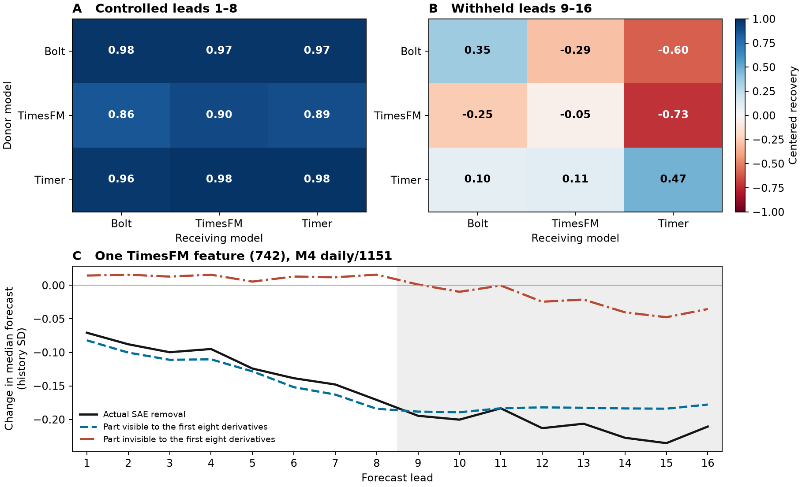

# What transfers between time-series forecasters?

**21 November 2026.** A source SAE feature's effect on the forecast can transfer across architectures. Its identity, the rest of the forecast, and its interactions with other features are separate claims. We compared the same forecaster with two independently trained SAEs, edited different forecasters, and tested whether early forecast changes predicted later ones. A hard sparsity boundary caused real jumps in some cases. In others a sparse representation lost the forecast shape even though no feature entered or left. In the clearest example, keeping the same 32 TimesFM directions and choosing their coefficients for the forecast recovered the first eight leads of a Bolt intervention. Exchanging the 32 directions with those active on another daily history cost almost nothing. Scrambling their orientation cost much more, and none of the larger-budget fits reproduced the donor’s next eight leads. [Matched geometry, dose and history controls](dictionary_prior/receiver_encoding/SPAN_INVERSE.md)

Here, a *feature* is a sparse autoencoder (SAE) decoder direction with a measured coefficient on a particular history. Removing the corresponding contribution from the original hidden state preserves the rest of that state. A *receiver* is another forecasting checkpoint, or the original checkpoint used as its own control. *Centered recovery* measures how closely the actual forecast changes agree after subtracting each intervention's own mean across the specified leads. We calculate one minus squared error divided by the reference effect's energy for each eligible source feature, then average features equally. The reference is usually the donor's natural removal. Tests of re-encoding also use the original dense receiving intervention as a reference. One means exact recovery, zero means doing nothing, and negative values are possible. The primary score measures forecast changes. A separate outcome study below checks whether those changes helped or hurt on actual futures. [Earlier experiments and literature gap](../GAP.md)

## Why was level the easiest thing to transfer?

Two phenomena had looked like one. Shifting an *entire* history by a constant changes absolute forecast level through the forecasters’ normalization and output rescaling. Restoring the clean middle-layer state did not remove that shift in Bolt, TimesFM or Timer. A high recent window *relative to the rest of the history* can instead engage specific internal features. For the historically matched TimesFM feature 742 and Chronos-Bolt feature 5432, we independently moved the final 32-observation mean up and down on 128 daily series, fixing the endpoint, local slope, whole-history mean and variance. The named contributions increased on 73 and 67 histories respectively and decreased on none. Locking only those contributions removed .0141 and .0198 history SD of forecast lift. Bolt's entire lift was just .0108. A full factorial found opposing effects from the other decoded terms and the reconstruction residual.

Generalization depended on the surrounding history. On 128 hourly traffic sensors the two named features stayed silent. We gave **every daily and traffic history the same recent mean (+1.25 SD), endpoint (+.5 SD) and fitted rise (zero)**. The features still fired on 28 daily histories for TimesFM and 43 for Bolt, versus zero traffic histories in both. A factorial input swap then kept the traffic pattern in the final 32 samples and supplied a daily pattern in the earlier 448 plus the daily allocation of residual energy between the two windows. In these 128 hybrid histories TimesFM fired 25 times and Bolt 39, close to the all-daily counts of 28 and 43. The hybrids retained 21/28 and 35/43 of the original all-daily firing cases. Each of those two substitutions on its own produced at most four firings. A second pairing showed the same ordering. Natural overlap in the three named statistics was limited, so these are controlled counterfactuals. A transferable level response does not require identical internal variables everywhere. Here two features participate in a shared conditional response on daily data, and even there other pathways carry a substantial part of the effect. [Absolute-level route](input_paths/README.md) · [Named-pair interventions](level_pair/README.md) · [Earlier versus recent context factorial](level_pair/SPLICE.md)

## What do eight matching numbers identify?

Level was the easiest effect for a *fixed* cross-model direction. Nonlevel steering became possible once the translator used the local output sensitivity of both models. On the additional 128 daily histories, such a translator recovered .858 of the early centered shape into Bolt and .971 into TimesFM. For named tilt and sine requests, an earlier test also distinguished copying a donor's actual effect (.971–.993) from producing the ideal requested waveform (.059–.289 when copying weak donors). Sending the ideal request directly to the recipient reached .717–.984. [Earlier shape and named-request tests](local_requests/README.md) · [Cohort replication](fresh_cohort/README.md)

We transmitted only each feature's estimated effect on eight forecast leads. Even if the receiving model was **the original donor**, at its original layer and token, the reconstructed edit could lose the continuation. Across 128 additional M4 daily histories, all six cross-architecture directions between Bolt, TimesFM and Timer recovered early shape at .858 to .981. Late shape on the same six directions ranged from −.726 to .107. Returning TimesFM's own signature to itself scored .903 early and −.051 late.

We can identify some of the hidden information that was discarded. Splitting a real Bolt feature into a direction visible to the first eight derivatives and a direction exactly invisible to them, then physically applying the invisible part alone, gave −.002 early shape and **.567 [.488, .622] late shape**. For TimesFM it gave .076 early and **.441 [.283, .572] late**. This is a statement about ordinary-state derivatives and finite-dose forecasts; the two are distinct in a nonlinear model. It also confines the non-identifiability claim to the space of unrestricted hidden writes. A known finite dictionary is an informative prior. [Three-by-three self and cross test, example and independent replay](self_transfer/README.md)

When the source came with a known finite dictionary, the answer changed. We gave a blinded matcher the *actual nonlinear* eight-lead effect of an unidentified removal and the 32 features currently active in the receiver. On the same additional daily series it identified 348/350 removals in Bolt and 407/423 in TimesFM when searching the original donor's own dictionary. Replaying the selected feature recovered .981 and .962 of late shape, compared with .323 and −.037 for unrestricted inverses given exactly the same measurements. Centered waveform shape alone, discarding level and amplitude, identified 338/350 and 351/423. In cross-model searches full feature removals had a median early shape 4.5 times the donor amplitude into TimesFM and .15 times into Bolt. Allowing fractional removal plus early correction gave .989 and .897 early recovery, while the late values were −.824 and −.219. The decoder dictionary contains information useful for identifying the original intervention; a second architecture supplies a different set of possible causes. [Blinded feature identification, signed dose and late continuation](dictionary_prior/README.md)

A separate control changed the receiving model's weights. At the original TimesFM removal amplitude, the trained Bolt scored .859 on daily shape and two random-initialized Bolt twins scored about .0002; every natural request hit the random receivers' norm cap. After shrinking the desired output by about 100,000 times using one scalar learned on separate histories, the random twins scored .895 and .896. Reordering the leads drove both below −1, and their unmeasured next-eight scores were −7.19 and −3.19. **Realistic amplitude requires substantial output sensitivity.** Finding a direction to match a small number of tiny output changes requires much less. [Random checkpoints, finite differences, noise floor and independent replay](random_receiver/README.md)

## Does the SAE's abrupt change in active features prevent comparison?

Changing only the receiver's SAE fit on an **unchanged checkpoint and unchanged input** was enough to break natural single-feature substitution. In two seed directions on each of Bolt and TimesFM, the donor's own dictionary gave .825–.982 on extra-daily later forecast shape; the independent fit gave −1.485 to −.649. Giving the alternate dictionary the exact hidden displacement allowed its active 32-dimensional span to recover .359–.588. Rank-32 clean-state PCA scored .356–.687 and won three of the four cells. Directly re-encoding the true endpoints with hard TopK often fared worse: switching from hard to fixed clean membership moved Bolt's two later scores from −2.499/−2.329 to .477/.208 and TimesFM's from −.254/−.391 to .259/.244. Matching hidden edit lengths reduced Bolt's deficit and removed TimesFM's locked advantage. In a prospective 96-daily/62-weekly replication, locking membership improved late recovery in all eight model/seed/frequency comparisons, seven after adjustment. The four daily results persisted on the 92 identities absent from all audited earlier panels. Both gate changes and the size of the resulting write can matter. [Matched dictionary training, gate interventions and replication](dictionary_prior/refit/README.md) · [Two observed jumps in native forecasts](dictionary_prior/refit/BOUNDARY_EXAMPLE.md)

A second test passed the *same already-effective cross-model dense write* through the recipient’s own public SAE. On daily Bolt → TimesFM, **zero of 360** eligible target writes changed an active ID. Nevertheless, passing that vector through the fixed active encoder and decoder gave −.184 recovery of the *dense recipient's* early centered shape. Matching the write length made it −.549. In traffic, only 4 of 242 such writes changed support, but each exchanged one winner and produced a displacement 9.6 to 195 times the intended length. Matching the intended length moved hard-gate recovery from −1.917 to .597. In the reverse daily direction, hard beat locked at native decoded lengths (.349 versus .123), and matching length largely erased the difference (.292 versus .313). Thus preserving support helps in some comparisons, and changes of dose or direction can dominate in others. [Actual receiver re-encoding, equal-length writes and controls](dictionary_prior/receiver_encoding/README.md) · [Local distance to the first boundary](dictionary_prior/receiver_encoding/BOUNDARY_DISTANCE.md)

We then kept the exact same 32 TimesFM receiver decoder axes and changed how their coefficients were chosen. On the 360 daily Bolt-donor cases, a hidden-space projection scored −.189. Fitting the *forecast response* in those same axes scored **.458 at the original hidden length, .986 with the normal receiver budget**. The latter achieved .963 against the actual Bolt donor on the eight supplied leads and −.197 on the next eight. A random 32-dimensional span reached .996 against the target with more displacement (median 6.78 times the original length versus 3.32 for the active dictionary). Four additional controls preserved every selected feature ID and decoder angle while rotating the entire history-dependent dictionary in the receiving model. At the original length these scored .243–.298 against .458 for the native orientation, a mean advantage of .194 [.157, .241] for the native span. Giving each daily history the active TimesFM directions of a *different* daily history preserved recovery (.458–.460). Those mismatched lists still shared a median 28–29 of 32 IDs. The dictionary’s orientation mattered, while selecting the exact history’s list contributed little on this panel. Every fit still used the current history’s forecast derivative. [Physical span-constrained writes, identical budgets and a local feasibility bound](dictionary_prior/receiver_encoding/SPAN_INVERSE.md)

The hard TopK boundary matters when the scientific claim concerns a feature's identity. It matters much less when the same behavior is available from several features. A single shared four-ID TimesFM shortlist across all source features recovered .635 on separate daily histories, almost the .653 of donor-specific lists. On 60 noisy-origin cases where neither of the two best local matches belonged to those four, the shortlist still delivered .645 shape. The reverse direction was weaker. A dictionary can provide useful receiving directions while telling us little about a unique cross-model name. [Feature shortlists, equally available controls and substitute directions](feature_groups/README.md)

Real changes of forecast origin separated a disappearing feature from a changing readout. On hourly traffic at +32 observations, 159 of 169 old TimesFM receiving features were still active for persistent Bolt donors, yet 143 of 169 were no longer the best local choice. Keeping the old physical write scored −.57, refitting its coefficient .43, and choosing a new active feature .96. Using the old donor waveform with its current amplitude scored −1.14. Merely updating either the feature ID or the scalar fails to account for all the change. [Rolling-origin study](rolling/README.md)

There is also a reproducible counterexample to a hard active-feature rule. For one TimesFM donor feature, 2362, a fixed Bolt decoder direction, 2622, continued to work when its own coefficient had fallen out of TopK. At matched tail origins on 96 further traffic sensors it scored .340, compared with .230 for the best currently active alternative and .262 on average for three equal-norm control directions. Moving the same sensors to earlier, variably phased origins reversed the ranking of fixed and locally active procedures (.082 versus .156). To separate clock time from elapsed date, we then tested the same 96 sensors at 15:00 and 03:00 on each of two Saturdays exactly a week apart. The fixed-minus-fresh advantages were +.110 and +.093 in the afternoons versus −.130 and −.142 overnight. The half-day contrast was −.237 [−.276, −.201]; the week contrast was −.015 [−.039, .008]. Both were holiday Saturdays, so the result identifies a schedule association on those dates. [Independent confirmation and control directions](rolling/fixed_2622/README.md) · [Four timestamp-matched comparisons](rolling/fixed_2622/factorial/README.md)

**Sparse lookup can also fail for the opposite reason.** A typical TimesFM traffic query shared 28 of its 32 active IDs with a generic training history. Its *best* match also typically shared 28, with 964 of 1,024 training histories tied for nearest. Distributing weight equally over tied neighbors made retrieval invariant to row order. It improved the calibrated error and daily TimesFM-donor results, while traffic remained difficult. In daily Bolt, an ordinary training row shared eight IDs and the nearest about 27. In these experiments both an abrupt change of support and *too little* change of support could make an ID-based comparison uninformative. [Tie-fair comparisons and independent SAE fit](state_predictor/README.md)

## Which receiving layer or calibration budget helps?

| Question | What we measured |
|---|---|
| Where can a *fixed* receiver library reproduce a Bolt edit? | On the additional daily set, the first and last TimesFM blocks scored .890 and .972 on the first eight leads. The adaptive last-block write scored .972 early and **−2.989** on the following eight. Bolt showed little daily trend with depth. A “best layer” needs a specified outcome and horizon. [Five depths and two-site controls](depth/README.md) |
| Did a .348 result on machines establish that transfer failed there? | One VM dominated it; leaving it out gave .927. A recipient-only scalar search at the original donor dose gave .930. On 256 unused VMs, the scores were .902 before search and .970 after. All ten shortened writes across old and new eligible cohorts came from the same Bolt feature. [New VM validation, per-atom estimates and actual feedback writes](depth/feedback/README.md) |
| Can the receiver be calibrated cheaply without gradients? | With generic signed forward probes, 16 histories × 24 directions cost 768 series-forwards, six times fewer than 96 × 24. On separate daily data centered skill was .694 versus .752 into TimesFM and .560 versus .583 into Bolt. The same budget lost .363 skill into TimesFM on traffic. Exploring more directions was often worth more than repeatedly probing a narrow set on more histories. [Costs, intervals and low-budget failures](calibration_budget/README.md) |
| Can an ordinary donor state replace a current donor probe? | On two daily cohorts, a lookup using dense Bolt activations gave .546 and .651 physical shape in TimesFM. A lookup using just the 32 active SAE IDs gave .538 and .650, against .347 and .452 for a mean donor derivative. The support and dense searches often returned different historical examples. In reverse, dense lookup was more promising than binary support. The preregistered family-adjusted comparisons did not establish a general sparse or dense winner. [Calibration, shuffled histories and extra SAE seed](state_predictor/README.md) |

## What happens outside the quantities supplied to the controller?

**A shared edit to the input.** We expressed each source feature's desired early effect as a bounded perturbation to 12 smooth modes in the last 32 observations. A donor-only fit replicated its own early daily response at .900 in Bolt and .635 in TimesFM. Sending the identical observations to the other checkpoint scored −.605 and .140. When both models' sensitivities helped select a *single* edit, the donor/receiver scores became .749/.788 for Bolt donors and .602/.632 in reverse. These are the same physical inputs in both models. A common solution can exist even when the donor's own best choice transfers poorly. All four unilateral cross-model scores on unobserved late shape were negative. [Input-only interventions and independent public-forecast audit](input_bridge/README.md)

**Forecast leads.** At a fixed budget of eight current gradient rows, moving observations across the first 16 leads changed the result on four unobserved daily leads. Bolt → TimesFM improved from −.390 to .663; TimesFM → Bolt from −.207 to .438. A straight line between the same donor observations gave .686 and .471. Removing that interpolation from each waveform left −.133 and −.088 for the physical writes. Both daily scores on leads 17–32 remained below zero. Thus where the measurements fall can matter as much as the translation, and interpolation is a strong control. [Lead budget, 32-lead interventions, figure and curvature controls](lead_budget/README.md)

**Forecast distributions.** On the 128 additional daily series, matching Bolt's median gave .971 median shape in TimesFM and −.249 interval-width recovery. Matching q10, q50 and q90 gave .968 and .964. The reverse width comparison was −.263 to .813. Six withheld deciles initially appeared to transfer too. But on 128 further daily series, a no-fit, Gaussian-quantile interpolation captured much of what had looked like unseen curvature. Supplying q30/q70 improved the four remaining deciles; a forecast-only interpolator given the exact same five donor derivative estimates predicted them still better. The physical intervention establishes genuine control over interval width and its shape. Smooth quantile heads explain much of the apparent transfer between anchors. [Native prediction intervals, recovery, same-information baselines and independent audit](quantiles/README.md) · [Independent cubic-interpolation check](method_review/REVIEW.md)

**Two-feature interventions.** On the additional daily histories, independently translated Bolt removals recovered the joint TimesFM effect with .950 shape skill. Adding the two *measured donor* single-feature effects already scored .992. The recipient's recovery of the interaction alone was −.010 [−.042, .016]. In reverse, joint recovery was .815 and interaction recovery −.046 [−.105, −.014]. Four extra *partial-dose* Bolt pair measurements allowed a pair-specific TimesFM write. On a third daily cohort the interaction score rose from .008 to .461 [.230, .559], with a permuted-lead control at −2.039. The next eight leads still scored −.290. The combined forecast alone hid a small interaction that could be transferred once it was measured in the source. [Factorial model runs and partial-dose follow-up](interactions/README.md)

**Historical continuation.** On 128 distinct daily histories, fitting each model's own early-to-late relationships independently gave .399 late recovery for Bolt → TimesFM and .148 in reverse. Correctly pairing historical source and target histories won zero of eight registered comparisons after multiplicity adjustment. Excluding fast late frequencies from calibration substantially reduced transfer of that component even when early performance held steady. [Frequency holdout, paired, shuffled and independent calibrations](blind_frequency/README.md)

**Decoder geometry.** In each of three real Bolt SAE dictionaries, retaining 32 directions selected by variability in forecast sensitivity, then rotating the remainder without changing decoder norms or pairwise angles, gave .754–.831 early daily shape recovery. The same control ranged from −.723 to .390 in TimesFM. Reducing dose and testing the first-order limit preserved much of the discrepancy. An average signature or a decoder cosine is insufficient to predict equivalence on an individual history. [Actual rotated writes, PCA and dose controls](response_subspace/README.md)

**Forecast accuracy.** We retrieved the actual eight observations following 512 of these histories. On two daily panels the sign of the MAE change matched in .839/.842 of cases for Bolt → TimesFM and .923/.866 in reverse (equal weight per recurring donor feature). Even adding the exact donor change to the receiver's original forecast gave .837/.859 and .937/.858 agreement. A shared correction can help one starting forecast and hurt the other. The errors assess the existing interventions on historical observations; no policy selected edits to improve forecast accuracy. [Buffered futures, signed MAE and arithmetic controls](forecast_loss/README.md)

The study covers frozen, short-horizon univariate forecasters, standardized real histories and selected public SAE sites. Most intervals resample whole histories conditional on the feature set; explicitly marked intervals also resample features. Nearby traffic sensors can be correlated. Different follow-ups reuse some evaluation histories for new endpoints, and the independent replications identify their new histories explicitly. The study concerns model-internal interventions, with possible pretraining overlap unobservable. The cohort audit found 2,654 unique item identities across the named training, calibration and evaluation panels, including 1,534 evaluation items, and zero identical standardized histories across those panels. These counts cover the named panels; each reported effect uses its own smaller denominator. In the gate confirmation, 92 of the 96 daily items and none of the 62 weekly items were absent from every earlier panel located in the wider project audit. [Cohort audit](cohort_audit.json) · [Independent methodological review](method_review/REVIEW.md) · [Reproduction and physical replay](REPRODUCE_NOV21.md)

## What information did each comparison receive?

| Test | Available when choosing the receiving edit | Evidence a positive result supplies |
|---|---|---|
| Activation alignment | Paired training activations and the actual source hidden displacement. | Whether a reusable map preserves the intervention in a new checkpoint. |
| Adaptive cross-model steering | Ordinary donor and recipient forecast derivatives at specified leads and the source feature’s natural coefficient. The actual donor removal is reserved for scoring. | Whether the target can physically implement this history-specific response. |
| Blinded feature fingerprint | The *measured* early donor knockout, active receiver dictionary and ordinary receiver derivatives. The matcher never sees the donor ID. | Whether natural candidate interventions can be distinguished from these measurements and predict the withheld continuation. |
| Controlled SAE refit | Identical checkpoint and hidden basis; the endpoint re-encoding and projection controls receive the actual source hidden vector. | How much the dictionary and the gate change the action of an already-known hidden intervention. |
| Partial-dose two-feature test | Four partial donor pair probes and the receiving model’s singleton and combined responses. The full-dose donor interaction and its late leads are withheld. | Whether a deliberately pair-dependent write generalizes within the source dose square and forecasts outside the supplied leads. |

## How I would compare the next pair of models

Start with one real source intervention on a particular history and measure the signed effect at its natural dose. Use dense hidden states to establish a faithful within-model reference and to check whether reconstructing through an SAE changed the intervention. Compare a second SAE fit on the *same* checkpoint before interpreting a cross-architecture mismatch. Then ask the receiving model to reproduce a specified part of the effect and reserve another part for evaluation. Match a forecast-only baseline to exactly the information supplied, especially for smoothly varying leads or quantiles.

This gives SAEs two concrete roles: defining a natural, localized removal and supplying candidate receiving directions. It also gives a cross-model correspondence a demanding test: whether a direction selected from early observations predicts what both models do elsewhere, across dose, context or later leads. A same-history fitted signature answers the narrower question of controllability.
