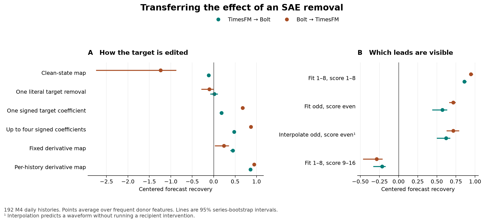

# Why level traveled, and when forecast shape travels too

**Level was the easiest output for a fixed clean-state map to control. Shape was also portable once we translated what a source write does to the forecast of the current history.** This held for deliberately requested tilt and sine, and for actual removal of naturally firing sparse autoencoder (SAE) features. A global one-to-one list of corresponding features would be a stronger result than these experiments establish.

**21 November follow-up.** Translating back into the original checkpoint, changing the measured quantiles, and testing two-feature interactions reveal what a successful intervention identifies. The new studies also test concrete sparse-feature matches over moving forecast origins. [Results, controls and practical costs](NOV21.md) · [Reproduction](REPRODUCE_NOV21.md)

We use *recovery* to mean one minus the squared error of an intervention divided by the squared error of leaving the forecast unchanged. One is exact agreement, zero is the no-edit baseline, and negative scores are possible. In the SAE experiments, the reference is the donor's actual forecast change when its feature is removed. We usually subtract every intervention's own eight-lead mean so that a common lift cannot earn shape credit, compute the score per source feature and give each frequent feature equal weight. In the named steering experiments we also score against the external request, which can be considerably stronger than the change the donor actually produced.

## Why did level work with the old map?

1. **Both models have an easily reached forecast-level direction.** Across the first 24 clean-state principal components at the middle study sites, a common shift across leads accounted for 93.3% of response energy in Chronos-Bolt and 99.0% in TimesFM. The correct paired map beat sign-oriented random directions at equal hidden norm. Removing the mapped tilt's predicted level spillover substantially reduced its loss going into Bolt but left almost no correctly signed tilt. In the reverse direction some temporal shape had the correct orientation at very low amplitude. These observations distinguish a common bias towards level from faithful shape transfer. [Sensitivity, random controls and cancellation](level_geometry/README.md)
2. **Absolute origin is an especially weak test of shared hidden encoding.** Translating an entire history by +0.05 translated all eight forecasts almost exactly in Bolt, TimesFM and Timer. Replacing the complete middle-block token tensor with its value from the original history preserved the shift. A recent ramp did move through these states: almost all of its effect could be transferred through TimesFM's final data token, versus about 3% through Bolt's terminal regression token. Moving the Bolt steering experiment onto the matching data patches still gave roughly zero direct TimesFM → Bolt shape control. [Input interchange](input_paths/README.md) · [Location-controlled intervention](token_position/README.md)
3. **Changes that occur naturally in the data and designed hidden writes behave differently.** A map fitted on paired responses to input perturbations improved recovery of genuinely held-out window shifts, including the actual recipient's forecast response. It did little for most arbitrary fixed tilt and sine writes. A fixed output-response map in 24 PCs also achieved little external-goal recovery on two novel waveforms orthogonal to the fitting requests. These nulls apply to those reusable maps and budgets. [Tangent maps and genuine-window controls](tangents/README.md) · [Fixed response map and novel waveforms](response/README.md)

## What changed the result?

For each firing source SAE feature, take the displacement that removes its decoder contribution. On the current, ordinary history, compute how all eight source forecast leads respond to that displacement to first order. Find a target displacement whose local forecast response matches those eight numbers. Apply the target edit and compare its **actual nonlinear forecast change** to the donor's actual ablation. The solver receives the original history and ordinary-state derivatives; no future values or observed test ablations enter it. A fixed ridge rule and norm cap are shared across features.

Let $J_s$ and $J_t$ describe how the eight forecast leads respond to small writes at the source and target sites. A clean-state map $T$ can predict ordinary target states accurately yet make a poor intervention when $J_t T u$ differs from $J_s u$ for the source edit $u$. The response-based method chooses the recipient write that best matches the predicted eight-lead change, with a penalty on write length and separate weights for level and shape. Each history can have a different pair of derivatives. Eight output constraints leave many possible writes in a hidden state with hundreds of dimensions. Forecasts beyond those leads can distinguish them.

| Receiver and method | TimesFM → Bolt, daily | Bolt → TimesFM, daily |
|---|---:|---:|
| Clean hidden-state translation | −.114 | −1.240 |
| Fixed map of the donor decoder vector; current donor coefficient | .444 | .238 |
| Current donor signature; eight frozen target write vectors | **.796** | **.896** |
| Current donor and target signatures | **.859** | **.944** |
| Current signatures, target forecast leads shuffled | −.423 | −1.092 |
| Repeat the unchanged adaptive method on prospectively selected daily histories | **.858** | **.971** |

The first five rows use 192 daily histories, with 14 frequent TimesFM and 15 frequent Bolt source atoms. The last row uses 128 newly selected daily histories after excluding 3,295 identifiable earlier daily series. Relative to 96-history calibration templates that already knew the source features' typical ablation effects, the adaptive improvement was .362 [.304, .451] and .549 [.477, .873] on the original daily cohort. A separate production implementation verified the score, gradient sign, dose and physical token placement. [Full experiment and checks](full_space/README.md) · [Independent audit](full_space/results/independent_audit.json) · [Frozen holdout](fresh_cohort/README.md)

On 128 new hourly traffic series, adaptive recovery was .884 into Bolt and .990 into TimesFM. Only two and five donor features respectively fired frequently enough to count. A third receiving architecture, Timer-base, reproduced daily centered changes from both donors at .889 and .946. Timer used a point forecast and a 96-observation data token; the donors used median forecasts and a 32-observation group. These tests broaden the observed settings while preserving the known eight-lead output contract. [Traffic cohorts and feature coverage](fresh_cohort/README.md) · [Third receiver and controls](third_receiver/README.md)

## Does it have to be dense?

The donor SAE supplied an identifiable intervention; the target could also implement much of it in sparse coordinates. Choosing up to four of the **currently firing target features** and adjusting their coefficients gave .476 centered recovery into Bolt and .869 into TimesFM. A history-specific *full removal* of one target feature gave .017 and −.101. For Bolt → TimesFM, 507 of 520 daily firing cases had useful target directions, yet all favorable full knockouts were too large. Allowing a partial reduction of just one coefficient gave .610. When decoder identities were permuted, the four-coefficient search still reached .462 and .828. Searching a small collection of directions by their local forecast response accounts for much of the sparse result; a universal semantic dictionary remains unproven. [Doses, sparse controls and feature selections](sparse_writes/README.md)

**A feature ID can jump even with no TopK boundary crossing.** In a 96-history follow-up, adding noise at 0.1% of history standard deviation left every TimesFM active set intact, yet the best single target feature changed on 17 of 283 still-firing Bolt-source cases. At 2% noise, 95 of 270 choices switched; 93 switches were between two features present at both endpoints. Letting the choice change improved measured centered recovery from .719 to .770 (paired difference .052 [.006, .126]) versus keeping the old feature and refitting its dose. In the reverse direction, 35 of 353 choices switched and either policy scored around .027. A jagged feature match can reflect a change in the ranking of already active alternatives. Its impact on the forecast must be measured separately. [Perturbations, forecast replays and paired intervals](sparse_stability/README.md)

## What does a successful translation buy?

* **Faithful copying and strong goal control are distinct.** For daily tilt and sine, the local translator recovered .971–.993 of the original donor edits' full changes across four transfer directions and goals. However, the donors themselves only weakly produced those shapes; the copied edits scored .059–.289 against the requested waveforms. A recipient given the request directly reached .717–.984. [Same models, histories and objectives](local_requests/README.md)
* **Dose can explain a failure.** On virtual-machine traces, Bolt → TimesFM scored .348 at the full natural source dose and .963 when actual source and recipient writes were both reduced to one quarter. No original target write hit the cap. For TimesFM → Bolt, 136 of 156 frequent cases hit the cap; doubling it increased shape recovery from .568 to .664. [Controlled dose follow-up](full_space/README.md)
* **Matching measured leads leaves the continuation underdetermined.** With only odd leads disclosed, daily centered shape on the omitted even leads reached .572 and .714 for TimesFM → Bolt and the reverse. Simple interpolation of the same four donor predictions reached .621 and .715. Steering on all first eight and evaluating the shape of leads 9–16 gave −.215 and −.287. We can reproduce a specific behavior without having identified the same internal feature or a transferable forecasting algorithm. [Withheld-lead records and stimulus access](full_space/LEADS_PROTOCOL.md) · [Conditional intervals](full_space/results/followups.json)

* **Historical continuation can recover some omitted shape.** On the original daily histories, conditioning an early write on 16-lead calibration derivatives lifted late skill from −.287 to .279 for Bolt → TimesFM and from −.215 to .032 for TimesFM → Bolt. On separate daily and traffic histories, the correctly paired calibration prior failed to beat independent within-model alternatives on all eight registered contrasts after adjustment. Learning each model’s usual relation between early and late outputs can account for much of this gain. [Continuation study](continuation/README.md) · [Independent cohorts, pairing controls and withheld frequencies](blind_frequency/README.md)
* **A forward-only implementation can copy some temporal shape.** With two small donor probes per active feature and eight fixed target writes, daily centered recovery reached .592 into Bolt and .587 into TimesFM. The target library was calibrated using positive and negative generic directions on separate histories. [Deployment formula, costs and physical checks](forward_only/README.md)

Previous TSFM studies have shown that within-model interventions can change trend or periodicity and that single-model SAEs reveal layer-dependent ablation effects. This experiment asks whether a genuine donor feature edit can be physically realized in another forecaster. Its endpoints are forecast changes under interventions, not improvements in accuracy against observed futures. It covers selected checkpoints, frozen public SAEs, univariate inputs and short horizons. [Wiliński et al.](https://proceedings.mlr.press/v267/wilinski25a.html) · [Mishra](https://arxiv.org/abs/2603.10071) · [Literature and gap](../GAP.md) · [Run and rescore](REPRODUCE.md)
