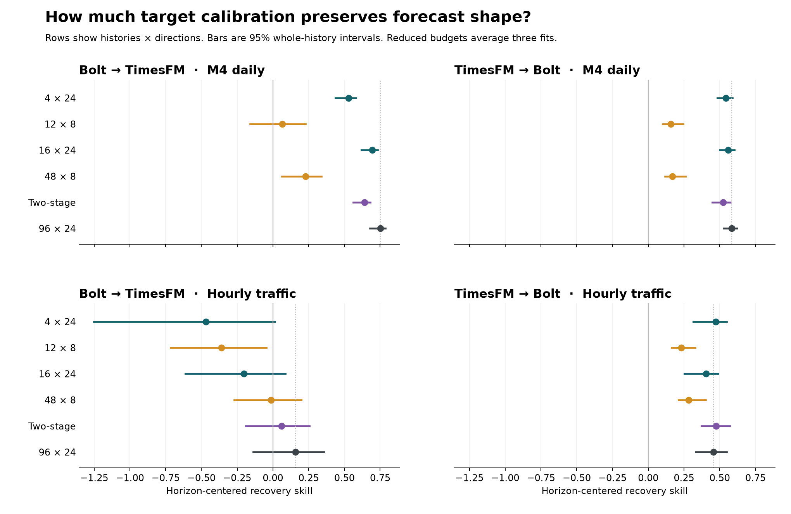

# The recipient calibration budget for an eight-vector transfer library

How much calibration is needed to translate another forecaster's SAE feature removal? The original forward-only method used 96 calibration histories, 24 clean principal components and two signs, or 4,608 perturbed recipient series-forwards. Here we vary the number of histories and directions separately. Each resulting library still contains eight generic recipient write vectors. We measure its effect by running the actual target after the calculated hidden write. [Protocol locked before fitting](PROTOCOL.md) · [Original eight-vector experiment](../forward_only/README.md)

**Sixteen calibration histories × 24 directions preserved daily centered forecast skill within the preregistered .10 tolerance in both transfer directions, using 768 perturbed target forwards instead of 4,608.** On the original M4 daily set, Bolt → TimesFM scored .566 versus .587, a paired loss of .020 [.000, .064]. TimesFM → Bolt scored .563 versus .592, a loss of .029 [.018, .040]. Independent daily histories confirmed the result. The 768-call scores were .694 versus .752 into TimesFM (loss .058 [.036, .080]) and .560 versus .583 into Bolt (loss .023 [.005, .043]). All intervals resample test histories, conditional on three calibration fits. [Scores and confidence intervals](results/scores.json)

The 192-call design had recipient-specific limits. On both daily sets, four histories and 24 axes clearly outperformed twelve histories and eight axes at the same cost. Into Bolt the four-history approach stayed within .10 of the baseline on both daily sets. Into TimesFM the original daily loss was .222 [.184, .261] and the separate daily score also dropped markedly. Single-history calibrations made the asymmetry clearer and sometimes produced larger target responses than requested. [48–96-call follow-up, including eight separate one-history fits](SINGLE_HISTORY.md)

### Horizon-centered skill

| Donor → recipient | Cohort | Atoms / firings | 96 × 24 | 4 × 24 | 12 × 8 | 16 × 24 | 48 × 8 | Two-stage | Wrong leads at 16 × 24 |
|---|---|---:|---:|---:|---:|---:|---:|---:|---:|
| Bolt → TimesFM | Original M4 daily | 15 / 520 | 0.587 | 0.364 | -0.028 | 0.566 | 0.120 | 0.371 | -1.323 |
| Bolt → TimesFM | Original Bitbrains | 4 / 127 | 0.293 | -0.050 | -0.002 | 0.240 | 0.167 | 0.320 | -0.495 |
| Bolt → TimesFM | Separate M4 daily | 14 / 339 | 0.752 | 0.529 | 0.065 | 0.694 | 0.227 | 0.640 | -0.645 |
| Bolt → TimesFM | Separate Hourly traffic | 5 / 233 | 0.158 | -0.468 | -0.360 | -0.204 | -0.014 | 0.059 | -0.923 |
| TimesFM → Bolt | Original M4 daily | 14 / 691 | 0.592 | 0.570 | 0.074 | 0.563 | 0.101 | 0.488 | -0.313 |
| TimesFM → Bolt | Original Bitbrains | 2 / 156 | 0.015 | 0.105 | -0.414 | -0.051 | -0.401 | 0.044 | -0.296 |
| TimesFM → Bolt | Separate M4 daily | 13 / 405 | 0.583 | 0.544 | 0.159 | 0.560 | 0.169 | 0.523 | -0.227 |
| TimesFM → Bolt | Separate Hourly traffic | 2 / 138 | 0.455 | 0.472 | 0.231 | 0.404 | 0.282 | 0.476 | 0.099 |

The hourly results do not support a single transferable budget. For Bolt → TimesFM, 16 × 24 on traffic reduced centered skill from .158 to −.204. Its paired loss of .363 [.223, .513] exceeded the .10 tolerance. In the opposite direction it reached .404 versus .455, a loss of .051 [.029, .087]. Traffic estimates cover five frequent Bolt donor atoms and two frequent TimesFM donor atoms. The table averages three actual calibration draws, each with the indicated number of histories. [Separate Bolt donor writes](results/bolt_fresh.npz) · [Separate TimesFM donor writes](results/timesfm_fresh.npz)



### Full eight-lead skill

| Donor → recipient | Cohort | 96 × 24 | 4 × 24 | 16 × 24 | Two-stage | Wrong leads at 16 × 24 |
|---|---|---:|---:|---:|---:|---:|
| Bolt → TimesFM | Original M4 daily | 0.976 | 0.957 | 0.974 | 0.970 | 0.930 |
| Bolt → TimesFM | Original Bitbrains | 0.683 | 0.516 | 0.677 | 0.659 | 0.456 |
| Bolt → TimesFM | Separate M4 daily | 0.974 | 0.947 | 0.971 | 0.967 | 0.922 |
| Bolt → TimesFM | Separate Hourly traffic | -0.485 | -0.157 | -0.456 | -0.284 | 0.092 |
| TimesFM → Bolt | Original M4 daily | 0.869 | 0.764 | 0.845 | 0.837 | 0.794 |
| TimesFM → Bolt | Original Bitbrains | 0.291 | 0.310 | 0.267 | 0.261 | 0.259 |
| TimesFM → Bolt | Separate M4 daily | 0.712 | 0.498 | 0.646 | 0.671 | 0.595 |
| TimesFM → Bolt | Separate Hourly traffic | 0.303 | 0.261 | 0.271 | 0.283 | 0.209 |

Retaining shape need not retain level or total forecast amplitude. On the separate daily cohort into Bolt, four histories achieved .544 centered skill versus .583 for full calibration, yet full skill fell from .712 to .498. The scrambled-lead control retained full skill of .595 there while centered skill fell to −.227. [Original Bolt donor writes](results/bolt_original.npz) · [Original TimesFM donor writes](results/timesfm_original.npz)

## What changed and how to read the cost

The source's two tiny forward probes on the current history, target's PCA from 1,024 clean histories, donor's previously fitted scalar that weights mean versus centered forecast, eight-lead outputs, atoms, .001 relative damping and 20% recipient cap stay fixed. Only the number of target histories and axes used to calibrate the eight output-impulse vectors changes. A target-calibration history–direction pair requires two perturbed forwards. We account separately for the cost of collecting clean states, the original donor’s 4,608 generic calibration probes for its global weight, and the online two donor forwards and one target write per firing pair. The acquired library is reused across the source's sixteen atoms and future test histories. [Forward-call definitions](../forward_only/README.md) · [Actual fitting and interventions](study.py)

The two equal-cost comparisons use four histories × 24 PCs against twelve histories × eight PCs at 192 rows, and sixteen histories × 24 PCs against 48 histories × eight PCs at 768. Additional four × eight and sixteen × eight cells provide a learning curve on the original test cohorts. For each combination, we fit three actual libraries from three fixed permutations of the 96 eligible calibration histories. The rows nest within each draw. They are independent of every target test history. The cheapest grid point uses 64 perturbed rows. Every selected axis contributes the difference between its positive and negative forecasts. Precomputed differences on the original 96 histories mean this experiment can exactly simulate smaller calibration budgets without recollecting measurements previously available in the archive. The fitted subset uses only the charged measurements.

At the 768-call budget we also tested a two-stage design. The first four histories probe all 24 PC directions. From the averaged eight-output-by-24 response matrix we retain eight right singular directions in the 24-PC span. We physically probe those eight newly oriented vectors on the next 36 disjoint calibration items and fit the library on those 36 items. The initial pilot costs 192 rows, leaving 576 for the second stage. All 768 rows count. The negative control applies the 16 × 24 library with permuted donor forecast leads, preserving the mean response that it is asked to realize. [Calibrated Bolt libraries](results/bolt_libraries.npz) · [Calibrated TimesFM libraries](results/timesfm_libraries.npz)

The original 192 M4 daily and 128 Bitbrains items were previously measured using the full library. We additionally test the frozen budgets on 128 disjoint M4 daily items and 128 hourly traffic sensors. Those series had been used in a prior gradient-transfer study. Here they receive fresh donor forward probes and all the newly fitted physical target writes. No test item chooses a budget, calibrates a vector, or sets the global weight. Both models see the same standardized 480 observations. The outcome compares their changes in eight forecast leads after the corresponding internal interventions, with no future true observations used as labels. [Fresh cohort split and provenance](../fresh_cohort/README.md)

For each feature that fires on eight or more items within a domain, recovery skill equals one minus the squared recipient-versus-donor forecast difference divided by donor-removal energy. The centered score first removes each response's own eight-lead mean. We average over eligible features, then over the three separately applied calibration fits. We never combine the three libraries' forecast effects into an ensemble. Paired 95% intervals resample 4,000 whole histories with all their features and fits together. The principal intervals condition on these three fitted draws. Each draw's score and a secondary two-way bootstrap of calibration draws and histories are archived. Three draws only weakly characterize the distribution over possible calibration sets. Nearby traffic sensors may also be correlated. The preregistered retention criterion requires the candidate's lower paired 95% endpoint to lie above −.10 skill relative to the original 4,608-call library. [Scoring implementation](score.py)

## Why the number of axes matters

The four-history pilot selected eight forecast-sensitive directions before spending the remainder of its 768 calls. On separate daily data it improved centered skill over eight leading clean PCs at the same total budget by +.413 [.297, .543] into TimesFM and +.354 [.258, .391] into Bolt. It scored .640 and .523 against .694 and .560 for the simpler sixteen histories × 24 PCs. Across the eight reported donor–cohort comparisons, the pilot improved on the matched 48 × 8 point estimate in all eight, with paired intervals above zero in seven. The exception was Bolt → TimesFM traffic, where the estimated gain was +.073 [−.229, .404].

Each clean PC is chosen for its variance in hidden state, which can differ from its effect on the eight forecast leads. On the last 48 CAL histories of each permutation, unused by all reduced-budget fits, the leading eight PCs captured 22% of the pooled centered output sensitivity in Bolt and 30% in TimesFM, measured relative to all 24 PCs. The eight directions chosen from four pilot histories captured 72% and 55%. For the part of the centered response shared across histories, the corresponding fractions were 8% versus 91% in Bolt and 22% versus 79% in TimesFM. These are calibration-side diagnostics, and their denominator is sensitivity inside the 24-PC span. [Independent CAL geometry](results/calibration_geometry.json) · [Geometry calculation](diagnostics.py)

## Reproduction

Run with the original forward-only probe archives, pinned checkpoints, 480-step replication data and fresh cohort data. Two models can run concurrently, one CPU thread each. [Full setup and model pins](../../REPRODUCE.md) · [Original probes](../forward_only/README.md) · [Fresh data](../fresh_cohort/README.md) · [Reproduction script](reproduce.sh)

```bash
PYTHON=python bash research/activation_transfer/shape_transfer/calibration_budget/reproduce.sh \
  /tmp/tsfm_atom_replication_20261120 /tmp/tsfm_fresh_full_space_v1 /tmp/tsfm-cal-budget-fresh
```

An independent augmented least-squares fit reproduced every static and pilot library, including the one- and two-history follow-up, within 1.12e-11 hidden units. A separate live additive hook replayed 136 physical target writes across 16 selected cases in all four domain/cohort cells per direction, with maximum forecast difference 1.79e-06 history SD. Twelve fresh tiny donor probe pairs agreed within 8.34e-07 SD. Three unit tests passed and the four targeted planted errors all failed by assertion. [Independent replay](results/replay.json) · [Replay code](audit.py) · [Planted-error verification](MUTATION_CHECK.md)
