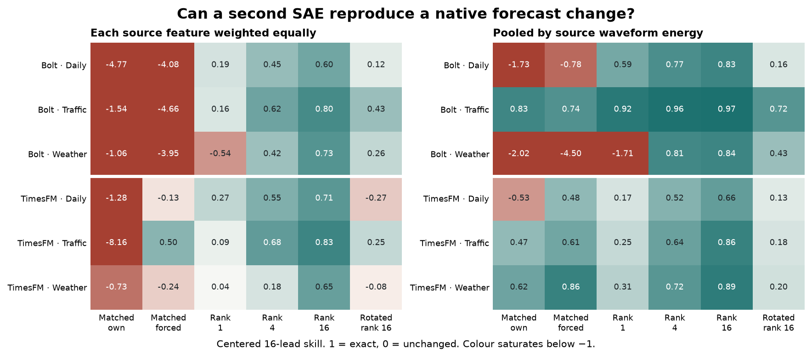

# Can a second dictionary reproduce an original feature’s forecast effect in Chronos-Bolt and TimesFM?

We held the native forecasting model fixed, changed only the trained SAE, and attempted to reproduce the measured forecast change from deleting a naturally firing source feature. A target atom matched by activation correlation and a signed group selected by decoder geometry test different claims about feature correspondence. Both use the same intact model and the same middle-block location. [Prospective protocol](PROTOCOL.md) · [Related MOMENT weather experiment](../../moment/dictionary_transfer/weather/README.md)

## How well did each intervention transfer?

A fixed group of receiving decoder vectors reproduced part of the natural donor's forecast change on both native models. On the primary M4 daily panel, Chronos-Bolt rank-16 skill was .603 across donor features (.831 pooled by reference energy), while the naturally matched single scored −4.770 (−1.729 pooled). TimesFM’s corresponding scores were .709 (.664 pooled) and −1.275 (−.534 pooled). Rank-16 groups outperformed norm-matched globally rotated and refitted groups on both daily panels, with crossed item/feature intervals above zero. Neither fit used a forecast response to select its axes or coefficients.

Each cell below is **equal-feature / pooled-energy** skill for the centered 16-lead finite forecast change. A score of 1 reproduces the reference waveform, 0 is an unchanged forecast, and a negative score increases squared error. Pooling weights high-energy feature/history events more, whereas equal-feature scores first calculate skill within each eligible donor. Both include target gates that stayed closed on a source firing.

| Model, panel | Matched own | Forced norm | Signed rank 1 | Signed rank 4 | Signed rank 16 | Rotated, refit 16 |
|---|---:|---:|---:|---:|---:|---:|
| Bolt, M4 daily | -4.770 / -1.729 | -4.083 / −.778 | .186 / .590 | .453 / .773 | .603 / .831 | .125 / .160 |
| Bolt, traffic | -1.539 / .825 | -4.662 / .744 | .160 / .919 | .622 / .961 | .796 / .973 | .433 / .721 |
| Bolt, weather | -1.060 / -2.017 | -3.953 / -4.497 | −.540 / -1.706 | .416 / .810 | .731 / .835 | .260 / .432 |
| TimesFM, M4 daily | -1.275 / −.534 | −.134 / .476 | .266 / .174 | .545 / .518 | .709 / .664 | −.272 / .131 |
| TimesFM, traffic | -8.158 / .465 | .501 / .605 | .091 / .247 | .677 / .639 | .831 / .855 | .250 / .176 |
| TimesFM, weather | −.729 / .623 | −.243 / .859 | .039 / .308 | .179 / .718 | .654 / .894 | −.085 / .196 |

Both lead bands were held out from the geometry fits. Their waveforms are centered *within each eight-lead block*. A donor entered the primary mean only when it naturally fired on at least eight distinct series or stations. The crossed intervals below resample those series/station blocks and eligible donor features in 3,000 paired draws. High geographic or cross-series correlation, shared four weather origins and limited feature coverage constrain extrapolation. Reference RMS, conditional source fires, physical units, ordinary/edited replay noise, full-waveform skills and case-block intervals are in the result archives. The physical panels were fixed before matching.

| Model, panel | Eligible donors | Eligible / total fires | Matched pair cofires | Covered series / stations | Rank 16 early 8 | Rank 16 late 8 | Rank 16 minus rotated, crossed 95% interval |
|---|---:|---:|---:|---:|---:|---:|---|
| Bolt, M4 daily | 15 | 360 / 367 | 276 | 119 / 128 | .568 | .494 | .479 [.223, .790] |
| Bolt, traffic | 6 | 242 / 247 | 143 | 112 / 128 | .791 | .622 | .363 [.106, .603] |
| Bolt, weather | 7 | 264 / 279 | 147 | 46 / 46 | .553 | .507 | .471 [.109, .828] |
| TimesFM, M4 daily | 15 | 455 / 458 | 366 | 128 / 128 | .692 | .637 | .981 [.542, 1.579] |
| TimesFM, traffic | 2 | 142 / 142 | 142 | 128 / 128 | .859 | .511 | .581 [.411, .699] |
| TimesFM, weather | 3 | 271 / 277 | 256 | 46 / 46 | .672 | .805 | .739 [.620, .967] |

Results by cohort are available for [Bolt daily](results/bolt_daily.json), [Bolt traffic](results/bolt_monash_traffic.json), [Bolt weather](results/bolt_noaa.json), [TimesFM daily](results/timesfm_daily.json), [TimesFM traffic](results/timesfm_monash_traffic.json) and [TimesFM weather](results/timesfm_noaa.json).

## What was shared across the comparisons?

For each backbone the original archived TopK-32 SAE supplied its 16 M4-training-selected donor features. The recipient was the independent seed-1 TopK-32 SAE fitted on the same development activation distribution, with dictionary width 6,144. The seed-1 files record 34,515 development activation rows and 720 optimizer steps. The archived SAE fit used development states; the distinct 1,024 M4 series selected donor atoms and provided the natural last-window correlations. The forecast checkpoint, receiving history and 16-lead native median head remain identical across both dictionaries. [Refit provenance](../../boundary/replica.py) · [Original donor choices](../../replication/experiment.py)

All 128 M4 daily and 128 Monash traffic items were previously held out from the 1,024 matching items and reused from the historical forecasting study. Traffic consists of related traffic series and intervals here resample series. The weather extension used the same 46 stations and four fixed 2026 dates as the MOMENT study. It conditions on those dates, resampling stations with their origins kept together. All tests reused prior panel identities and archived true natural donor interventions. The particular pairwise matches, signed groups, global rotation and resulting receiving forecasts were generated for this comparison. [M4 and traffic sampling](../blind_frequency/data.py) · [Weather context and raw-unit provenance](../support_confirmation/noaa/README.md)

Bolt uses the joint final two 16-step tokens after encoder block 3. TimesFM uses its final 32-step token after block 10. Both SAEs encode the pooled final-window state. On a source firing we subtract its coefficient times its decoder from every covered token, then read the native forecast. The literal match subtracts the matched receiving feature at its own coefficient, including zero when it does not fire. The forced single uses the same receiving decoder at the exact donor hidden norm. The fixed groups use signed least-squares coefficients and the original donor dose. Each group can use inactive receiving features, and the rank-one group can reverse a target decoder’s sign or reduce its norm. This rank-one arm is a fitted geometric projection. [Finite physical intervention code](study.py)

The candidate pool contained 426 Bolt and 112 TimesFM receiver features that fired on at least eight of 1,024 historical comparisons. Median train Pearson correlation of the 16 frozen matches was .502 and .682; corresponding signed decoder cosine was .127 and .609. For Bolt the median fraction of donor squared hidden norm explained by groups of rank 1, 4 and 16 was .079, .209, .441. For TimesFM it was .393, .580, .690. The rotation control applies one fixed orthogonal transformation to all eligible receiving decoders, preserving their internal pairwise geometry. It then refits the same rank-16 pursuit to the donor and matches the original rank-16 intervention norm separately for each feature. Median hidden reconstruction skill after this rescaling was .089 for Bolt and −.330 for TimesFM. These medians describe all original donor candidates, regardless of later firing. [Bolt matched directions and fit metadata](results/bolt_fit.npz) · [TimesFM matched directions and fit metadata](results/timesfm_fit.npz)

## Scope of the replication

The daily improvements from the matched-dose single to the fixed group were +4.686 in Bolt (crossed 95% interval [1.296, 12.117]) and +.843 in TimesFM ([.223, 4.021]). On TimesFM weather the estimate was +.897 across just three eligible source features. Its station interval was [.592, 1.381] and its crossed interval [−.059, 2.671]. Just two candidates fired often enough on TimesFM traffic. These restricted means do not estimate how a typical feature in the full SAE behaves.

The activated receiving single could capture most of a high-energy response in some panels, and direct matching also worked on specific features. A single direction or a 16-dimensional group is a signed hidden intervention, while a feature label or a scalar correlation alone leaves both the forecast-relevant direction and the applied dose uncertain. The rotation controls show that the actual orientation of these finite decoder groups matters beyond the dictionary’s internal geometry and applied norm. The study used one donor and one independent recipient SAE per frozen backbone. It establishes cross-dictionary substitution within each backbone. Between-backbone feature identity needs its own evidence.

## Two Bolt features illustrate the range

A forced single can win for some objectives. On TimesFM daily, the early eight leads pooled by donor response energy scored .773 for the equal-norm single and .598 for the 16-axis group, while equal-feature scores were .055 and .692. The later eight pooled scores were −.461 and .622. The aggregation rule and forecast interval matter. [TimesFM daily outcomes](results/timesfm_daily.json)

The most negative equal-norm correlation match on the primary daily panel was donor 4869 → receiver 3873. They co-fired in 18 of 19 source events. Their training-code correlation was .467, but decoder cosine was −.004. The matched single gave centered H16 skill −26.92 at its own dose and −43.74 at donor norm. The fixed rank-16 group gave .371. Its donor waveform’s centered RMS was .00160 in the archive's standardized input units, compared with a maximum donor replay discrepancy of .00000120 across the 12 prespecified real-model checks on this panel.

Donor 5876 → receiver 3875 had training correlation .925 and decoder cosine .911. The natural matched feature captured its forecast change with skill .598, equalizing the hidden norm yielded .727, and the rank-16 group scored .968. This pair had the highest historical activation correlation among the 15 eligible donors. The examples illustrate heterogeneity; the statistics across all eligible donors are primary. [All individual Bolt daily scores and pair geometry](results/bolt_daily.json)

## Verification

An independent implementation recaptured native singleton token states, rebuilt each signed group from its selected indices and least-squares coefficients, regenerated the rotation and issued real full-model additive interventions. Across six model/domain panels and 161 independently checked H16 forecast changes, the maximum discrepancy was .00000215 history SD. The two primary daily panels were also replayed from isolated copies of source and archived effects. The unit suite had three passing tests, and each of three isolated planted regressions was caught. [Bolt daily native checks](results/bolt_daily_replay.json) · [TimesFM daily native checks](results/timesfm_daily_replay.json) · [Control verification](MUTATION_CHECK.md)

## Reproduction

    PYTHON=python bash research/activation_transfer/shape_transfer/cross_seed_groups/reproduce.sh \
      /tmp/tsfm-cross-seed-groups-new /tmp/tsfm-cross-seed-groups-results

The runner uses the cached historical training and test inputs described above, the original saved SAEs and the independently fitted seed-1 dictionaries. It checks archived source responses against actual finite interventions before scoring and stores an effect for every method and firing. [Reproduction script](reproduce.sh) · [Scoring](score.py) · [Native singleton replay](audit.py) · [Isolated replay](replay_isolated.sh) · [Tests and planted failures](MUTATION_CHECK.md)
