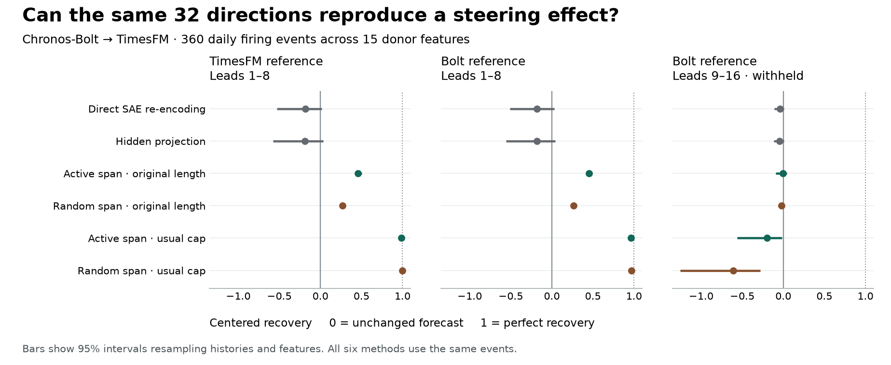

# Do the same active directions lack capacity, or did the SAE choose poor coefficients?

The unmodified TimesFM SAE missed the centered response of an already successful dense controller on 360 daily writes without a single change of active feature IDs. Freeze a test that holds the actual 32 active receiver decoder rows fixed. Obtain an orthonormal basis of that specific span, predict the original dense write's eight early changes with the ordinary recipient Jacobian, and solve the same balanced damped inverse inside this span. Score the resulting physical edit against the observed dense target and separately the actual donor. No actual edited waveform is supplied. Test a cap equal to the dense write's actual length and the original full receiver cap. Include an equally sized fixed isotropic subspace given the same information, budgets and optimization, and the archived Euclidean projection and hard re-encoding. The signed decoder mixture is an intervention in the span of clean active rows. It need not equal a new natural code or preserve the receiving encoder's support after the edit.

Primary endpoint: early centered recovery of the actual dense receiver on the blind daily Bolt → TimesFM cohort. The reverse direction, hourly traffic and the next eight leads are secondary. The comparison is a diagnostic motivated by the earlier results on these panels. A positive result would distinguish poor direct re-encoding from insufficient behavioral capacity of the same 32 axes under the stated budget. The isotropic comparator distinguishes any benefit specific to the target SAE axes from generic low-dimensional output control.

For a local feasibility bound, compute the pseudoinverse solution for *exactly* the known dense write's eight linearized changes in the same active span. Also compute the minimum-norm vector matching only the seven centered components, and the best achievable centered squared error under the original write length (quadratic trust-region problem). These are mathematical statements about the ordinary-state linearization and the given span. They exclude finite-dose nonlinear effects and say nothing about a different checkpoint or support. The bound permits any signed decoder mixture and, for the centered-only endpoint, any change in mean forecast level.

## Results

The same 32 directions could produce a much better early response when their coefficients were chosen for the forecast. On daily Bolt → TimesFM, direct hard re-encoding scored −.184 against the recipient’s original dense effect. Euclidean projection onto the active span scored −.189. Using the ordinary output derivative inside that span scored **.458 at the original hidden length** and **.986 under the usual recipient cap**. All three span procedures used the same basis for a given history. The difference is what they optimized and how much hidden displacement they could use.

| Donor and domain | Hard re-encoding | Hidden projection | Fit within active span, same length / full cap | Fit within random span, same length / full cap |
|---|---:|---:|---:|---:|
| Bolt, daily | −.184 | −.189 | .458 / .986 | .271 / .996 |
| Bolt, traffic | −1.917 | .356 | .477 / .997 | .282 / 1.000 |
| TimesFM, daily | .349 | .262 | .709 / .904 | .443 / .773 |
| TimesFM, traffic | .652 | .507 | .757 / .824 | .403 / .483 |



The table compares to the actual dense recipient intervention. Against the *original donor*, unrestricted-within-cap active-span writes reached .963/.989 for Bolt daily/traffic and .789/.677 for TimesFM daily/traffic. On the originally undisclosed leads 9–16, the corresponding scores were −.197/−.166 and −.184/.085. Only two TimesFM donor features qualified on traffic. The Bolt-donor daily active-span fit used a median 3.32 times the direct dense write length under the full cap; a fixed rank-32 isotropic span achieved .996 using 6.78 times the direct length. The active directions could be more efficient under a tight length constraint, while generic directions were also effective when more length was available. These interventions solve for signed mixtures, so no unique receiving feature correspondence follows. [All early and late outcomes, information-matched controls and uncertainty](results/span_inverse.json)

A calculation using only the recipient's ordinary derivative gave a more precise limit. To reproduce the exact seven centered components inside the 32 active directions required a median 3.74 times the original dense length in daily TimesFM and 2.69 times in daily Bolt. Only 5/360 and 2/455 events could reproduce the entire centered response at the original length in this local linear model. The upper bounds on equal-feature centered recovery at that length, with arbitrary mean level and an optimal constrained solution, were .750 and .813. These limits apply to the ordinary linearization. The physical results above include finite-dose curvature and balance level as well as shape. [Per-domain capacity and rank](results/capacity.json) · [Constrained least-squares bound](capacity.py)

There is a geometric reason the length matters. The original dense write is a weighted ridge solution in the span of the eight receiving forecast derivatives. For its own achieved response, it is already the shortest hidden write in the local linear model. Every other write giving all eight identical changes adds a vector invisible to the eight derivatives. That added vector is perpendicular to the original write, so it increases the required length. Across all four domain/direction cells, the numerical check found at most 3.28 × 10⁻⁸ of the dense length outside the eight-derivative span. Permitting an arbitrary change in mean level relaxes this constraint, as the seven-component calculation shows. Measuring short-budget performance therefore tests how efficiently the decoder directions cover the forecast-sensitive space.

An independent audit reconstructed 48 physical writes across both domains and both recipients. It rebuilt the active axes by QR in feature-ID order, solved the primal ridge equation and patched singleton forecasts. Its largest discrepancy across the 16 forecast leads was 1.20 × 10⁻⁶ in standardized forecast units. [Independent audit code](audit_span.py) · [Per-intervention discrepancies](results/span_audit.json)

## Does a different span on every history give an automatic advantage?

The original active subspace varies with the history, whereas the original random subspace was fixed. Before evaluation, we fixed four global signed permutations of the native TimesFM hidden coordinates, using seeds 2301 through 2304. Each permutation preserves every active feature ID, decoder row norm and pairwise decoder angle, and transforms every history's span by the same isometry. We also drew four fresh fixed Gaussian rank-32 subspaces with the same seeds. Every arm used the same early forecast derivative, ridge penalty rule, receiver cap and 360 eligible daily Bolt-donor firing events. We measured actual forecast changes at both displacement budgets. The primary comparison is original-length early centered shape against the dense receiver. Late donor effects and the length used were secondary outcomes. This diagnostic reuses the primary cohort.


At the original displacement, the native active span scored .458. The four globally transformed, history-dependent spans scored .243–.298. The four fresh fixed random spans scored .244–.289. Averaging over the four fixed seeds, the native advantage was .194 [.157, .241] over the history-dependent controls and .188 [.152, .233] over the fixed controls. The intervals jointly resample histories and features, conditional on the four transformations tested. Preserving the history's feature selection and all decoder angles did not preserve the advantage. Its orientation relative to the receiving forecaster mattered.

Under the usual cap the eight controls scored .994–.997 on early dense recovery. The median length they used was 5.91–7.76 times the original, versus 3.32 for the native span. Every control scored below zero against the actual late Bolt effect under that cap (−.675 to −.223). An independent implementation permuted the raw decoder rows before taking their QR basis and repeated 48 single-series forecast interventions across all four seeds. The largest discrepancy was 2.39 × 10⁻⁶ in forecast units. A trained dictionary can save intervention length at the observed leads while providing little evidence of a common underlying feature. [Four seeds and paired intervals](results/span_controls.json) · [Geometry-preserving control implementation](span_controls.py) · [Independent control audit](results/span_control_audit.json)

## Does the receiving SAE have to select the right history?

The rotated dictionaries distinguish native from scrambled orientation, but leave open whether the receiving history's selection matters. Before looking at this endpoint, fix four random one-cycle reassignments of the 128 daily histories (seeds 2301–2304). For every source firing on a given history, use the 32 active axes of its assigned, different TimesFM history. Retain the actual current history's forecast derivative, dense goal, baseline, norm limit and physical forecast. Compare same-length early recovery against the native assignment and record the number of shared active IDs. Every support occurs once across the 128 assigned histories, though their numbers of source firings differ. This comparison uses the same daily evaluation histories.


Swapping the source of the active directions across histories **preserved early recovery**. The four assignments scored .4603, .4578, .4600 and .4590, compared with .4578 for the native assignment. The paired native-minus-average difference was −.0015 [−.0069, .0031]. Each assignment preserved a median of 28 or 29 of the 32 native IDs per firing. The current history's derivative and dense goal still entered each solve. The wrong history supplied only the candidate directions. The result is consistent with recurrent receiving directions explaining much of the short-budget advantage on this cohort. The experiment leaves open what the three or four less recurrent directions do for rarer interventions or other outputs. [All four derangements and uncertainty](results/swap_support.json) · [Physical swap implementation](swap_support.py)

```bash
p=research.activation_transfer.shape_transfer.dictionary_prior.receiver_encoding
for source in bolt timesfm; do python -m "$p.span_inverse" "$source"; done
python -m "$p.span_inverse" score
python -m "$p.figure_span"
python -m "$p.capacity"
for seed in 2301 2302 2303 2304; do python -m "$p.span_controls" "$seed"; done
python -m "$p.span_controls" score
python -m "$p.swap_support"
python -m "$p.dose_margin"
python -m "$p.audit_span"
python -m "$p.audit_span" --controls
```
