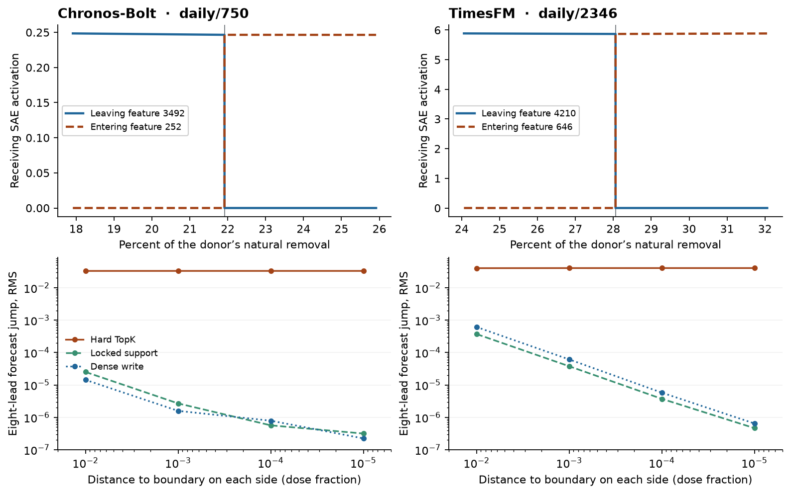

# A direct view of an activation boundary

Select the first manifest-ordered firing of a recurring seed-1 donor on the 92 strictly disjoint daily histories for which the receiver seed-2 support first changes between 5% and 90% of the true hidden dose, with one winner exchange at ±0.001 of full dose. This deliberately selects a boundary crossing, using no forecast or decoder-effect scores. The sample illustrates what a failing gate can physically do. It is not a random estimate of forecast jump size. For context, report the distribution of the first membership change across all recurring firings in this 92-item panel. A fixed TopK support with positive entries is a convex region of affine preactivations, so membership of the initial region can be located by bisection along the edit.

On both sides of the illustrated boundary compare the true dense edit, the hard endpoint re-encoding and the clean-membership re-encoding, using the same recipient hidden budget and the normal median forecast. At progressively smaller symmetric distances from the crossing, measure the two-sided hidden displacement and forecast jump. As the dense step tends to zero, a continuous encoder should make the decoded and forecast differences tend to zero. A hard TopK winner swap can instead remove and add finite coefficients along different decoder vectors. The forecast can still be insensitive to that jump.

## What happened at the first exchange?

In the strictly disjoint daily panel, 193/206 eligible Bolt seed-1 removals and 96/148 TimesFM removals crossed their second fit's original boundary before full dose. Among the crossing cases the median first exit occurred at .233 and .425 of the source removal. The two preselected examples happened at .2191 (Bolt) and .2806 (TimesFM).

At a distance of just 0.00001 of the full dose on each side of the boundary, the two actual dense edits changed Bolt's eight-lead median forecast by RMS 0.000000223 history SD. The hard decoded edits changed it by **0.0331130** SD; locked membership gave 0.000000315. TimesFM gave 0.000000645 dense, **0.0405588** hard, and 0.000000464 locked. Shrinking the approach distance by two orders of magnitude had barely changed either hard forecast jump. Finite precision limits the smallest smooth differences. These intentionally selected crossings make the role of the gate visible in the model's actual output. They do not estimate a typical jump across all source features. [Exact model, history, coefficients and forecast vectors](results/boundary_trace.json) · [Reproducible selection and physical trace](trace_boundary.py)

