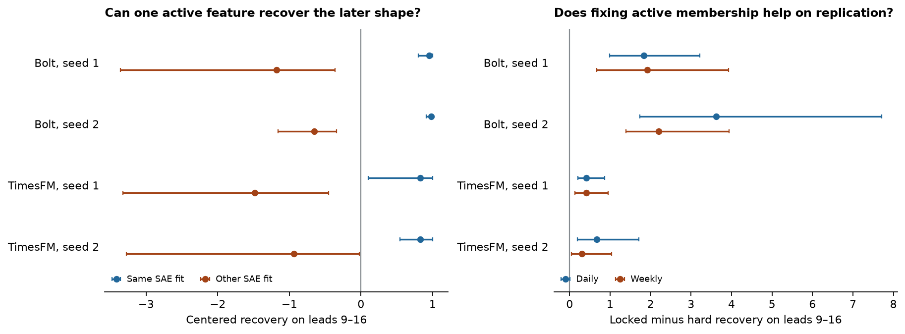

# What breaks when only the SAE changes?

**A single natural SAE feature was easy to identify within its own dictionary and a poor substitute in a second SAE trained on the same forecaster.** On 128 additional daily histories, full natural removal of the blindly selected feature scored .825 to .982 on the unseen forecast shape with the original fit. Swapping the receiver SAE pushed all four comparisons below zero, between −1.485 and −.649. The forecasting model, hidden coordinates, target site, input, original donor removal and readout were fixed. A cross-model difference in architecture is unnecessary to produce this failure. [Frozen comparison and access rules](PROTOCOL.md) · [Complete paired results](results/summary.json)

Both SAEs per backbone used the same 34,515 training activations and 720 optimizer steps. The training random seed governed initialization and minibatch order. Each seed's 16 source IDs had been selected earlier using source training data. Changing the receiver fit preserves the tested donor events. Switching the donor seed changes which features fire. Both cohorts were previously studied on different endpoints. These rankings receive the *measured nonlinear* early donor response. Named source IDs and the second eight forecast leads are hidden from the matcher. [Independent training, tensor and scoring audit](AUDIT.md)

## Identifying a single feature versus reconstructing a hidden change

Each row uses the same donor queries for every column. Values are actual centered recovery on leads 9–16, after physically applying the chosen write. The first two columns search the active 32 candidate features and choose a full removal. The third allows fractional removal and adds an early residual correction. Dense fits only the eight observed changes, starting at zero. The final two columns are privileged controls. Knowing the true hidden write in the same checkpoint, project it onto one decoder axis or the span of the 32 active axes in the alternate receiver fit, with signed unrestricted coefficients and the same final vector cap.

| Donor, additional daily | Own fit, natural | Other fit, natural | Other fit, attenuated + corrected | Dense | Other fit, best hidden axis | Other fit, active hidden span |
|---|---:|---:|---:|---:|---:|---:|
| Bolt seed 1, 318 eligible firings | .954 | −1.176 | −.157 | .338 | .065 | .588 |
| Bolt seed 2, 289 | .982 | −.649 | .127 | .372 | .225 | .359 |
| TimesFM seed 1, 222 | .829 | −1.485 | −.537 | −.073 | .302 | .398 |
| TimesFM seed 2, 305 | .825 | −.938 | −.435 | −.112 | .261 | .413 |

Correctly identifying a diagonal feature did not always yield perfect forecast recovery across an entire cohort: cap decisions and a few misidentified features matter. The original 192 daily series replicated the contrast, with diagonal natural scores .977–.996 and off-diagonal scores −1.489 to −.498. Across all eight comparisons the 95% intervals for the paired natural-recovery drop excluded zero when resampling both features and histories. Yet the corrected alternate-dictionary writes scored .951–.994 on the *supplied* early shape on the additional cohort. The loss of continuation is particularly easy to overlook when evaluating only those leads. [Physical writes](run.py) · [Matched interval computation](score.py)

Active decoder spans held some of the hidden change. A control projected the same donor vector onto a different daily history's 32 active axes, the first 32 clean-state PCs learned from 1,024 training series, or a fixed isotropic 32-dimensional space. Across the four rows above the active span scored .359–.588 versus .181–.490 for a different history’s support, .356–.687 for PCA and −.025 to .124 for isotropic projection. PCA outscored the active SAE span in three of four rows. Thus history-specific active features supply informative directions without a general advantage over equally sized dense subspaces. [Dimension-matched controls](SPAN_CONTROLS.md) · [Per-seed scores and paired intervals](results/span_summary.json)

## What does the TopK boundary itself do?

We gave the second fit the exact original donor displacement and clean hidden state. One arm re-encoded both endpoints using its true TopK operation and decoded the difference. Another held the *set of active IDs* fixed at the clean state, allowing their positive coefficients to change. We physically patched each resulting displacement into the original state, leaving its reconstruction error intact. A third arm used the repository’s continuous shoulder at the rank boundary, with the same decoder weights. Both the hard and the locked arms still have access to the true dense intervention here. This isolates the cost of how each trained dictionary represents that intervention.

| Additional daily donor | Full-dose events changing active set | Hard | Locked membership | Continuous shoulder | Hard after matching true hidden length | Locked after matching true hidden length |
|---|---:|---:|---:|---:|---:|---:|
| Bolt seed 1 | 302/318 | −2.499 | .477 | .121 | −.443 | .262 |
| Bolt seed 2 | 274/289 | −2.329 | .208 | .032 | −.681 | −.122 |
| TimesFM seed 1 | 145/222 | −.254 | .259 | .084 | −.358 | −.405 |
| TimesFM seed 2 | 235/305 | −.391 | .244 | .076 | −.648 | −.772 |

All columns score later forecast shape. In Bolt, hard re-encoding typically produced a write about 1.4 times the true length and a worse angle. Equalizing lengths helped substantially but did not close the deficit. In TimesFM the locked vectors were shorter than the source. Under a forced equal-length intervention their advantage over hard disappeared. This is evidence for a role of dose in TimesFM's gain at native lengths. Shrinking the input displacement to one eighth caused fewer discrete switches, yet scaling that decoded displacement back up made Bolt's predictions markedly worse. A newly entering atom can contribute a finite decoded jump even for a small input step. Locked decoding remains an approximation because the encoder and decoder are not inverses on every direction. [Full-dose and one-eighth interventions](results/encoding.json) · [Length and cosine controls](results/normgate_summary.json) · [Independent direct TopK reconstruction](AUDIT.md)

A direct trace makes this discontinuity visible. At a preselected Bolt rank crossing, hidden states only 0.00002 of a natural removal apart gave an eight-lead forecast difference of 0.000000223 SD through the dense model. Re-encoding the two states with hard TopK and physically applying their decoded changes gave **0.033113 SD**. The same geometry-only selection in TimesFM gave 0.000000645 versus **0.040559 SD**. A continuous change in the underlying model can look like an abrupt causal change once the sparse decomposition is imposed. [Two real forecast traces and their selection rule](BOUNDARY_EXAMPLE.md)

## Prospective daily and weekly gate replication

We froze the same six hard, fixed-membership and shoulder interventions at native and equalized lengths before collecting the next forecasts. The fixed sampling procedure returned 96 daily histories and the 62 weekly histories eligible after the specified earlier weekly benchmark and pair exclusions. All point estimates for **locked minus hard** on unseen late shape were positive. Seven of eight cleared a one-sided Bonferroni adjustment across both checkpoints, seeds and frequencies, resampling both features and histories.

| Receiver and donor SAE seed | Daily hard → locked | Daily simultaneous lower bound on gain | Weekly hard → locked | Weekly simultaneous lower bound on gain |
|---|---:|---:|---:|---:|
| Bolt seed 1 | −1.465 → .372 | +.789 | −1.310 → .608 | +.471 |
| Bolt seed 2 | −3.343 → .273 | +1.384 | −2.027 → .178 | +1.130 |
| TimesFM seed 1 | −.045 → .362 | +.142 | −.023 → .392 | +.041 |
| TimesFM seed 2 | −.331 → .340 | +.104 | −.030 → .269 | −.047 |

The weekly cells include only 3–8 recurring source features. A separate audit identified four daily items in an earlier benchmarking panel and all 62 weekly items in other earlier project studies. Restricting the daily data to the 92 identities absent from every audited earlier panel preserved the improvement for both seeds of both models. Their adjusted lower bounds were +.811, +1.393, +.150 and +.104 in table order. **The weekly result tests a new intervention and sampling frequency on previously studied identities.** The complete frozen panel was retained and the stricter subset is reported separately. [Prospective confirmation and sampling rules](CONFIRMATION.md) · [All eight paired comparisons](results/confirmation.json) · [92-series sensitivity](results/confirmation_disjoint.json) · [Named membership audit](results/confirm_overlap.json)

The gain also appeared when pooling forecast energy across all firing events: it was positive in every confirmation cell, ranging from .240 to 2.075. Leaving any one source feature out preserved the sign in all eight cells. On one TimesFM daily seed only seven of nine individual features improved, and some interventions worsened in every cell. This bounds how broadly the group result can be applied. [Event-level wins, higher-amplitude donor features and leave-one-out checks](results/confirmation_sensitivity.json) · [Independent reconstruction of raw items, physical forecasts and all eight primary intervals](CONFIRM_AUDIT.md)



## Reproduce

Use the pinned offline environment in the parent reproduction guide. Build the two independent boundary-study SAE checkpoints, the per-seed donor-removal archives and the clean states/ordinary middle-layer derivatives before this study. The newly selected histories are frozen in the confirmation manifest. Paths and hashes for the previous data and weights are recorded in the earlier protocols. [Parent reproduction guide](../../REPRODUCE_NOV21.md) · [Two SAE fits and their actual training samples](../../../boundary/SEEDS.md)

```bash
p=research.activation_transfer.shape_transfer.dictionary_prior.refit
for m in bolt timesfm; do
  for donor in 1 2; do
    for receiver in 1 2; do python -m "$p.run" "$m" "$donor" "$receiver"; done
    python -m "$p.encoding" "$m" "$donor"
    python -m "$p.encoding" "$m" "$donor" --compare-norms
    python -m "$p.span_controls" "$m" "$donor"
  done
done
python -m "$p.score"
python -m "$p.score_encoding"
for c in span normgate; do python -m "$p.score_controls" "$c"; done
python -m "$p.confirmation" data
for m in bolt timesfm; do
  python -m "$p.confirmation" capture "$m"
  for s in 1 2; do python -m "$p.confirmation" run "$m" --seed "$s"; done
done
python -m "$p.score_confirmation"
python -m "$p.score_confirmation" --strictly-disjoint
python -m "$p.sensitivity"
python -m "$p.trace_boundary"
python -m "$p.plot_trace"
python -m "$p.figure"
```
