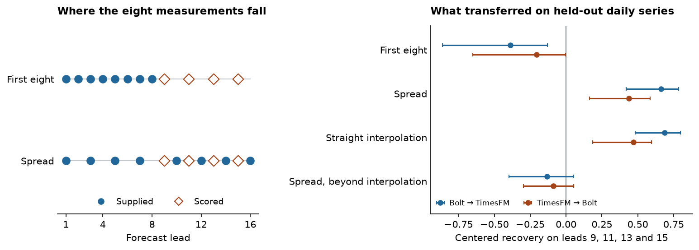

# Which eight forecast leads are worth measuring?

Moving eight measurement points across a sixteen-step horizon substantially improved physical steering on four common, unmeasured daily leads. The same change bought little ability to forecast the next sixteen steps. Both models' own horizon smoothness explained much of the apparent gain between the measurement points. [Prospective design and retrospective curvature test](PROTOCOL.md)

We measured each natural donor SAE removal over 32 leads and reserved it for evaluation. The controller received ordinary-state donor and recipient derivatives for exactly eight coordinates. It used the same local inverse and hidden-state budget as the earlier first-eight test. The three options measured the first eight consecutive leads, the spread set 1/3/5/7/10/12/14/16, or eight leads selected using donor-only calibration gradients from 96 disjoint histories. Of 495 eligible subsets, cross-validation independently chose 2/3/5/8/10/12/14/16 for each checkpoint. All three methods were scored at the same unmeasured coordinates 9/11/13/15 on 128 daily series and 128 hourly traffic sensors. This fixes the number of gradient rows. Actual inference costs depend on the forecaster and which outputs can be computed together. [Real model driver and budget selection](run.py)

| Donor → receiver, evaluation domain | First eight | Spread | Calibration-selected | Straight interpolation of spread donor estimates | Spread improvement over first, 95% interval over histories and features |
|---|---:|---:|---:|---:|---:|
| Bolt → TimesFM, daily | −.390 | .663 | .669 | .686 | +1.053 [.751, 1.502] |
| TimesFM → Bolt, daily | −.207 | .438 | .473 | .471 | +.645 [.433, .999] |
| Bolt → TimesFM, traffic | −.095 | .418 | .587 | .543 | +.514 [.051, .884] |
| TimesFM → Bolt, traffic | .245 | .515 | .537 | .526 | +.271 [−.322, .791] |

Scores are centered recovery of the actual donor removal on those four leads. The interpolation baseline only sees the same current donor derivative values as the physical method. On daily data, spreading the physical constraints reduced first-eight shape recovery from .972 to .874 into TimesFM and .902 to .809 into Bolt. It improved overall sixteen-step shape recovery from .281 to .921 and .611 to .825. Beyond lead 16 both daily spread writes were worse than no action (−.137 and −.053); regressions fitted on historical donor derivatives gave .237 and .130. Results differed on traffic, with spread physical late scores of .302 into TimesFM and −.507 into Bolt. The latter direction has just two eligible features. [All domain comparisons and intervals](results/summary.json)

We then removed from each waveform the straight-line interpolation of its own supplied anchors. This tests the fine shape at the unmeasured leads while removing the influence of errors at those anchors. On the same daily spread arm, centered deviation recovery fell to −.133 into TimesFM and −.088 into Bolt. The historical donor-only regressor scored .148 and .060. For Bolt donors the deviation was 27% of the original centered audit RMS and for TimesFM donors 48%, so this residual had measurable magnitude. A zero-deviation response scores zero. This follow-up was specified after observing the initial interpolation scores. Local measurements can support interpolation; predicting the source’s fine structure and its future continuation calls for additional information. [Residual computation](residual.py) · [Scores with cubic and historical competitors](results/residual.json)
