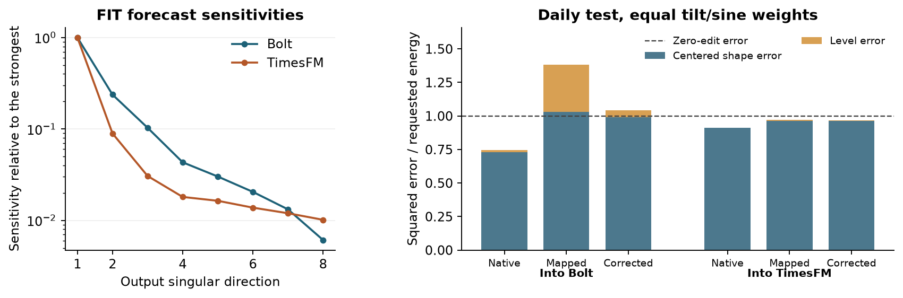

# Does removing a common forecast shift recover the requested shape?

Removing a predicted mean shift from a mapped hidden edit made it less disruptive, but did little to recover the requested forecast tilt or sinusoid at these sites. The reason differed by direction. **Into Bolt**, the mapped edits introduced a substantial wrong level shift. Canceling that shift removed most of their excess error, while the corrected waveforms still scored worse than making no edit. **Into TimesFM**, the mapped edits already pointed partly along the requested shapes. Their signed gains were only 1–3% of the requested change, and level cancellation scarcely increased skill. [Prospective protocol](PROTOCOL.md) · [Per-series effects and exact results](results/scores.json)



## Where the recipient is sensitive

| FIT geometry in 24 clean hidden PCs | Bolt | TimesFM |
|---|---:|---:|
| Constant-level fraction of total eight-lead response energy | 93.33% | 99.01% |
| Absolute cosine of dominant pooled output axis with a constant lift | .99950 | .99997 |
| Fraction of DC gradient energy retained by its mean across histories | 52.57% | 97.35% |
| Fraction of centered shape energy retained by its mean across histories | 44.19% | 12.68% |
| First three singular values of the mean Jacobian, forecast units / hidden unit | .02195, .00458, .00233 | .22361, .00654, .00165 |
| First three singular values after removing mean forecast level | .00466, .00234, .00099 | .00766, .00188, .00105 |

The first row weights all calibration histories and all probed directions; it measures how readily a hidden perturbation moves the forecast baseline. The ratios compare responses within each recipient. A common eight-lead level response leaves open how each model represents that information internally. [Bolt spectrum and hidden directions](results/bolt_geometry.json) · [TimesFM spectrum and hidden directions](results/timesfm_geometry.json)

## Did the live hidden correction recover shape?

All writes below use the same L2 budget as the corresponding recipient-native direction. “Native” denotes the receiving model’s independently fitted direction for the desired output. Errors are divided by requested energy. A shape error of one is the error of leaving the requested waveform entirely unrecovered. Horizon-centered cosine gives directional agreement without requiring matching amplitude.

| Recipient | Test | Cue | Native skill | Mapped → corrected skill | Level error, mapped → corrected | Shape error, mapped → corrected | Centered cosine, mapped → corrected |
|---|---|---|---:|---:|---:|---:|---:|
| Bolt | Daily | Tilt | .284 | −.420 → −.051 | .363 → .049 | 1.057 → 1.002 | −.413 → −.060 |
| Bolt | Daily | Sine | .224 | −.346 → −.035 | .345 → .057 | 1.001 → .978 | .053 → .169 |
| Bolt | Weekly | Tilt | .313 | −.411 → −.134 | .337 → .095 | 1.074 → 1.039 | −.327 → −.179 |
| Bolt | Weekly | Sine | .245 | −.371 → −.130 | .343 → .118 | 1.028 → 1.012 | −.098 → −.052 |
| TimesFM | Daily | Tilt | .114 | .039 → .045 | .014 → .005 | .947 → .951 | .666 → .627 |
| TimesFM | Daily | Sine | .059 | .017 → .021 | .004 → .002 | .979 → .977 | .419 → .444 |
| TimesFM | Weekly | Tilt | .103 | .044 → .048 | .017 → .007 | .938 → .945 | .585 → .547 |
| TimesFM | Weekly | Sine | .059 | .012 → .012 | .005 → .007 | .983 → .981 | .314 → .338 |

From TimesFM into Bolt, averaged across tilt and sine, the change in daily skill was **+.340 [.277, .406]**. Reduced level error contributed .301 of that gain and reduced shape error .039. Weekly skill rose +.259 [.172, .349], of which .234 came from level error. The corrected daily requested gains were .000 and .013, compared with .172 and .140 for recipient-native writes. The wrong level was a measurable nuisance. Its removal still left little of either requested waveform.

From Bolt into TimesFM, daily skill rose **+.00458 [.00340, .00588]** on average and weekly rose +.00182 [.00055, .00307]. On daily data, signed gains for mapped tilt and sine were .028 and .011, versus .062 and .032 natively. Corrected gains were .026 and .012. There is detectable direction agreement in this receiver alongside weak amplitude, including weak amplitude of the native comparator itself. For both domains the average centered error actually rose slightly after the correction, by .00145 daily and .00237 weekly. [Full uncertainty by direction, domain and cue](results/scores.json)

On the independent 64-history FIT probe, the mapped tilt/sine predicted mean shifts of +.02470/−.02832 SD into Bolt and −.00545/−.00225 SD into TimesFM. The pre-rescaling minimum corrections occupied 47.6%/54.5% and 4.6%/2.6% of the respective write norms. The mean offset canceled numerically in the fitted linear response. The actual held-out output can retain a shift because the write is finite and the same fixed direction is used on every series. The FIT centered responses of the original mapped writes had mean per-history cosine −.209/−.045 with native tilt/sine in Bolt and .456/.321 in TimesFM. These differences were visible before scoring the new interventions.

## How much of the common lift is direction-specific?

| Recipient | Test | Native lift skill | Clean-mapped | Eight sign-oriented random directions, mean skill | Mapped minus random, 95% interval |
|---|---|---:|---:|---:|---:|
| Bolt | Daily | .791 | .815 | .183 | +.632 [.590, .670] |
| Bolt | Weekly | .778 | .776 | .085 | +.691 [.640, .738] |
| TimesFM | Daily | .994 | .684 | .310 | +.373 [.367, .380] |
| TimesFM | Weekly | .979 | .631 | .271 | +.359 [.350, .368] |

The randomized directions already benefited from the correct target-side sign and the recipient-native lift norm. Their positive average confirms that a generic upward response is available in this subspace. The mapped source direction carried additional signal relative to those controls. Individual random controls varied, including daily lift skill from −.14 to .56 in Bolt and .00 to .66 in TimesFM. The paired intervals condition on the eight fixed draws. Once every direction received a separately fitted scalar capped at the same budget, the daily mapped and random lift skills were .822/.206 into Bolt and remained .684/.310 into TimesFM. For both shape requests into Bolt, this optional scalar reduced mapped or corrected skill to roughly zero or below, often by making a very small write. All TimesFM arm scalars reached the upper bound. [Raw calibration values and live dose responses](results/scores.json)

## What the intervention tests

We reused the original fit for eight-lead requests with RMS 0.05 in clean-history standard deviations. Each model had 640 paired clean daily histories for its map, a disjoint 64 daily histories for fitting native forecast directions, 32 for optional scalar dose calibration and 128 daily plus 128 weekly for evaluation. Each history contained 192 observations. We used the input to a middle transformer block at the last functional token, a registration token in Chronos-Bolt-small and a data patch in TimesFM 2.5-200M. These cohorts were evaluated previously for other intervention arms. [Design frozen before the corrected effects](PROTOCOL.md) · [Original requests and data selection](../../forecast_requests/PROTOCOL.md)

The recipient’s local Jacobian measures the symmetric forecast response to a probe in each of 24 orthonormal clean-state PC directions. Its shape is 64 histories × 8 leads × 24 hidden directions. We measured the signed DC sensitivity by projecting the forecast axis onto the unit constant waveform, and retained its seven-dimensional orthogonal complement as shape. The pooled energy fraction sums squared responses from every history. The common-gradient fraction compares the energy of the mean gradient across histories with the mean energy of the individual gradients.

For each requested shape, the clean-state map translated the source’s independently fitted direction. We set the mapped vector’s L2 norm to the receiving model’s native norm for that cue and measured its central-difference response directly on FIT, including its component outside the recipient’s 24-PC subspace. If `m` is the mean predicted forecast shift and `g` is the FIT mean sensitivity to forecast level, adding `−m g / ||g||²` is the shortest PC-space correction canceling that shift. We then rescaled the complete corrected vector back to the same per-cue hidden norm. This uses the target’s sensitivity to level and never the desired tilt or sine in fitting the correction. It predicts cancellation in the FIT-averaged local linear response. Our outcomes are single-sided, full nonlinear edits on new series. [Intervention and geometry code](run.py)

The target-native, mapped and corrected candidates each got exactly the same hidden L2 norm in the primary comparison. For lift, we compared the mapped direction with eight random directions sampled in the same recipient PC subspace, with eight fixed draws and equal native lift norm. The recipient FIT gradient supplies the sign that should move the average forecast upward. Each random direction was applied and scored individually before averaging. A secondary comparison allows every candidate one nonnegative scalar from the 32 CAL histories, at most one, then executes the scaled write again. All writes stay within the original per-cue budget. Scalars can differ between arms. We retain the raw observed no-op replay deviation and use exactly zero movement to score a mathematically zero write.

For a zero-mean shape, normalized squared forecast error is the sum of squared output level and squared error in the seven centered horizon degrees of freedom, both divided by requested energy. Skill is one minus this error. A zero intervention therefore has shape error one and skill zero. Even an ideal subtraction of each held-out response’s true forecast level would leave its centered error unchanged. Paired 95% intervals resample 128 histories jointly within a domain over 4,000 draws. They condition on the checkpoint, native PCs, calibration items and eight random controls. [Scoring](score.py) · [Complete held-out measures](results/scores.json)

## Reproduce and inspect the interventions

Use a Python environment with the repository's model adapters and the pinned checkpoint/data caches. Supply the original request fits from the parent experiment and two new output directories. The script rebuilds both finite-difference Jacobians, reruns all recipient interventions with one CPU thread per model and scores the resulting forecasts. [Source fit regeneration](../../forecast_requests/README.md) · [Finite-difference probes](../response/probe.py) · [Five tests and six planted regressions](MUTATION_CHECK.md)

```bash
PYTHON=python bash research/activation_transfer/shape_transfer/level_geometry/reproduce.sh \
  /tmp/tsfm-fresh-level-jac /tmp/tsfm_forecast_requests_20261120 \
  /tmp/tsfm-fresh-level-results
```

The raw archives contain the held-out series IDs, requested curves, forecast changes by intervention arm, hidden writes, per-arm doses and FIT responses. [Raw Bolt archive](results/bolt_effects.npz) · [Raw TimesFM archive](results/timesfm_effects.npz)

A separate run collected both Jacobians afresh and repeated every live intervention and bootstrap score from the archived source fits. Maximum absolute differences were zero for each measured array, geometry statistic, held-out score and interval endpoint. [Replay comparison](results/replay.json) · [Verification code](verify.py)
