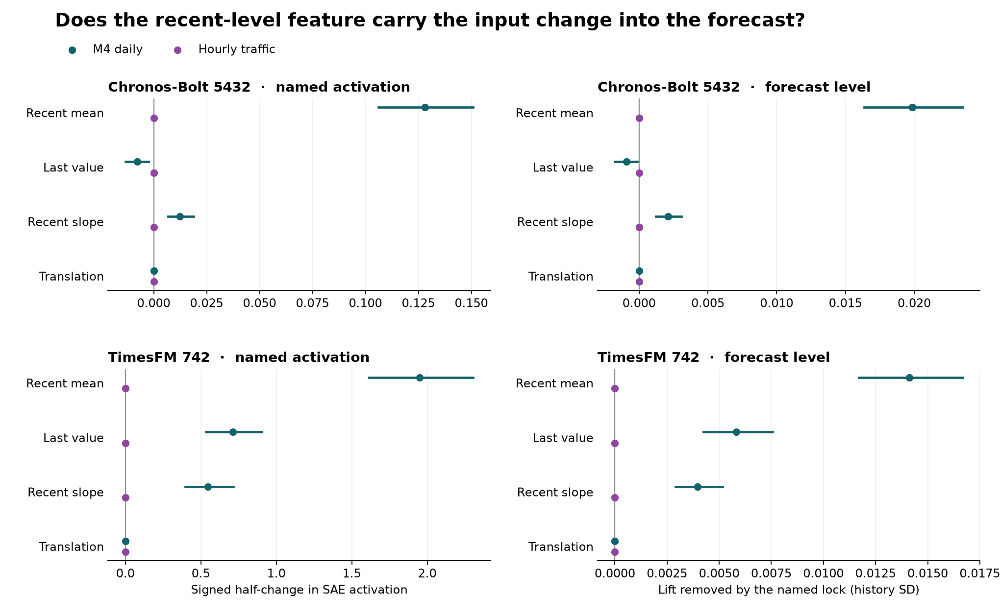

# What drives the TimesFM 742 and Chronos-Bolt 5432 feature pair?

Removing TimesFM feature 742 or Chronos-Bolt feature 5432 at each model’s natural activation previously produced similar overall forecast shifts on reserve daily series. Their clean activation correlation was .877 there. High recent window means predicted whether each feature fired, with daily AUROCs of .944 and .985. Those observations motivated two separable questions. Does changing the recent mean while fixing the last value and slope move each feature? How much of that input edit’s actual forecast response disappears if we lock the named decoder contribution to its original value? [Earlier pair ablations and readouts](../../replication/README.md) · [Protocol frozen before new outcomes](PROTOCOL.md)

**Both features respond to a higher mean in the final 32 observations when the endpoint, recent slope, global mean and variance are held fixed. Their decoder contributions carry a small, reproducible positive forecast shift on daily series.** On hourly traffic, neither feature fired on any of the 128 original or edited histories, even though the same relative-mean edits lifted the forecast. That domain has a measurable response through other computations. [Raw Bolt cases](results/bolt_effects.npz) · [Raw TimesFM cases](results/timesfm_effects.npz)

### Isolating recent mean

Code change and forecast lift below are half of the positive-minus-negative contrast. Forecasts are in clean-history standard deviations. The primary score averages the whole sampled domain, including dormant features. A positive named-lock result means the intact forecast lift fell when we held the decoder contribution at its clean value.

| Feature | Domain | Clean firings / histories | Firings, minus → plus | Mean code change | Intact forecast lift | Lift removed by named lock [95% interval] | Remaining lift |
|---|---|---:|---:|---:|---:|---:|---:|
| Bolt 5432 | M4 daily | 55 / 128 | 32 → 67 | 0.128 | 0.0108 | 0.0198 [0.0163, 0.0235] | -0.0090 |
| Bolt 5432 | Hourly traffic | 0 / 128 | 0 → 0 | 0.000 | 0.1162 | 0.0000 [0.0000, 0.0000] | 0.1162 |
| TimesFM 742 | M4 daily | 63 / 128 | 51 → 73 | 1.948 | 0.0131 | 0.0141 [0.0117, 0.0167] | -0.0010 |
| TimesFM 742 | Hourly traffic | 0 / 128 | 0 → 0 | 0.000 | 0.0639 | 0.0000 [0.0000, 0.0000] | 0.0639 |

On daily histories, the average named lock exceeded the average effect of the three matched-norm nonpartner decoder directions by +.02195 SD [.01811, .02597] for Bolt and +.00928 [.00755, .01106] for TimesFM. The intact daily lifts were themselves small relative to the ±.25 input dose. Comparing the named effect to the total as a percentage is misleading when opposing effects cancel. Locking the entire pooled SAE reconstruction removed .10789 and .06103 SD, substantially more than either intact effect. Restoring the exact clean native tokens provided the contrasting test below. [Paired intervals, individual control directions and active subgroups](results/scores.json)

Among 52 histories on which both original codes were active, the named removal of recent-mean lift averaged .03842 SD in Bolt and .02564 in TimesFM. Across all 128, the two features' activation changes had Spearman correlation .782, and the forecasts removed by their respective locks had correlation .765. Restricted to the 76 histories where either model fired on either edited sign, those correlations fell to .371 and .302. Shared zeros made the full-population correlations larger. The named correction removed .8% [.4%, 1.4%] of the horizon-centered response by signed projection in Bolt and 12.0% [6.5%, 19.6%] in TimesFM. A second encode of the physically modified hidden state gave a mean signed code half-change of +.0316 in Bolt and −.0988 in TimesFM. The lock fixes the original decoder term algebraically. The re-encoded value depends on the modified state and the native TopK competition. [Paired model statistics](results/pair.json) · [Conditional populations and re-encoding](results/scores.json)

### Endpoint, slope and translation controls on daily histories

| Feature | Input statistic | Mean code half-change | Rising / falling histories | Intact forecast lift | Lift removed by named lock |
|---|---|---:|---:|---:|---:|
| Bolt 5432 | recent | 0.1282 | 67 / 0 | 0.0108 | 0.0198 |
| Bolt 5432 | last | -0.0077 | 16 / 36 | 0.4624 | -0.0009 |
| Bolt 5432 | slope | 0.0124 | 39 / 15 | 0.0044 | 0.0021 |
| Bolt 5432 | translation | 0.0000 | 0 / 0 | 0.2500 | -0.0000 |
| TimesFM 742 | recent | 1.9479 | 73 / 0 | 0.0131 | 0.0141 |
| TimesFM 742 | last | 0.7120 | 62 / 1 | 0.4322 | 0.0058 |
| TimesFM 742 | slope | 0.5479 | 61 / 4 | 0.0035 | 0.0040 |
| TimesFM 742 | translation | 0.0000 | 0 / 0 | 0.2500 | 0.0000 |

Endpoint-only perturbations moved forecasts far more than the isolated recent-mean perturbation: .4624 SD in Bolt and .4322 SD in TimesFM. Bolt 5432's contribution was near zero there. TimesFM 742 also responded to the endpoint, although its code change was smaller despite an input dose twice as large, and its decoder lock accounted for only .00581 SD of the endpoint forecast lift. Translating the whole history by +.25 raised the ordinary forecasts by .25 while leaving the named sparse responses effectively unchanged. [All four targeted cues and actual shape responses](results/scores.json)



## Why clamping one term can remove more than the intact lift

Seeing a larger Bolt named-lock effect than its intact mean lift motivated a second, explanatory experiment on the same 128 daily histories. We split the exact clean-token restoration into three displacements. We used the named decoder correction, the other decoded corrections, and the remaining per-token difference. The last includes the SAE reconstruction residual and within-window token differences. We physically applied every one of the eight possible subsets. A term’s order-averaged effect is its incremental forecast change averaged over the six possible restoration orders. These signed contributions sum exactly to the effect of restoring the window tokens; that total can differ from the response of the intact model to the input edit. [Follow-up protocol](FACTORIAL_PROTOCOL.md) · [Physical factorial writes](factorial.py)

| Model | Named term, first → last | Named order average | Other decoded average | Residual average | Total exact-token restoration |
|---|---:|---:|---:|---:|---:|
| Chronos-Bolt | .01984 → .01963 | +.01968 | +.09165 | −.11795 | −.00662 |
| TimesFM | .01412 → .01417 | +.01413 | +.04768 | −.04872 | +.01310 |

The named contribution was positive in both models under either restoration order. The rest of the decoded displacement also produced a positive effect, while the residual displaced the forecast in the opposite direction. Their cancellation explains how a reproducible positive decoder term can coexist with a small intact mean change. In Bolt, restoring just these two data tokens left the separate registration-token pathway live. In TimesFM, restoring its last data token removed nearly all of the mean change for this controlled input. The component labels refer to this specified decomposition of each model's hidden state. [All subset forecasts, Bolt](results/bolt_factorial.npz) · [All subset forecasts, TimesFM](results/timesfm_factorial.npz) · [Bootstrap intervals](results/factorial.json)

## Why the pair was silent on hourly traffic

Both named features had negative preactivations on every clean traffic sensor. We then set *all three* statistics identically across daily and traffic histories. At a recent relative mean of +1.25 SD, an endpoint of +.5 and zero fitted rise, Bolt fired on 43/128 daily histories and TimesFM on 28/128. Both stayed off on all 128 traffic histories. Fifty Bolt traffic preactivations became positive but still missed the sparse cutoff. Every TimesFM traffic preactivation remained negative. Other structure in the histories contributes to the coding difference at these fixed coordinates. Natural matching across all three statistics retained only eight unique daily controls. The high common target is unusual in traffic. [Rank, threshold, overlap and common-input experiment](GATING.md) · [Per-series bootstrap comparisons](results/gating.json)

A second input experiment separated the earlier 448-observation pattern, the last-32 pattern and the share of unexplained variance in the last 32. Combining the daily earlier pattern and daily variance allocation, while retaining the traffic last-32 pattern, produced 39/128 Bolt firings and 25/128 TimesFM firings. The all-daily inputs gave 43 and 28. No single swap gave more than four firings. In these controlled histories both models' firing depended jointly on the earlier context and the amplitude assigned to recent fluctuations. [Residual swaps, all eight cells and second pairing](SPLICE.md)

## Intervention

The sample is the separately frozen 128 M4 daily series and 128 hourly Monash traffic sensors from the blind-frequency experiment. Each pair of perturbed inputs uses the same original 480 observations. For a recent-mean test, we change the last-32 mean relative to the full history by +.25 or −.25 history SD while preserving the final value, fitted last-32 slope, global mean and global variance. The two specificity tests shift either the final observation by ±.5 SD or the least-squares end-to-end rise across the last 32 by ±.5 SD while preserving the other two quantities. These are isolated manipulations of the three named statistics. Other aspects of the series can change. We also translate every observation by ±.25 SD to test absolute level separately. [New series and hashes](../blind_frequency/results/manifest.json) · [Exact counterfactual construction](inputs.py)

For the three isolated tests, we project each demeaned input onto the joint span of the three statistic rows. The targeted movement is in this span. The residual is orthogonal to all statistic rows and has zero mean. Scaling this same residual restores the original total variance. All 256 series supported both signs at their requested full doses. The largest drift in history SD after rounding model inputs to FP32 was 0.000000023. Each forecast uses the actual frozen checkpoint and the original archive-trained dictionary at the native post-block site. Bolt-small uses data tokens 28 and 29 after encoder block 3. TimesFM 2.5 200M uses data token 14 after transformer block 10, with zero-based indices. Both cover the final 32 observations. The dictionary encodes their window mean. [Exact stimuli and achieved statistics](results/inputs.npz)

For each edited input we run the intact forecast and then change only the model's last-window states at the SAE measurement site. The named lock adds `(clean activation − edited activation) × named decoder row` to each of its window tokens. The remaining hidden residual and all other computations stay live on that edited input. A second lock adds the full clean-minus-edited SAE reconstruction. A third replaces every corresponding edited window token with its own exact clean state. Three controls apply the same signed displacement magnitude along the first three eligible decoder rows of the earlier training-selected sample. The code is also re-encoded after the write, so the measured contribution lock can be distinguished from setting the encoder output exactly. [Forecast intervention code](run.py)

The primary outcome is the mean eight-lead forecast lift removed by the named lock under the relative-mean edit. For each series, take half the difference in the forecast between the positive and negative input, average across leads, and subtract the same number under the lock. This retains the sign and units of the forecast response. A positive value indicates that locking the decoder term reduced the induced forecast lift. The population includes histories with no named response, where the zero correction leaves the physical forecast unchanged. All intervals resample entire series jointly over models' own intervention arms, with 4,000 paired draws per cohort. Separate clean-active and either-sign-active estimates describe conditional effects. Nearby traffic sensors can share traffic and calendar conditions. [Scoring implementation](score.py)

## Verification and reproduction

Independent block hooks and an explicit TopK encode replayed 224 original forecast curves and 16 extra factorial curves per model. The maximum discrepancy across both checkpoints was 0.00000191 forecast SD. Independently solving the input constraints using four raw statistic rows and bisection reproduced every signed FP32 model input exactly. A separate rank replay regenerated all stronger common-coordinate inputs bit for bit and repeated 56 singleton encodes, with every rank exactly matching and a maximum margin discrepancy of 0.0000115. Repeating the full original Bolt measurement with batch size 16 in place of 8 produced the same firings and changed no eight-lead forecast by more than 0.00000310 SD. [Independent forecast replay](results/replay.json) · [Common-grid and rank replay](results/gating_replay.json) · [Full Bolt batch comparison](results/bolt_batch_replay.json) · [Tests and planted errors](MUTATION_CHECK.md)


The blind-frequency cache supplies the standardized histories and archived clean token states. The named SAE files and pinned published checkpoints are documented in the repository reproduction instructions. [Blind-frequency collection](../blind_frequency/README.md) · [Checkpoint and SAE setup](../../REPRODUCE.md) · [Reproduction script](reproduce.sh)

```bash
PYTHON=python bash research/activation_transfer/shape_transfer/level_pair/reproduce.sh \
  /tmp/tsfm_blind_frequency_20261121 /tmp/tsfm-named-level-fresh
```
