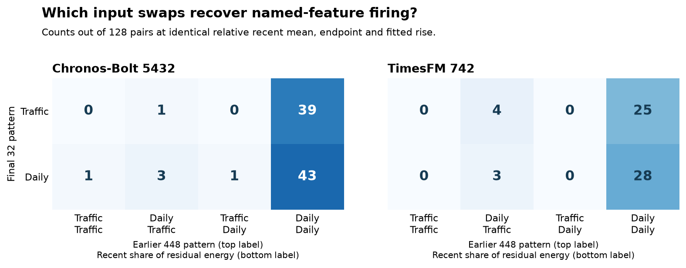

# Which part of the history keeps a recent-level feature off?

**At identical recent mean, endpoint and slope, the earlier 448-observation pattern and the allocation of variance to the final 32 jointly restored most of the firing gap. The final 32 observations could retain a traffic pattern.** Switching only the earlier pattern, only the final-window pattern, or only the residual-energy allocation produced at most four firings in 128 pairs. Combining the daily earlier pattern and daily energy allocation with the traffic final-window pattern yielded 39 firings in Bolt and 25 in TimesFM. The all-daily inputs gave 43 and 28. TimesFM and Bolt each gained four cases absent among their original all-daily firings. [Registered hybrid design](SPLICE_PROTOCOL.md) · [Matched case scores and intervals](results/splice.json)

We paired each of the 128 daily histories with one of the 128 traffic histories. Every hybrid's recent relative mean was +1.25 history SD, its endpoint was +.5 and its fitted last-32 rise was zero. We decomposed the rest of each original history into three quantities. After removing the joint projection on the statistics, the early 448 and recent 32 residuals each have zero mean, and the recent residual also has zero endpoint and fitted slope. Each block has its own unit-length pattern, and the fraction of remaining squared norm in the recent block specifies the relative amplitude of the two patterns. We crossed all three choices between each pair's daily and traffic series. Every hybrid preserves the full-history mean and SD of the earlier-pattern donor. All observations were originally standardized separately. The maximum drift in any of the five standardized constraints across all hybrid inputs was below 0.0000001.

These are interventions on the **observed input waveform**. We ran the original, unmodified model to its same native middle-block SAE site and recomputed the named feature's actual TopK code. The checkpoints received no hidden-state patches in this part. These counterfactuals address why the detector fired. The separate decoder-lock experiment measures what the detector’s contribution did to the forecast. [Hybrid construction and live measurements](splice.py) · [Independent input/encoder replay](splice_audit.py)

| Earlier 448 pattern | Final 32 pattern | Residual energy allocation | Bolt, primary / repeat | TimesFM, primary / repeat |
|---|---|---|---:|---:|
| Traffic | Traffic | Traffic | 0 / 0 | 0 / 0 |
| Daily | Traffic | Traffic | 1 / 0 | 4 / 4 |
| Traffic | Daily | Traffic | 1 / 0 | 0 / 0 |
| Daily | Daily | Traffic | 3 / 1 | 3 / 1 |
| Traffic | Traffic | Daily | 0 / 1 | 0 / 0 |
| Daily | Traffic | Daily | **39 / 38** | **25 / 19** |
| Traffic | Daily | Daily | 1 / 1 | 0 / 0 |
| Daily | Daily | Daily | **43 / 43** | **28 / 28** |

The recent window carried a median **0.119%** of total orthogonal residual energy in the daily histories, compared with **2.524%** in traffic. The 10th–90th percentile ranges were 0.035%–0.434% and 0.869%–5.290%. This is variance left after removing the constrained statistics. At a fixed traffic tail pattern, daily earlier pattern and daily energy allocation had a positive joint effect above the sum of their individual effects. That exploratory interaction on firing probability was +.297 [.219, .375] in Bolt and +.164 [.109, .234] in TimesFM. Under the second, prespecified pairing the estimates were +.289 [.211, .375] and +.117 [.063, .180]. [All per-pair Bolt encodes](results/bolt_splice.npz) · [All per-pair TimesFM encodes](results/timesfm_splice.npz)

The primary score averages the incremental effect of each substitution across all six orders. Intervals use 2,000 bootstraps over the 128 series pairs. The order averages sum to the all-daily minus all-traffic firing-rate difference.

| Feature | Earlier 448 pattern | Final 32 pattern | Relative residual energy | Total rate difference |
|---|---:|---:|---:|---:|
| Bolt 5432 | +.165 [.126, .207] | +.017 [−.005, .042] | +.154 [.117, .193] | +.336 |
| TimesFM 742 | +.120 [.082, .160] | +.007 [−.010, .025] | +.092 [.062, .124] | +.219 |

The two models assigned different importance to these components before the sparse cutoff. The mean order-averaged Bolt *margin* changes were +.087 for the earlier pattern, −.075 for the final pattern, and +.246 for energy allocation. In native TimesFM units they were +10.593, −.164 and +1.205. Both models therefore produced a similar conjunction for binary firing even though different components supplied most of the pre-threshold margin. The effects can depend on replacement order, dose, domain and the construction of the hybrids. Calendar frequency, trend and a particular network circuit each require their own intervention. [Preactivations, cutoffs, margins, firings and alternate pairing](results/splice.json)

On the primary pairing, 35 of 43 all-daily Bolt firings and 21 of 28 TimesFM firings survived substituting the traffic final-window pattern at the daily energy allocation. Under the second pairing 34 and 18 survived. This distinguishes partial preservation of individual firings from similar overall rates. Across both pairings, the all-from-one-domain inputs matched the earlier joint-high check bit for bit. A separate blockwise regression implementation independently reconstructed every FP32 hybrid, replayed 32 singleton encodes, and reproduced all 32 ranks exactly. The largest margin discrepancy was 0.0000091. [Independent replay results](results/splice_replay.json)
