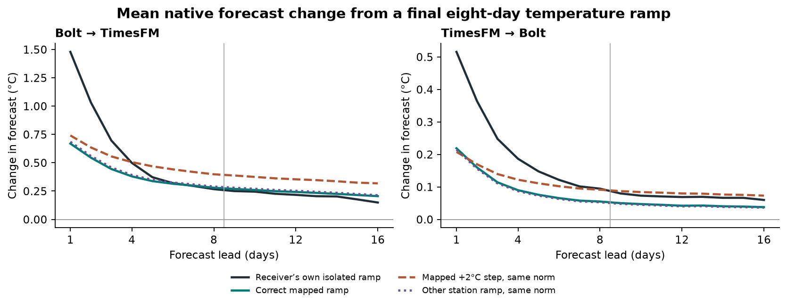

# A physical temperature ramp crosses two forecasters' hidden spaces

A linear map learned from **ordinary, unedited M4 histories** translated the forecast response to an eight-day temperature ramp between TimesFM and Chronos-Bolt. On 46 NOAA stations at four dates, the correct mapped ramp recovered **.617 of early forecast-shape energy for TimesFM → Bolt and .521 for Bolt → TimesFM**. A same-history warming step of identical hidden-vector length did worse in both directions. A ramp taken from another station on the same date retained almost the entire benefit. The result identifies a transferable response to this particular edit. Evidence that the direction captures how individual stations differ is much weaker.

## What was changed and measured

For each 480-day history, both models independently saw an added linear ramp from −2°C to +2°C over the last eight observed days. The constant-step control added +2°C on each of those days. Each model used its original input normalization and H16 median forecasting head. Neither received station ID or season. We collected ordinary and edited states covering the last 32 observations at the same middle-block outputs used to learn the map. TimesFM supplies one 32-day token at block 10. Bolt supplies two 16-day tokens at encoder block 3. We took the edited-minus-clean change in their mean. The reference was the forecast change after adding the receiver’s **own** pooled change to every covered clean token. For Bolt, broadcasting one vector to both tokens drops the difference between the two individual changes. Other layers, tokens and input normalization stayed at their original clean values during the live write. Whole-input effects were measured separately. [Preregistered design](PROTOCOL.md) · [Original map and sites](../../atoms/matched_windows/README.md)

We translated the donor displacement through the linear part of the existing paired ridge map, with no receiver-specific scaling. Two controls received the same norm as this mapped vector on each example. One translated the donor’s constant step. The other translated its ramp from a different station at the same date. Direct forecast copying used the donor’s own isolated ramp waveform in °C. Shape skill is one minus pooled squared error divided by reference energy after removing each waveform’s own mean over the indicated leads. Zero corresponds to applying no edit. Intervals resample 46 whole stations 3,000 times, conditional on the four observed dates. No observed future temperature enters the score. [NOAA cohort](../../moment/forecast_quality/post_release/PROTOCOL.md)

## Testing shape specificity and the station effect

| Donor → receiver | Leads | Mapped ramp [95%] | Mapped step | Other station | Direct donor waveform | Mapped − step [95%] |
|---|---:|---:|---:|---:|---:|---:|
| TimesFM → Bolt | 1–8 | .617 [.606, .629] | .463 | .610 | −2.850 | .155 [.148, .162] |
| TimesFM → Bolt | 9–16 | .627 [.593, .656] | .487 | .604 | −8.360 | .139 [.103, .170] |
| Bolt → TimesFM | 1–8 | .521 [.504, .537] | .456 | .523 | .547 | .065 [.053, .076] |
| Bolt → TimesFM | 9–16 | .753 [.722, .782] | .717 | .743 | .241 | .036 [.015, .059] |

The early mapped-minus-other-station gap was .007 [.001, .014] for TimesFM → Bolt and −.002 [−.018, .012] for Bolt → TimesFM. Only 3.7% and 4.0%, respectively, of early centered reference energy remained after subtracting each date’s mean across stations. On this smaller component the respective mapped skills were .417 and .268, with mapped-minus-other-station gains .035 [−.013, .083] and .090 [.018, .169]. Each bootstrap re-estimated the date mean for each method separately. Direct donor forecast copying actually edged out the translated vector for the early Bolt → TimesFM contrast. The reverse direction gave the clear advantage over this inexpensive baseline. [TimesFM donor estimates](results/timesfm_scores.json) · [Bolt donor estimates](results/bolt_scores.json)

The mean level of the change also matters. When scored on the full uncentered early wave, the constant step had slightly higher skill than the ramp in both directions (.685 versus .665 into Bolt, .768 versus .746 into TimesFM). Early and late isolated centered reference RMS were respectively .142°C and .010°C for Bolt, compared with .351°C and .031°C for the ordinary whole-input edit. TimesFM’s isolated values were .413°C and .036°C, close to its whole-input .414°C and .036°C. High recovery at late leads can therefore describe a very small perturbation. The mean forecast responses below show both the waveform and the mapped vector’s reduced amplitude.



The mapped-to-native median hidden cosines were .714 into Bolt and .381 into TimesFM. The corresponding median length ratios were .341 and .524, and dense hidden-space skills were .353 and .119. Recovering much of a forecast shape required neither reproducing every hidden coordinate nor finding any SAE feature IDs. This experiment tests one specified input edit at two fixed sites. It leaves open which individual hidden dimensions mediate the response. [TimesFM donor case-level waves and hidden writes](results/timesfm_transfer.npz) · [Bolt donor case-level waves and hidden writes](results/bolt_transfer.npz)

## Independent sites and dates

The TimesFM → Bolt direction was selected on the first panel for a prospectively specified replication covering 35 other stations and eleven different forecast dates. The correct ramp beat the warming step by .150 [.136, .166] on early forecast shape. One generic direction averaged on the original panel scored .636, slightly exceeding the current-history direction’s .621. An additional control then reversed the ramp’s six interior temperature values while preserving endpoints and edit magnitude. Matching the correct order improved early shape skill by only .0028 [−.0010, .0066] averaged over both native targets. This distinction narrows what the original warming-step contrast identifies. [Independent 385-history study](new_dates/README.md) · [Interior-order falsification](new_dates/order/README.md)

## Reproduction

Both compressed map archives include the full float64 operator in the array `linear`, its SHA-256, all 1,024 training IDs, and both token selectors. A donor displacement row maps to the receiver via `donor_delta @ linear`. The fixed ridge operator was evaluated on identity rows. Across the original 16 decoder directions, maximum absolute discrepancies from the older published mapped vectors were 5.33 × 10⁻¹⁵ (Bolt donor) and 8.67 × 10⁻¹⁸ (TimesFM donor). Unpatched H16 captures were checked against the prior NOAA archive and against zero-dose calls. A second implementation rebuilt the operator by SVD and issued 32 direct singleton forecast interventions on fixed rows. The worst discrepancy was .00000763°C. Both replay files were byte-identical from an isolated source copy. The three targeted implementation regressions each failed their designated test. [Mapped-vector check, Bolt](results/bolt_map.npz) · [Mapped-vector check, TimesFM](results/timesfm_map.npz) · [Singleton replay](audit.py) · [Mutation results](MUTATION_CHECK.md)

With repository materials and checkpoints staged as described in the original map and NOAA studies, run these from the repository root. The first command uses fresh output directories. The second independently reconstructs selected archived results.

```bash
PYTHON=python bash research/activation_transfer/shape_transfer/physical_ramp/reproduce.sh /tmp/ramp-operators /tmp/ramp-results
PYTHON=python bash research/activation_transfer/shape_transfer/physical_ramp/replay_isolated.sh
```
