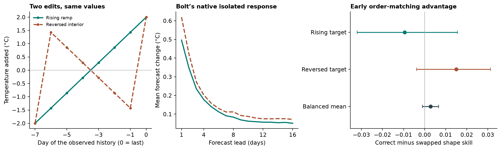

# The early forecast response transfers even when the ramp’s interior order is wrong

Bolt responded differently to an ordinary rising temperature ramp and a reversal of its six interior values. Yet at days 1–8, sending TimesFM’s *correct* edit through the frozen hidden-state map offered little advantage over sending the swapped edit at equal length. The balanced gain was **.0028** of shape skill [95% crossed station/date interval **−.0010, .0066**]. The earlier .150 ramp advantage over a constant warming step therefore provides little evidence that the map transports the precise order of the six interior temperatures.



## Identical perturbation values, different order

The original eight-day edit adds **−2.00, −1.43, −0.86, −0.29, +0.29, +0.86, +1.43, +2.00°C** to the final eight observations. The alternative leaves the first and last edits fixed and reverses the six numbers in between. The perturbations have exactly the same minimum, maximum, mean, variance and norm. Their covariance with the underlying temperatures can differ, so the models’ ordinary normalization can differ as well. Each model processed each edited raw input on the same 385 clean station/date histories. This exploratory experiment was registered after the ramp-versus-step comparison and before running either model on the reversed edit. [Frozen protocol](PROTOCOL.md) · [Preceding panel and methods](../README.md)

For each history we obtained **two distinct Bolt references**, one for each input edit. Each equals the forecast change when its own measured mean hidden displacement is written identically to the last two middle-block tokens of the *clean* history. We also obtained two TimesFM donor displacements and used the unchanged M4-trained operator to map each to Bolt. Within each row of the table, the swapped donor uses the norm of the correct donor for that row, and both go into the same clean Bolt receiver. Every entry is a real H16 forecast. The paired advantage is the difference between the correct and swapped donor skill against that row’s reference. Its balanced mean gives the two targets equal weight.

| Bolt target, days 1–8 | Mapped rising donor | Mapped reversed donor | Correct minus swapped [95%] |
|---|---:|---:|---:|
| Rising ramp | .621 | .630 | −.0094 [−.0320, .0156] |
| Reversed interior | .490 | .505 | .0150 [−.0038, .0312] |
| Balanced advantage | | | **.0028 [−.0010, .0066]** |

The two **true early Bolt shape responses differed by .0517°C RMS** [.0426, .0608]. Their individual RMS values were .139°C for the rising ramp and .178°C for the reversed edit. Their pooled signed cosine was .977, so the two responses still shared a strong shape. The corresponding difference from running both edits on the entire raw input was .101°C RMS. Native replay precision was under .000005°C. TimesFM’s two mapped hidden directions had median cosine .859 (10th–90th percentiles .718–.928). Multiple directions can generate similar early shapes in the receiving model. This one permutation does not establish which statistic of the recent history is sufficient for the shared response. [Full results and uncertainty](results/scores.json) · [Paired true, matched and swapped waveforms and writes](results/order.npz)

## Where the order made a measurable difference

| Outcome | Correct minus swapped, rising target | Correct minus swapped, reversed target | Balanced gain [95%] | True order difference, RMS °C [95%] |
|---|---:|---:|---:|---:|
| Days 1–8, centered | −.009 [−.032, .016] | .015 [−.004, .031] | .003 [−.001, .007] | .0517 [.0426, .0608] |
| Days 1–8, full | .052 [.018, .094] | −.030 [−.060, −.008] | .011 [.004, .018] | .0975 [.0814, .1144] |
| Days 9–16, centered | .077 [−.020, .152] | .009 [−.044, .068] | .043 [.014, .072] | .0072 [.0061, .0083] |
| Days 9–16, full | .189 [.076, .276] | −.134 [−.210, −.067] | .027 [−.009, .047] | .0426 [.0363, .0487] |

The late centered average showed a small reproducible advantage for matching order. Both true late centered effects were small, RMS .00994°C and .01124°C. Including the waveform mean favored the rising donor for both early targets, so the positive balanced full-wave gain coexists with an advantage for the **wrong** donor on the reversed target. Across all 16 leads centered together the balanced gain was .0045 [.0001, .0089]. These estimates describe one middle-block write on this previously analyzed station panel. The primary early interval used 3,000 paired crossed resamples; fixing dates and resampling only stations instead gives [.0012, .0047]. Considering date variation matters to this inference.

## Verification

At station/date rows 0, 192 and 384, a second implementation rebuilt the M4 map by SVD, independently constructed both edits, and issued fresh single-history calls for both native references and all four interventions. The worst error across these 18 H16 waveforms was .00000477°C. A second end-to-end run rematerialized the original map, processed all 385 new histories, and exactly reproduced all 28 archived array fields plus both JSON reports. Two targeted regressions, including keeping the six interior values in their original order by mistake, failed the intended tests. [Independent replay](results/replay.json) · [Mutation results](MUTATION_CHECK.md)

```bash
PYTHON=python bash research/activation_transfer/shape_transfer/physical_ramp/new_dates/order/reproduce.sh /tmp/new-ramp-order
```
