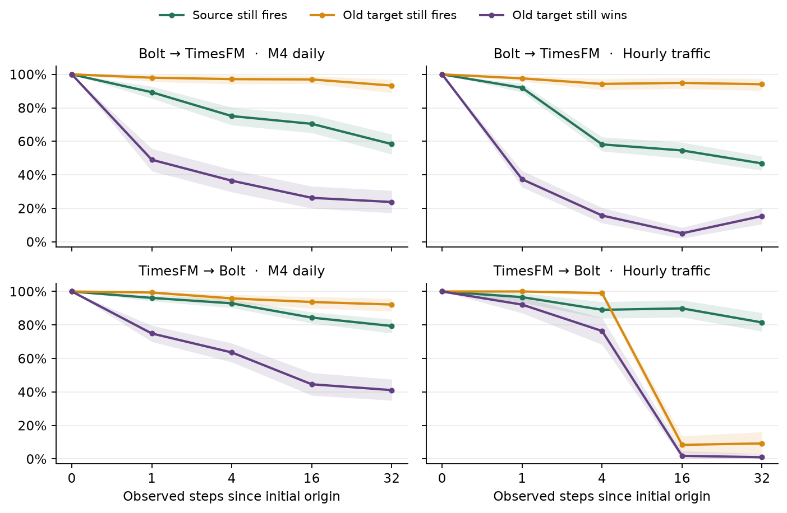

# What happens to a transferred SAE intervention when the forecast origin advances?

An original target atom can remain active while its usefulness changes. When the source was Chronos-Bolt, advancing the forecast origin by 32 observations left at least 93% of the old TimesFM target winners active on persistent donor cases in *both* domains. The best target still changed on 76% of daily and 85% of traffic cases. Refitting and reselecting against the current source waveform restored much of the centered forecast effect. The opposite direction exposed a different mechanism on traffic: one originally useful Bolt decoder direction retained an effect after it had usually dropped out of the active code.

An operational forecast moves as observations arrive. We selected one signed target-atom intervention for each naturally firing source atom at an initial origin, then evaluated it again after **1, 4, 16 and 32 actual observations**. Each new target forecast was scored against a real ablation of the original source feature at its current intensity in that new context. The next eight forecast *leads* are comparable, although their calendar dates advance with the window. [Protocol](PROTOCOL.md)

## Histories and interventions

We selected 96 M4 daily series and 96 hourly Monash traffic sensors for this experiment, disjoint from the previous atom, replication, fresh and blind-frequency holdings and named study exclusions (3,551 daily series and 580 traffic IDs). We used one final 512-observation span per series, holding out eight later observations, and took five overlapping 480-observation contexts. Their unit and offset were fixed using only the original 480 observations; as a result the exact shared observations remain equal at adjacent origins. Point forecasts and SAE effects are measured in the original history's standard-deviation units. The manifest gives each original series ID and the zero-based half-open raw intervals for all five contexts. This exclusion audit covers evaluation series. Checkpoint pretraining exposure is unknown. Every series was sampled near its end, and traffic sensors may share times of day and shocks. Sensor resampling gives conditional uncertainty for this panel, with limited coverage of alternate anchor dates. [Series and all absolute time indices](results/manifest.json)

The 16 donor atom IDs, both checkpoints' SAE sites and decoder dictionaries, the final 32-observation patch group, calibration-only forecast weighting, and 20% receiver radius cap came from the earlier one-atom study. An originally active donor defines the tracked case; later entrants are counted separately. We compared the following ways to write one target coefficient.

| Policy | Target identity | Target coefficient and source information available at the new origin |
|---|---|---|
| Exact old write | Original winner | Original executed value, including if the target is now inactive or the old magnitude exceeds the current coefficient bound |
| Old write, current bound | Original winner | Original value clipped to the target's current natural coefficient; zero if target inactive |
| Refit old ID | Original winner | Current receiver derivative and source response signature and intensity; zero if either atom is inactive |
| Fresh local | Best of the 32 currently active target atoms | Current receiver and source derivatives and natural coefficients |
| Old source signature | Best of the 32 currently active target atoms | Current receiver derivative and current natural source intensity, but the original per-unit source forecast derivative |

The blind policies deliberately allow a stale target action after a source atom stops firing. The three source-aware policies return the zero write in that case. The source waveform supplied to the selector always comes from a derivative at an ordinary, unablated state. The actual ablated source forecast was hidden from target selection. The unmodified forecast is the zero-recovery comparator. [Target choices and physical interventions](intervene.py)

## Which features stayed active?



Source survival uses the initially firing cases as its denominator. The other two lines condition on the donor firing at *both* origins. Bands are 95% intervals from 4,000 bootstrap resamples of the 96 original series, carrying every atom of a series together. An unchanged target ID can remain available even if a newly available alternative better matches the waveform.

| At +32 observed steps | Original donor still fires | Original target still fires, given donor survival | Best target ID switched | Old best dropped out among switches | Both competing target IDs were already active |
|---|---:|---:|---:|---:|---:|
| Bolt → TimesFM, daily | 164/281 | 153/164 | 125/164 | 11/125 | 109/125 |
| Bolt → TimesFM, traffic | 169/361 | 159/169 | 143/169 | 10/143 | 124/143 |
| TimesFM → Bolt, daily | 270/340 | 249/270 | 159/270 | 21/159 | 113/159 |
| TimesFM → Bolt, traffic | 97/119 | 9/97 | 96/97 | 88/96 | 6/96 |

The last column requires the old winner to survive *and* the new winner to have already been in the original active set. Our earlier [synthetic-noise experiment](../sparse_stability/README.md) found that both candidates survived in 93/95 Bolt-source and 34/35 TimesFM-source daily switches under 2% observational noise. Operational shifts were larger and structurally different: the median RMS change at aligned input *positions* from +1 to +32 ranged from .133 to .693 anchor SDs on daily, and .548 to 1.550 on traffic, although overlapping raw observations remained identical. The previous synthetic amplitudes and these rolling lags are different interventions. [All lag counts and uncertainty](results/summary.json)

## Executed forecast effects

Recovery is one minus the squared mismatch divided by the energy of the current source ablation. Zero predicts no forecast change; one reproduces it exactly. Centered recovery removes the mean of each eight-lead response before scoring. The primary scores pool the actual energy of cases firing at both origins. Equal-donor results for donors with at least eight eligible series, the full initial-firing population, the pure no-op, coverage counts and every lag's conditional intervals are in the archive. The calendar forecast targets change at each advance. The unusually small active populations in some traffic cells are reported with their donor identities.

| At +32, on persistent donors | Stale centered | Old write, current bound | Refit old ID | Fresh local centered [95% interval] | Current dose, old source signature | Full: stale / refit / fresh |
|---|---:|---:|---:|---|---:|---|
| Bolt → TimesFM, daily | .044 | .281 | .435 | .697 [.453, .828] | .192 | .575 / .770 / .957 |
| Bolt → TimesFM, traffic | −.571 | −.387 | .426 | .964 [.957, .970] | −1.140 | −.237 / −.663 / .913 |
| TimesFM → Bolt, daily | .013 | .011 | .005 | .016 [−.005, .039] | .021 | .433 / .429 / .510 |
| TimesFM → Bolt, traffic | .357 | .013 | .013 | .234 [.207, .260] | .230 | .353 / .017 / .282 |

Reranking concerned real forecast effects. For Bolt→TimesFM on daily, the paired centered gain from selecting a fresh identity instead of refitting the old target was .232 [.077, .371] after just one observation and .262 [.125, .419] at +32. The four fresh centered scores at +1/+4/+16/+32 were .811/.760/.806/.697, versus .544/.365/.112/.044 for blindly carrying the same write. On traffic, the same pairs were .864/.755/.796/.964 versus .721/−.226/−1.060/−.571. Restricting an edit to the old identity and fitting its dose to the new shape could still damage the full waveform on traffic. The registered selector emphasizes centered shape and the full score includes mean-level error. For TimesFM→Bolt daily, neither old nor fresh one-atom edits recovered substantial energy-pooled centered response. [Per-case Bolt-source writes](results/bolt.npz) · [TimesFM-source writes](results/timesfm.npz)

Blind reuse also applied unwanted edits after a donor stopped firing. At +32, such cases accounted for 44% [28%, 67%] of total squared stale-write error for Bolt→TimesFM daily, 19% [12%, 28%] on traffic, and 5% and 2% in the reverse direction. Including all originally firing daily Bolt cases changed stale centered recovery from .044 to −.375; the source-aware policy correctly applied zero to the disappeared donors.

### A decoder direction can still act after its feature drops out

On TimesFM→Bolt traffic at +32, the initial receiver atom was now outside Bolt's active set in 88/97 surviving source cases on 88 sensors. The unchanged physical vector still recovered .365 [.324, .405] of the centered source response on those 88 cases, compared with .234 [.204, .262] for the freshly chosen active atom. The paired difference favoring the stale vector was .131 [.106, .159]. Current-support policies that require the original receiver to fire produced a zero intervention by construction. This is strong local evidence for a particular handle. All 88 involved source atom 2362; 85 of them had chosen Bolt atom 2622 originally. An inactive decoder vector remains a mathematically available hidden-space direction. Applying it manipulates the residual stream outside the current firing code. On daily cases where the old Bolt target exited (21/270), that same policy class scored −.040 and a fresh eligible target scored .023. This finding arose on examining the traffic outcomes. [Conditional support-exit counts and contrasts](results/summary.json)

### The donor's effect changes as real values arrive

An old target can become unsuitable because the source itself calls for a different waveform. On Bolt→TimesFM traffic at +32, allowing the recipient to select among all current features and using the correct current donor intensity, while retaining the *old per-unit source response*, yielded centered recovery −1.140. Updating only that source signature raised it to .964, a paired gain of 2.104 [1.602, 2.822]. The corresponding gain was .505 [.073, 1.166] on daily. Even the earlier **measured source ablation**, rescaled by the new/old natural coefficient and used directly as a forecast estimate, scored −1.673 on traffic. The current source's first-order forecast approximation scored .981. In contrast, old-signature and fresh selection on TimesFM→Bolt traffic scored .230 and .234. Comparing these arms holds recipient derivatives and current donor intensity fixed.

A descriptive split by the magnitude of the actually arriving observations supports this interpretation, with limits. At +32, the half whose incoming segment most departed from its old last value retained 9–22 percentage points fewer original donor firings across the four domain/direction comparisons. On Bolt-source traffic its conditional target-switch rate was also 13.2 points higher [4.0, 21.5]; switch differences on the other cohorts were smaller or uncertain. Window reindexing and newly received values change together, so this observational comparison cannot attribute a causal contribution to an individual new observation. [Input-change strata](results/summary.json)

The fixed target-2622 traffic exception was subsequently tested on 96 different sensors using the fixed direction on all donor-2362 cases, whether or not it originally won. On the same tail schedule, centered recovery was .340 versus .230 for a fresh on-support choice; at earlier randomized phases the advantage reversed, .082 versus .156. [Independent fixed-direction confirmation](fixed_2622/README.md)

## Reproduction and checks

Run the [historical material setup](../fresh_cohort/README.md) for pinned checkpoint and dictionary access. The rolling raw Arrow inputs and normalization require the sources in the manifest. The pinned two-thread CPU environment can reproduce the study from the repository root.

```bash
export PYTHONPATH=.:tsfm_lens:tsfm_benchmark HF_HUB_OFFLINE=1
export OMP_NUM_THREADS=2 MKL_NUM_THREADS=2 OPENBLAS_NUM_THREADS=2
pkg=research.activation_transfer.shape_transfer
scratch=/tmp/tsfm_rolling_20261121
python -m "$pkg.rolling.data"
for model in bolt timesfm; do
    python -m "$pkg.fresh_cohort.run" collect "$model" --cache "$scratch" --out "$scratch"
done
for source in timesfm bolt; do python -m "$pkg.rolling.intervene" "$source"; done
python -m "$pkg.rolling.score"
python -m "$pkg.rolling.figure"
python -m "$pkg.rolling.verify"
python -m pytest -q research/activation_transfer/shape_transfer/rolling/test_rolling.py
```

Independent raw-series reselection reproduced all 960 numeric input windows and the frozen manifest byte-for-byte. Two isolated planted regressions verified the tests. Fitting normalization independently at each origin made the observed-overlap test fail. Enforcing current support on the nominally blind write made the stale-policy test fail. Each produced one assertion failure, and the restored suite passed both tests.

An independent scalar loss calculation and direct model-hook replay checked 180 receiver actions and 36 genuine source ablations across lags, domains, checkpoints and both persistent and extinguished donors. Maximum absolute forecast difference was 0.0000039 in anchor SD units. Direct residual-sum calculations also reproduced all 400 pooled physical recovery points, 20 support-switch decompositions and the four observed input overlaps exactly. [Independent intervention replay](results/replay.json) · [Bolt derivative and zero-patch checks](results/bolt_checks.json) · [TimesFM checks](results/timesfm_checks.json)
