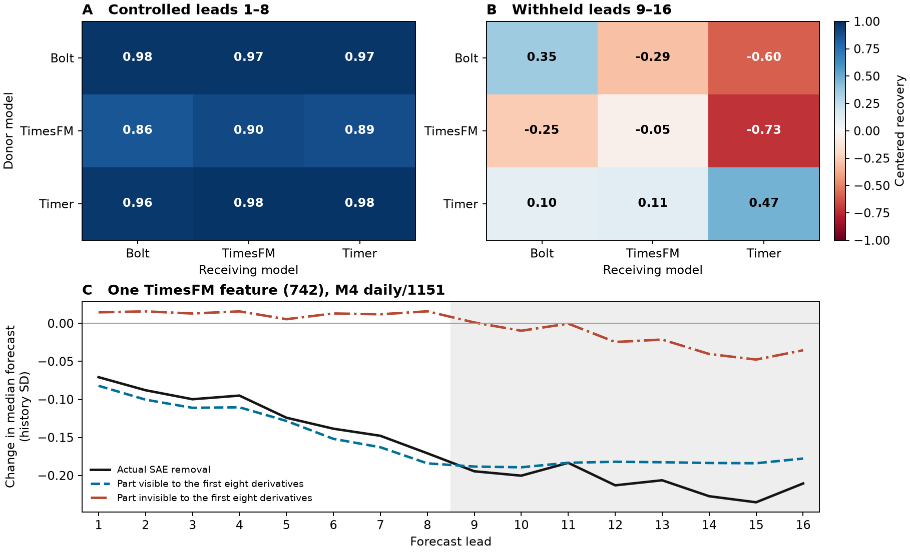

# What is lost when a model translates its own feature back into itself?

For each real source SAE removal, we transmitted just the estimated change in the first eight forecast values. A recipient then found a small hidden write consistent with those values. We repeated the procedure with the **original model as its own recipient**, at the very same block and token positions. Even there, recovering the first eight forecast changes usually failed to recover their continuation. Crossing architectures caused an additional loss in several comparisons. Some loss already occurred when the source edit was reduced to eight numbers. [Prospective design](PROTOCOL.md)

Each cell below reports **leads 1–8 / leads 9–16** on the same 128 additional M4 daily series. The method observes only derivatives of the first eight outputs. Both scores remove each waveform's own mean within the scored segment. Zero is the skill of an unchanged forecast. Each donor feature with at least eight firings gets equal weight.

| Source (frequent features / firing cases) | Bolt recipient | TimesFM recipient | Timer recipient |
|---|---:|---:|---:|
| Bolt (14 / 339) | **.975 / .353** | .971 / −.293 | .970 / −.600 |
| TimesFM (13 / 405) | .858 / −.255 | **.903 / −.051** | .888 / −.726 |
| Timer (12 / 210) | .965 / .099 | .981 / .107 | **.984 / .474** |

Timer provides a third independent *donor* SAE. A 96-step data token supplies its point forecast, compared with 32-step token windows for the other two donors' medians. On the additional daily cohort, Timer's own unseen-horizon recovery was .474 [.300, .582]. TimesFM's self recovery on that horizon was −.051 [−.248, .034]. Among the 16 training-selected Timer features, none fired on at least eight histories in either the VM or hourly traffic cohorts. Those Timer-donor cells are unestimated. The other donors can still be evaluated *into* Timer on those domains. [All cohort sizes, nine model pairs and paired differences](results/summary.json)

## Where was the missing information?

We split each actual decoder write into two parts at the current input. One lies in the span of the eight early forecast derivatives. The other is perpendicular to every one of them. Their sum equals the original hidden write exactly. We applied each part in its own real forward pass. No cross-model alignment, cap or regularizer enters this decomposition.

For the additional daily histories, the visible component's median length was only .163 of the true decoder length in Bolt, .152 in TimesFM and .121 in Timer. Applied alone, the Bolt component perpendicular to all eight early derivatives scored −.002 on early shape and **.567 [.488, .622] on late shape**. In TimesFM it scored .076 early and **.441 [.283, .572] late**. A direction can carry a substantial part of a forecast's continuation while being invisible in every disclosed early derivative. The small nonzero early effects are expected because physical full-dose interventions can be nonlinear. Separately applying the two components and adding their resulting forecasts is only an approximation; the raw archives include both components so the discrepancy can be checked. [Bolt decomposition](results/bolt_to_bolt.npz) · [TimesFM decomposition](results/timesfm_to_timesfm.npz) · [Timer decomposition](results/timer_to_timer.npz)

Early agreement across checkpoints demonstrates an ability to write a response. It identifies the equivalence class of writes allowed by that measurement. The original donor decoder contains additional information about subsequent leads. The actual diagonal-versus-off-diagonal results show that the size of the loss also depends on which checkpoint receives a given donor. The results are conditional on these blocks, source dictionaries and history frequencies. A longer or more varied set of observed outputs can distinguish more directions. [Native implementation and frozen source selection](run.py) · [Figure-case selection using only the clean coefficient](figure.py)

An independent implementation reproduced 72 live forecast operations using singleton hooks, freshly recomputed derivatives and an SVD, with maximum absolute discrepancy 0.00000179 in standardized forecast units. [Independent numerical replay](results/audit.json) · [Review of random and other-decoder norm controls](../method_review/REVIEW.md)
