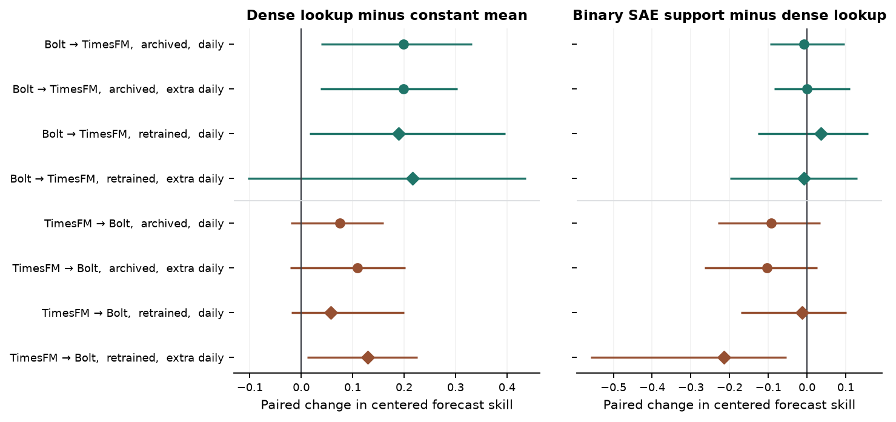

# Inferring a donor intervention from a clean lookup key

For each original source feature, remove its actual firing coefficient times its decoder direction from its model's live state. A prospective receiver gets the natural donor coefficient and decoder direction, and a lookup key derived from the *unedited* history. It receives no derivative measurements from either current model, except in a separately labeled donor-only positive control. An eight-vector recipient library fitted on 96 historical target responses turns the predicted donor forecast change into an actual receiver write. This measures how well a dense receiver write reproduces a specified causal response. The recipient atom identity remains open. [Protocol](PROTOCOL.md)

The seeded training-row shuffle changed 1,022 of 1,024 key-to-derivative associations. Each shuffled estimator was allowed to choose its own neighborhood and shrinkage on correctly associated calibration labels.

A lookup averages the donor derivative matrices of nearby *training* histories and shrinks that estimate toward the average training derivative. Its calibration target is the complete eight-by-hidden derivative, so fitting does not require choosing or labeling SAE atoms. At deployment a new source direction can be multiplied by this generic estimate, or by the preprojected historical responses for that direction. The expensive part is the derivative memory: 1,024 historical inputs × eight output gradients per donor, plus 96 calibration histories for selecting the neighborhood. The full float32 derivative memory takes 16 MiB for Bolt or 40 MiB for TimesFM. For a frozen set of 16 edits, their preprojected historical eight-lead responses take 0.5 MiB per donor, in addition to lookup keys and model/SAE weights. A new sparse/dense query needs a clean donor forward to form its lookup key; every method, including the raw-input baseline, is supplied the source intervention's firing coefficient. Recipient learning uses 96 calibration inputs only, and test-time measurement requires the ordinary and edited forward forecasts. No actual test donor-removal outcome is used by the predictor.

## What did the recipient actually reproduce?

On both daily cohorts, the archived Bolt donor's **32-index SAE support** provided nearly the same measured utility as its 512-dimensional dense state with this lookup and fixed receiver. Centered physical skills were .538 versus .546 on original daily, and .650 versus .651 on extra daily. The paired support-minus-dense differences were −.007 [−.096, .097] and −.001 [−.084, .112]. These intervals leave room for meaningful differences in either direction. The two keys retrieve *functionally useful* neighbors without requiring any common SAE coordinates across checkpoints.

TimesFM behaved differently. On its two daily cohorts, dense state scored .511/.528, binary support gave .418/.425 and SAE magnitudes gave .445/.365. Its true-current donor derivative, sent through the identical target library, scored .796/.774. Predicting that derivative from historical neighbors recovers only part of the effect available when probing the current source.

**Archived source dictionaries**. Each cell is centered skill on the actual eight-lead recipient change, compared with the true natural donor removal. Features contribute equally after normalization by their own donor effect energy. The current donor control can observe the test derivative. Other arms can observe only their lookup key, feature identity and coefficient.

| Donor → recipient | Domain | Atoms / firings | Training mean | Raw | Dense | SAE magnitudes | SAE support | Current donor gradient |
|---|---|---:|---:|---:|---:|---:|---:|---:|
| Bolt → TimesFM | Daily | 15 / 520 | .347 | .506 | .546 | .487 | .538 | .896 |
| Bolt → TimesFM | Extra daily | 14 / 339 | .452 | .614 | .651 | .621 | .650 | .920 |
| Bolt → TimesFM | VMs | 4 / 127 | −.215 | .024 | .026 | .021 | .027 | .612 |
| Bolt → TimesFM | Traffic | 5 / 233 | .193 | .084 | .135 | .074 | .141 | .468 |
| TimesFM → Bolt | Daily | 14 / 691 | .435 | .444 | .511 | .445 | .418 | .796 |
| TimesFM → Bolt | Extra daily | 13 / 405 | .419 | .418 | .528 | .365 | .425 | .774 |
| TimesFM → Bolt | VMs | 2 / 156 | −.130 | −.147 | −.175 | −.103 | −.123 | .203 |
| TimesFM → Bolt | Traffic | 2 / 138 | .553 | .542 | .542 | .567 | .559 | .615 |

Dense lookup improved over the training mean by +.199 [.039, .332] and +.198 [.037, .303] in the two Bolt → TimesFM daily cohorts. TimesFM → Bolt gains were +.075 [−.021, .160] and +.109 [−.021, .202]. The intervals jointly resample histories and eligible atoms. **Zero of the 16 prespecified one-sided primary comparisons** (dense over mean or SAE magnitudes over dense) survived family adjustment. The more precise fixed-feature intervals, all source/recipient full-waveform scores, paired shuffled-memory contrasts and individual atom outcomes are in the result files. The intervals describe frozen dictionaries and reused cohorts. A claim of equivalence across representations or forecasters would need a prespecified tolerance and tighter intervals.

The training row association mattered on daily Bolt. On separate calibration histories, generic derivative error relative to predicting the constant mean was .529 for the raw key, .393 for dense, .421 for SAE magnitudes, and .408 for binary support. Identically tuned but shuffled memories were .997–1.000. On the two daily evaluation cohorts, dense physical gains over its tuned shuffled control were +.199 [.038, .329] and +.200 [.039, .305]. Full daily physical skill in Bolt → TimesFM rose from .294/.332 for the mean to .867/.887 for dense retrieval. In the original TimesFM dictionary, the corresponding generic calibration error ratios were .857 raw, .762 dense, .816 magnitudes and .893 support.

Out of domain, query representation and receiver limitations both mattered. With Bolt as donor on traffic, dense forecast-only recovery of the actual source removal was .036 versus .990 for the current derivative, and no eligible dense write hit the receiver cap. With TimesFM as donor on traffic, all 138 eligible receiver writes hit the cap across the mean, dense and true-current conditions. Only two source features contributed there. The memory contains daily histories, so a nearest neighbor exists even for queries well outside its useful range.

**Independently initialized source SAEs**. This changes both the sparse lookup representation and the sixteen training-selected edit directions. It tests whether the pattern recurs after retraining and reselecting features.

| Donor → recipient | Domain | Atoms / firings | Training mean | Raw | Dense | SAE magnitudes | SAE support | Current donor gradient |
|---|---|---:|---:|---:|---:|---:|---:|---:|
| Bolt → TimesFM | Daily | 15 / 475 | .303 | .404 | .492 | .557 | .529 | .928 |
| Bolt → TimesFM | Extra daily | 12 / 318 | .196 | .411 | .413 | .344 | .405 | .812 |
| Bolt → TimesFM | VMs | 6 / 179 | .128 | .165 | .188 | .200 | .168 | .704 |
| Bolt → TimesFM | Traffic | 3 / 281 | .267 | .067 | .310 | .285 | .207 | .573 |
| TimesFM → Bolt | Daily | 13 / 397 | .372 | .469 | .430 | .453 | .417 | .805 |
| TimesFM → Bolt | Extra daily | 10 / 222 | .437 | .435 | .566 | .523 | .351 | .857 |
| TimesFM → Bolt | VMs | 1 / 32 | −.489 | −1.206 | −.838 | −1.030 | −.376 | −.040 |
| TimesFM → Bolt | Traffic | 0 / 0 | — | — | — | — | — | — |

For the second Bolt SAE, original daily favored magnitudes (.557) over dense (.492), and extra daily favored dense (.413) over magnitudes (.344). The paired differences were +.065 [−.040, .194] and −.069 [−.525, .164]. Binary support and dense differed by +.036 [−.126, .159] and −.008 [−.199, .130]. The second TimesFM SAE had only one eligible source feature on VMs and none on traffic. Coverage is part of the result. A different choice of SAE seed changes which natural removals can be evaluated on these domains.



## Do the support and dense keys retrieve the same histories?

Every evaluation support contained exactly 32 active coordinates out of 6,144. On archived Bolt's original/extra daily histories, the top-ranked historical item agreed with dense retrieval 55%/50% of the time. The true dense neighbor was among all tied support minimizers 65%/64% of the time, and the median closest support was unique in both cohorts. TimesFM’s corresponding stable choices agreed only 18%/16%; accounting for ties raised these figures to 50%/51%. On TimesFM traffic, a median 964 of the 1,024 memory rows tied for closest support. A stable tie break chose the same top item as dense on 0% of traffic histories even though the dense choice was among the tied items 92% of the time. The tied histories were indistinguishable at this support distance. [Neighbor agreement and tie counts](results/neighbors.json)

The source supports have different baselines for overlap. A Bolt daily history shared a median 8 of 32 indices with a generic memory history and 27 with its closest match. For TimesFM traffic, the corresponding medians were both 28. Most of the high overlap there was common to the historical library, leaving few coordinates to distinguish neighbors.

### Does sharing weight across tied histories help?

Before testing this follow-up, we specified a rule that distributes the remaining neighbor weight equally over every history at the kth distance. The calibration procedure and function for producing recipient writes stayed fixed. We refit both the neighborhood size and its shrinkage using generic calibration derivatives only. [Follow-up protocol](TIES.md)

| Donor → recipient | Domain | Stable support | Fractional support | Paired change [crossed 95% interval] | Donor forecast-only, stable → fractional |
|---|---|---:|---:|---:|---:|
| Bolt → TimesFM | Daily | .538 | .541 | +.003 [−.030, .055] | .590 → .588 |
| Bolt → TimesFM | Extra daily | .650 | .651 | +.001 [−.030, .018] | .693 → .692 |
| Bolt → TimesFM | Traffic | .141 | .123 | −.019 [−.068, .029] | .043 → .028 |
| Bolt → TimesFM | VMs | .027 | .017 | −.010 [−.046, .010] | .104 → .101 |
| TimesFM → Bolt | Daily | .418 | .493 | +.075 [.001, .220] | .505 → .543 |
| TimesFM → Bolt | Extra daily | .425 | .497 | +.072 [−.038, .238] | .503 → .569 |
| TimesFM → Bolt | Traffic | .559 | .542 | −.016 [−.053, .016] | .403 → .435 |
| TimesFM → Bolt | VMs | −.123 | −.143 | −.020 [−.084, .011] | .395 → .170 |

Fractional weighting improved generic calibration for both donors, from .408 to .393 on Bolt (k=4 for both, neighbor weight .952 to .979), and from .893 to .816 on TimesFM (k=4 to k=1, weight .536 to .643). On TimesFM's two daily cohorts the differences from dense lookup shrank from .093/.103 to .018/.032 points. How a method handles low-resolution distances therefore affected the apparent daily gap. The largest tie group occurred on traffic, where all 138 TimesFM-donor receiver writes hit the cap in both arms and the physical score fell slightly. Original/extra daily cap counts were 327/198 for stable and 327/201 for fractional. All Bolt-donor cells had zero caps. No physical improvement survived the six prespecified one-sided daily/traffic comparisons. The VM results are descriptive. Jointly permuting all 1,024 history keys and derivative labels reproduced every fractional weight exactly and every estimated unit response within 4.2 × 10⁻¹⁷. [Bolt-donor results](results/bolt_ties.json) · [TimesFM-donor results](results/timesfm_ties.json)

## Scope

The historical neighbor search takes place within a single donor. Its cross-model test is the subsequent physical write into a frozen recipient. These results establish whether a donor-side SAE code can serve as a useful lookup key for a specific causal forecast response. An identification of a corresponding individual recipient feature, or a claim that the models encode the same concept, needs other evidence.

## Reproduction

Run from the repository root in the project's pinned offline environment. Complete the original replication and full-space/depth material preparation first. The independent source SAE seed 1 checkpoints live in the original replication's cache. The two derivative memories and neighbor-level inputs regenerate under `/tmp/tsfm_state_predictor_20261121`. One CPU thread per model process suffices.

```sh
export PYTHONPATH=.:tsfm_lens HF_HUB_OFFLINE=1 OPENBLAS_NUM_THREADS=1 OMP_NUM_THREADS=1 MKL_NUM_THREADS=1
p=research.activation_transfer.shape_transfer.state_predictor
for model in bolt timesfm; do
  python -m "$p.memory" "$model"
  for seed in 0 1; do
    python -m "$p.fit" "$model" "$seed"
    python -m "$p.intervene" "$model" "$seed"
    python -m "$p.score" "$model" "$seed"
    python -m "$p.audit" "$model" "$seed"
  done
done
python -m "$p.neighbors"
for model in bolt timesfm; do python -m "$p.ties" "$model"; done
python -m "$p.figure"
python -m pytest -q research/activation_transfer/shape_transfer/state_predictor/test_predictor.py
python -m "$p.check_tests"
```

For each model/seed, `results/*_fit.json` records the calibration-chosen neighborhood, shrinkage and relative generic error. The `*.npz` archives preserve all measured source/recipient changes, forecast-only predictions, codes, masks, identities and write sizes. Scored per-atom and macro outcomes, paired series and crossed bootstrap intervals, clip counts and multiplicity-adjusted primary lower bounds are in `*_scores.json`. Independent replays of selected nearby histories, generic calibration errors, and additive production hooks use `*_audit.json`.

Four numerical tests cover the original lookup and the tie follow-up. Isolated implementations that made binary distance differ from set symmetric difference, inverted the analytic shrinkage coefficient, silently omitted shrinkage in the final projection, or returned conventional top-k rows at a tie each failed the corresponding numerical test.
