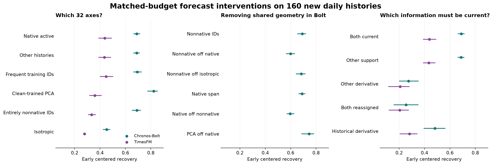

# Does the receiving model need its own active SAE features for this history?

**Changing all 32 candidate feature IDs gave almost identical average early forecast recovery in Chronos-Bolt.** On 160 previously unused M4 daily series with genuine 256-step contexts, native Bolt features scored .689 and a history-specific set containing **zero** of those feature IDs scored .690. The paired native-minus-zero-ID contrast was −.0011 [−.0281, .0302]. A different history’s actual active set scored .688. The native-minus-reassigned difference was +.001 [−.019, .022], even though these assignments shared only 7–8 active IDs on the median firing event. Every method saw the current model’s derivative and the same requested change for these comparisons. [Prospective protocol](PROTOCOL.md) · [Context-length amendment before model captures](SHORT_CONTEXT.md) · [All scores and paired intervals](results/summary.json)

The controlled disjoint-ID result differed in TimesFM. Its other histories usually shared 28–29 feature IDs. Swapping between those histories changed little, while replacing every native ID reduced skill from .437 to .333. A single set of 32 features selected by firing frequency on the historical training series scored .448. The identical training protocol for clean rank-32 PCA scored .359 in TimesFM and .823 in Bolt. [Chronos-Bolt measured cases](results/short_bolt.npz) · [TimesFM measured cases](results/short_timesfm.npz)

## Two prospectively frozen M4 cohorts

We audited item identities across the original mapping, training and calibration panels, previous intervention studies, the external benchmark, rolling-window cohorts, the first blind daily studies, and the last dictionary gate confirmation. The exclusion set contained 3,744 M4 daily IDs. There were 483 other source IDs, of which just 19 supplied 480 observed steps and an eight-observation trailing buffer. We retained all 19. Before collecting any hidden state or evaluating any new forecast, we added a 256-step panel of 160 other identities using the same minimum trailing buffer. The 160 are disjoint both from the original 19 and from the entire exclusion set. Each new series was standardized using its own observed context. The buffer contributed no inputs or forecast labels. These checks apply to the audited research panels. Pretraining exposure remains unknown. [Full-length IDs, exclusions and hashes](results/manifest.json) · [Short-context IDs and hash](results/short_manifest.json)

The original 19-history panel retained 46 firing events across four donor features for Bolt and 23 across two for TimesFM under the registered minimum eight fires per feature. Its primary contrasts have limited precision. The table gives mean per-feature recovery of the physically measured **dense recipient** effect on leads 1–8, after removing each waveform’s mean. A score of 1 reproduces the dense waveform and zero corresponds to making no change. Intervals on paired differences independently resample source series and the eligible donor features. The score file includes fixed-feature series intervals.

| Receiver | Histories × length | Eligible events / donor atoms | Native 32 | Four wrong histories | Native minus wrong [95%] | Train frequent 32 | Train PCA 32 | Isotropic 32 |
|---|---:|---:|---:|---:|---:|---:|---:|---:|
| Bolt | 160 × 256 | 349 / 8 | .689 | .688 | +.001 [−.019, .022] | .694 | .823 | .452 |
| TimesFM | 160 × 256 | 291 / 11 | .437 | .434 | +.003 [−.003, .011] | .448 | .359 | .278 |
| Bolt | 19 × 480 | 46 / 4 | .731 | .705 | +.026 [−.012, .057] | .715 | .859 | .458 |
| TimesFM | 19 × 480 | 23 / 2 | .571 | .568 | +.002 [−.002, .013] | .572 | .417 | .291 |

The short-panel intervals for both native-minus-wrong contrasts fit within the prospectively specified ±.03 practical margin. The original-length Bolt interval extends outside it. The methods had the same norm cap per case. In both new populations every native, frequent and zero-ID write used at least 99% of its cap. On short-context Bolt PCA the same held for 99.1% of writes. [Realized lengths and unrounded effects](results/summary.json)

## What happens as the number of shared IDs changes?

The minimum-overlap control reassigns complete supports through a one-to-one bipartite match over all input series. This preserves each support’s population frequency across histories. The controlled overlap experiment keeps 0, 8, 16, 24 or 32 native IDs in a fixed nested order and fills the rest from the training-frequency ranking, excluding the native axes. Constructing the zero-ID control requires knowing which current features to exclude. The unrestricted frequency-ranked 32, train PCA and isotropic control do not query the current SAE support. Changing the overlap also changes subspace geometry. [Support construction](supports.py)

| Receiver, 160 × 256 | Lowest-overlap assignment | Median shared IDs | Exactly 0 native | Exactly 8 | Exactly 16 | Exactly 24 | All 32 |
|---|---:|---:|---:|---:|---:|---:|---:|
| Chronos-Bolt | 0.686 | 3 | 0.690 | 0.699 | 0.698 | 0.703 | 0.689 |
| TimesFM | 0.440 | 28 | 0.333 | 0.372 | 0.402 | 0.428 | 0.437 |

Removing a naturally firing historical TimesFM atom defined the donor reference for each Bolt edit, and vice versa. Against that donor's actual **early** centered response, Bolt scored .476 native, .478 swapped and .556 PCA. TimesFM scored .433, .430 and .355. On the withheld donor response at leads 9–16, native and swapped scored .021 and .005 in Bolt, −.006 and −.014 in TimesFM. The near-equality during the fitted interval gives little evidence that either support identifies a shared, persistent causal feature. [Early and late effects, full waves and centered waves](results/summary.json)

## Two tests of the mechanism

The first removes geometric overlap from spans whose feature IDs are already disjoint. The second crosses the source of the candidate axes with the source of the forecast derivative used to fit their coefficients. Both reuse the 160 short-context cases after the primary outcome was known. [Orthogonalized-span experiment](RESIDUAL.md) · [Current versus reassigned derivatives](DERIVATIVE.md)

## External replication on 2026 weather histories

The external panel contains four 480-day forecast origins at each of 46 separated US weather stations. It repeats the frozen current-versus-other derivative comparison and both fixed-frequency and zero-native-ID support controls. Station-block intervals preserve repeated origins. [Weather results and station coverage](noaa/README.md)

## Input length and numerical checks

On a separate development set of 128 prior M4 histories, we kept the end time fixed and truncated each history from 480 to 256 genuine observations. The median same-history overlap across these lengths was 19/32 in Bolt and 29/32 in TimesFM. Mean cross-history overlap changed little, from 9.51 to 9.36 in Bolt and from 28.70 to 28.64 in TimesFM. In Bolt the fraction of centered ordinary-derivative energy inside the native axes changed from .144 to .151 and PCA from .268 to .271. In TimesFM the native fraction changed from .088 to .064 and PCA from .021 to .026. These are within-item changes in ordinary geometry. The two prospective groups also differ in item identity. [Within-item design](LENGTH_CHECK.md) · [Bolt measurements](results/bolt_context_check.json) · [TimesFM measurements](results/timesfm_context_check.json)

The models use native-length context tensors. Bolt takes the last two 16-step data tokens after block 3, indices 14–15 at 256 and 28–29 at 480. For TimesFM the final 32 steps form one data token after block 10, indices 7 and 14 respectively. Both use their archived 6,144-feature TopK-32 SAE on the pooled window. The donor's natural removal is the clean coefficient times its original decoder row, with negative sign. Its ordinary first-eight derivative response enters the historical shape-balanced damped dense controller. Each candidate recipient span then fits the same eight linearized changes of that bounded dense write. The inherited solver uses ridge strength equal to .001 times the largest eigenvalue of its own shape-balanced design Gram matrix. It rescales the resulting vector radially if it exceeds the dense budget. This experiment measures that specific algorithm. A trust-region optimum at the same norm is a different controller. Outcomes came from finite physical interventions on the original model, scored against the separately measured dense or natural donor waveforms. The training-frequency and clean PCA controls used the same original 1,024 M4 items. The fixed isotropic control used the same rank. The writes are unrestricted signed mixtures in these spans. [Physical experiment](run.py) · [Scoring](score.py)

Ordinary Jacobians passed symmetric physical finite-difference checks on twelve histories per new group and receiver. Relative errors ranged from .000613 to .003905. An independent implementation reconstructed and ran 180 singleton forecast interventions across both lengths and receivers. It used an additive hook, separately computed covariance eigenvectors for PCA and an SVD ridge inverse. Maximum discrepancy was 0.000003815 forecast SD across all 16 leads. The two follow-ups added 21 independently replayed residual interventions and 60 derivative-factorial interventions. All three replay files were reproduced byte for byte from an isolated source and artifact copy. [Per-case replay](results/replay.json) · [Isolated reproduction script](replay_isolated.sh) · [Aggregated verification and tests](VERIFICATION.md)

    PYTHON=python bash research/activation_transfer/shape_transfer/support_confirmation/reproduce.sh \
      /tmp/tsfm-support-new /tmp/tsfm-support-results

The command uses the locally pinned SAE/model and historical calibration assets described in the transfer study. It reproduces source contexts from the two frozen manifests, reruns both physical panels and the follow-ups, and checks actual forecasts. [Reproduction script](reproduce.sh) · [Shared weights and data setup](../../REPRODUCE.md)
