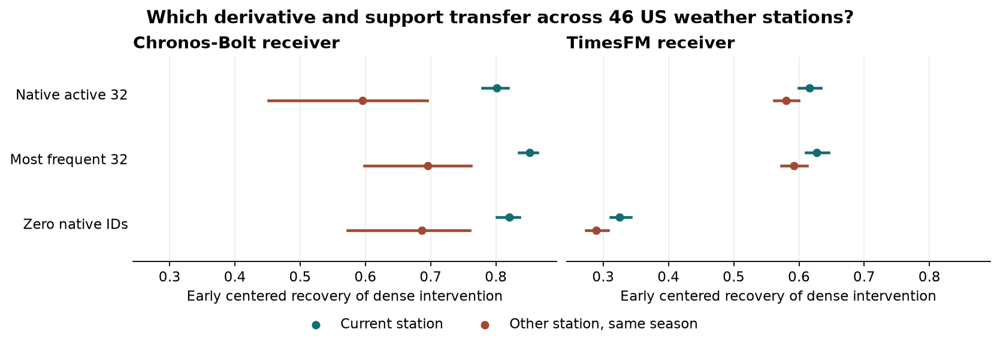

# Does the support-versus-derivative result extend to 2026 temperature histories?

We repeated the central comparison on a separately frozen US Climate Reference Network panel. The forecasts’ 2026 origin dates followed both checkpoints’ releases. Earlier portions of each 480-day weather context were already public. The tested outcome is the internal intervention’s effect on each model’s forecast, in units of the station history’s SD. This experiment never reads the actual subsequent weather. [Preregistered transfer study](PROTOCOL.md) · [Independent weather sampling protocol](../../../moment/forecast_quality/post_release/PROTOCOL.md)

## Population and interventions

The inputs were 46 contiguous-US stations spaced at least 200 km apart, each observed at the same four seasons. Forecasts start January 10, April 10, July 10 or October 10, 2026. Every history contains the preceding 480 daily observations, using the external panel’s frozen historical imputation rule when necessary. Neither the site nor the date is a model input. The forecast models receive raw temperatures in °C. We divide each forecast derivative by the history SD of the station and origin on which it was evaluated. We divide every measured finite forecast change by the current history SD. This keeps physical doses comparable in the recipient even when the derivative comes from a station with a different temperature range. The per-event archives also retain the original Celsius changes. [Fixed station list and input hashes](results/manifest.json) · [Preparation and normalization check](data.py)

At the last 32 observations, the recipient write adds a common hidden vector to the final two 16-step Bolt tokens or the final 32-step TimesFM token. These are finite edits at one middle block. Each donor model retains its original 16 daily-training-selected candidate atoms, natural clean activation level and exact physical native knockout. As on M4, the internal recipient request uses only the unmodified donor and recipient derivatives for leads 1–8. We estimate coefficients inside three candidate rank-32 receiver spaces, each with the same current-case dense hidden budget. The choices are the native 32 active axes, the same fixed 32 training-most-frequent features for every station, and the 32 training-most-frequent SAE features inactive on this station and origin. The zero-ID arm uses the current support to exclude native directions; the fixed frequency arm needs no current SAE query. For each choice we fit using the current receiving derivative or a different station’s derivative at the same seasonal origin. The current requested waveform, norm cap and actual receiving history stay fixed. The inherited controller solves the shape-weighted ridge problem and radially rescales an over-budget write to the allowed norm. All 96 historical calibration cases, 1,024 frequency-ranking training cases, original SAEs and model weights remain frozen. [Methods](run.py) · [Station-block scoring](score.py)

Donor features had to fire in at least eight **distinct stations** to enter the primary analysis. Multiple origins at one station count once toward eligibility. Each interval resamples the 46 station blocks, retaining all origins and firing events within a sampled station. Results also include crossed donor-feature/site intervals and a sensitivity with equal weight for each active station within each feature. Weather at different stations can still be correlated. Only four common dates were observed, so the station bootstrap does not estimate year-to-year or seasonal sampling uncertainty.

## What changed the physically edited forecast?

A score of 1 exactly reproduces the reference forecast change, 0 ties a zero-change prediction and negative values increase squared error. Each 8-lead change is centered over its own leads to separate forecast shape from a level shift. “Dense” refers to the finite, unrestricted recipient intervention fitted on the first eight leads. “Donor” is the measured forecast response to deleting the naturally firing source SAE atom. Leads 9–16 were withheld from every controller. The four wrong-station policies were scored individually and their skills averaged.

| Recipient and support | Early dense, current J | Early dense, other J | Early donor, current J | Early donor, other J | Held-out donor, current J | Held-out donor, other J |
|---|---:|---:|---:|---:|---:|---:|
| Bolt, native 32 | .802 | .596 | .645 | .480 | .326 | .273 |
| Bolt, frequent 32 | .852 | .696 | .686 | .562 | .347 | .302 |
| Bolt, zero native IDs | .821 | .686 | .661 | .554 | .323 | .264 |
| TimesFM, native 32 | .616 | .580 | .604 | .572 | .061 | .089 |
| TimesFM, frequent 32 | .628 | .592 | .615 | .584 | .061 | .086 |
| TimesFM, zero native IDs | .325 | .289 | .317 | .283 | .037 | .046 |

The figure shows paired-design, 95% station-block intervals for each policy mean. The contrast intervals below use the within-station differences.

With three eligible TimesFM donor atoms, Bolt's current-station derivative improved early dense recovery by .206 over the other-station policy using the native support (paired station 95% interval [.116, .338], crossed station/atom [.081, .480]). The fixed training-frequency span improved on native by .050, with paired station interval [.036, .063] and crossed interval [.032, .069]. Removing all native IDs improved by .019 for this trio (station [.008, .031]). Its crossed interval [−.034, .057] includes either sign. Station-equal weighting gave .020 for the same disjoint-minus-native contrast. Retaining the current derivative also improved withheld actual donor shape by .053, station interval [.026, .081]. Among these three donor features, two fired at nearly all stations.

With seven eligible Bolt donor atoms, TimesFM's current-station derivative improved early dense recovery by .036, station interval [.020, .051], crossed station/atom [−.007, .073]. Excluding every native ID cost .291 relative to native, station [.275, .306], crossed [.241, .344]. The unrestricted training-frequency basis improved on native by .011, station [.010, .014], crossed [.006, .017]. On the eight withheld leads its native support reproduced only .061 of the donor's centered effect; the other-station derivative scored .089. The paired difference of −.028 had station interval [−.047, −.005] and crossed interval [−.068, .005].

The late donor references varied in physical size. Pooled over eligible firing events, their raw full and centered RMS were 1.681°C and 0.175°C for the TimesFM donor, 0.0674°C and 0.00635°C for the Bolt donor. Skill normalizes by reference energy within each eligible atom.

The fixed training-frequency axes were competitive in both receivers. In Bolt a basis selected to share zero active IDs also worked. In TimesFM removing the heavily reused directions cost more than substituting another station's derivative. Both conclusions apply to the measured finite edits, the specified ridge and norm cap, and the donor features that fired on these dates. The measured quantity is recovery of an intervention-induced waveform. A feature correspondence or an accuracy gain would require its own experiment. [Scoring and per-feature estimates](results/summary.json) · [Bolt per-event forecasts](results/bolt.npz) · [TimesFM per-event forecasts](results/timesfm.npz)

## Which historical features actually fired?

| Donor → receiver | Source removals, all 16 candidates | Eligible removals | Eligible atoms | Stations with at least one eligible event | Eligible removals in Jan / Apr / Jul / Oct |
|---|---:|---:|---:|---:|---|
| TimesFM → Chronos-Bolt | 277 | 271 | 3 | 46 | 46 / 80 / 82 / 63 |
| Chronos-Bolt → TimesFM | 279 | 264 | 7 | 46 | 31 / 96 / 87 / 50 |

TimesFM donor IDs 1641, 2106 and 2362 fired at 15, 45 and 46 distinct stations, with 16, 71 and 184 eligible station-origin events respectively. Chronos-Bolt donor IDs 41, 5749, 2629, 4869, 1404, 6065 and 1608 fired at 28, 45, 45, 17, 14, 36 and 13 stations. Every feature gets equal weight in the main score. The estimates apply to the listed features under natural firing. [Per-atom site counts and seasonal firings](results/summary.json)

Same-season receivers at different stations had fairly similar forecast derivatives. The median cosine between horizon-centered derivatives across the four station assignments was .943 in Bolt and .854 in TimesFM. For the 160 short M4 daily histories this was .442 and .443. The 19 long M4 histories gave .694 and .693. Weather therefore tests substituting a derivative that often resembles the current derivative. The four assignments shared a median 17 of 32 active IDs in Bolt and 30 of 32 in TimesFM. The fixed training-frequency basis shared a median 7 native IDs in Bolt and 29 in TimesFM. The explicitly disjoint construction shared zero for every history. The cross-domain differences also include eligibility, history length and input distribution. [Paired derivative descriptions](results/jacobian_similarity.json)

## Reproduction

    PYTHON=python bash research/activation_transfer/shape_transfer/support_confirmation/noaa/reproduce.sh \
      /tmp/tsfm-support-noaa-new /tmp/tsfm-support-noaa-results

An independent implementation reconstructed 64 actual single-history source, dense, native-support, fixed-frequency and disjoint-support forecast interventions. The largest discrepancy was 0.000001433 historical SD. The aggregate output archives retain all 8,340 16-lead candidate forecasts from 15 physical policies on every naturally firing candidate event, including events excluded from the primary analysis. [Singleton physical audit](results/replay.json) · [Isolated replay command](replay_isolated.sh)

The source weather panel, historical M4 assets and pinned local models must be available. [Reproduction script](reproduce.sh) · [Station inference unit tests and planted failures](MUTATION_CHECK.md)
