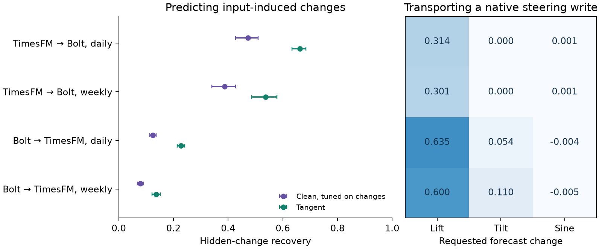

# Does learning matched activation changes transfer an independently chosen steering direction?

This study compares learning from aligned clean states with learning from small input perturbations that elicit paired hidden changes. The hidden maps never see a forecast response. One endpoint measures held-out input-induced hidden changes. Another takes each model's fixed, output-targeted level, tilt and period-eight steering vectors, passes each through the fitted map, and actually applies the resulting vector in the other model. [Protocol](PROTOCOL.md)

## A positive control for learning input-induced changes

Training directly on matched changes improved hidden response prediction in **both directions on both held-out domains**. The clean comparator in the first column has the same 512 training histories and even chooses its regularization to predict validation *changes*. The first two columns average the four generic edit families with equal weight. The next two show target forecast recovery when applying an actual predicted displacement from previously untrained ±4-step observed shifts. The reference here is the forecast caused by the recipient's own measured hidden shift.

| Source → receiver | Domain | Generic hidden recovery, clean | Generic hidden recovery, tangent | Observed-shift forecast recovery, clean | Observed-shift forecast recovery, tangent | Waveform-only shift forecast recovery |
|---|---|---:|---:|---:|---:|---:|
| TimesFM → Bolt | Daily | .473 | .663 | .834 | .894 | .895 |
| TimesFM → Bolt | Weekly | .387 | .537 | .679 | .835 | .806 |
| Bolt → TimesFM | Daily | .125 | .228 | .900 | .932 | .798 |
| Bolt → TimesFM | Weekly | .079 | .137 | .791 | .849 | .770 |

The paired improvements in generic hidden recovery were .190 [.160, .223] and .149 [.109, .188] toward Bolt and .103 [.093, .113] and .058 [.048, .068] toward TimesFM. Improvement against the standard clean model was also positive in all four point comparisons. For true ±4-step shifts, hidden energy recovery itself was more variable: .681/.566 toward Bolt and .205/.017 toward TimesFM (daily/weekly; see exact entries in the archive). Even the true shift's forecast response could be recoverable while its full hidden displacement was much harder. The shuffled tangent's corresponding forecast recovery ranged from −.047 to .077. The known input signal alone was competitive on the Bolt recipient. [All per-family results, paired intervals and forecast responses](results/summary.json)

## Applying an independent source-native write

These are actual forecast interventions at each map's own calibrated dose. Recovery one means the requested eight-lead change was matched; zero means the same squared error as no action. The rightmost columns separately compare the tilt and sine responses with **what the source model itself did** on the same histories.

| Source → receiver | Domain | Tangent lift | Tangent tilt | Tangent sine | Clean tilt / sine, tuned on changes | Tilt / sine against source-native effect |
|---|---|---:|---:|---:|---:|---:|
| TimesFM → Bolt | Daily | .314 | .0001 | .0010 | .000 / .000 | −.056 / −.301 |
| TimesFM → Bolt | Weekly | .301 | .0003 | .0010 | .000 / .000 | −.007 / −.141 |
| Bolt → TimesFM | Daily | .635 | .0544 | −.0041 | .085 / .002 | −.042 / −.124 |
| Bolt → TimesFM | Weekly | .600 | .1101 | −.0046 | .146 / .002 | .032 / −.026 |



The weekly tilt into TimesFM is a useful exception. The tangent write recovered .110 [.079, .143] of the specified tilt, close to the recipient's own native .114. The clean-change-tuned write already achieved .146. Against the source's actual native forecast change, the tangent write scored .032 [−.101, .160]; against the recipient's native *intervention response* it scored −1.967. Multiple response vectors can achieve similar squared error against an imperfectly attainable requested tilt.

For TimesFM → Bolt, even before the target dose was calibrated, the tangent writes for tilt and sine reached only .008 and .006 times the requested RMS on daily. Their mean signed cosines to the requested shapes were −.007 and .023. Calibration assigned nonzero doses (1.96 and 5.33), but the change in requested recovery remained close to zero. In reverse, source-dose writes **overshot** severely: daily tilt/sine recovery was −40.344/−103.569. Recipient behavior and write strength both limit transfer. The legacy clean map still recovered .319/.304 of the calibrated lift into Bolt and .982/.976 into TimesFM. One shuffled tangent map also recovered .958/.949 for lift into TimesFM after getting the same per-request norm and its own dose calibration. A single shuffle cannot estimate the distribution of those null results.

The native writes had originally been fitted inside each source's clean PCA24 span. For TimesFM as source, the leading 32 clean-state PCs contained .975 of the tilt and sine write energies, compared with .421 for the leading 32 tangent PCs. In Bolt, the corresponding tangent fractions were .951/.954. This helps characterize the input-change coverage of the original writes; it does not show which individual dimensions causally explain any transfer difference. [Bolt as source](results/bolt_to_timesfm_map.json) · [TimesFM as source](results/timesfm_to_bolt_map.json)

These results support learning from tangents to predict changes induced by similar inputs in another model. They do not support treating that improvement as evidence that an independently chosen native steering direction will retain its action, particularly for a signed multilead shape. Only two checkpoints, one middle token, fixed input perturbations and three steering directions were tested.

## Independent replay

An independent calculation reproduced all 628 reported per-domain energy recoveries for individual hidden-change families, native four-step forecast patches, and arbitrary forecast writes against all three references and both doses. Direct Cholesky solutions of the ridge normal equations reproduced the source writes learned through the eigensolver, with a maximum absolute coordinate discrepancy below 0.00000061 across clean, tangent and joint maps. On two daily and two weekly histories, new checkpoint calls reproduced all raw and calibrated writes within 0.000047 history SD and all observed-shift interventions within 0.000001. Every legacy raw and calibrated forecast on the 128 evaluation histories matched its original archive within 0.000004. The legacy arm uses its recorded scalar exactly. Re-estimating the weak TimesFM → Bolt sine dose in the two-thread runtime gave .10668 versus the original .11029, illustrating why the registered dose and separate forecast replay are retained. [Replay into Bolt](results/timesfm_to_bolt_verification.json) · [Replay into TimesFM](results/bolt_to_timesfm_verification.json)

## What was trained and what was held out

Both frozen models share the same 192-observation histories. At the middle block we used the last-token inputs from the original output-request study, i.e. the Chronos-Bolt registration token and TimesFM's final data patch. The first 512 original daily alignment items fit the maps. The next 128 choose regularization. The native steering directions had been fitted separately on 64 other daily histories to produce an eight-lead change, using the top 24 clean-state principal directions in each source. The optional one-dimensional dose calibration uses 32 further target histories. Evaluation uses the first 64 original held-out daily and weekly items; it reuses prior populations to allow a direct paired comparison. [Original steering experiment](../../forecast_requests/README.md) · [Frozen item partitions and input hash](results/manifest.json)

Each training item receives four small, independently generated signed perturbation pairs: a recent local bump, an earlier bump, a broad smooth trend and an oscillation near the endpoint. Their half-difference has an RMS of 0.06 standardized history units. A fifth pair consists of actual observed windows ending two observations before/after the original endpoint. We capture half the difference of each pair's hidden states. The hidden-change regression divides by the input half-difference RMS with a floor of .02 and gives each family equal total source training energy. A clean model fits centered states; a joint model gives clean and perturbed examples equal total source energy. The standard clean model tunes ridge on clean validation MSE. A second clean model tunes regularization using validation changes, as in the tangent and joint models.

A matched-null control reassigns the target tangent to a different source history while retaining family. It uses the real tangent map's ridge penalty. Its predicted hidden shifts retain their natural magnitude; for the arbitrary writes it gets the same per-request target vector norms as the real tangent arm. Each arm, including this null, gets its own scalar dose calibration on the same 32 target histories, constrained to [0,8]. The historical clean map used 640 alignment items and the original relative penalty .01. The raw-input half-difference baseline can predict a response to a known change, but cannot assign an arbitrary hidden write to an observed input perturbation.

## Reproduction

Run in the [study environment](../../REPRODUCE.md) after producing the original three-model forecast-request fits and published eight-lead responses. Only the Bolt and TimesFM fits are used here. Data capture and fitting default to separate scratch directories `/tmp/tsfm_forecast_requests_20261120` for the originals and `/tmp/tsfm_shape_tangents_v1` for this comparison. All scripts expose `--help`.

```bash
export PYTHONPATH=.:tsfm_lens:tsfm_benchmark
export HF_HUB_OFFLINE=1
export OMP_NUM_THREADS=2 MKL_NUM_THREADS=2 OPENBLAS_NUM_THREADS=2
pkg=research.activation_transfer.shape_transfer.tangents
python -m "$pkg.capture" prepare
for model in bolt timesfm; do python -m "$pkg.capture" "$model"; done
for target in bolt timesfm; do python -m "$pkg.maps" "$target"; done
for target in bolt timesfm; do python -m "$pkg.forecast" "$target"; done
python -m "$pkg.summary"
for target in bolt timesfm; do python -m "$pkg.replay" "$target"; done
python -m "$pkg.plot"
python -m pytest -q research/activation_transfer/shape_transfer/tangents/test_tangents.py
```

The compact archives in `results/` provide per-item hidden-change inner products, intervention responses, calibration effects, doses and original native responses in both directions. The summary script recomputes magnitude-sensitive recovery, signed gain, mean signed cosine and RMS ratios from them. They compare model behavior rather than future observation accuracy. The focused test was run against a deliberately reversed penalty selection in a temporary copy. It failed on 389 of 390 held-out coordinates of the planted affine change and passed on the corrected implementation.
