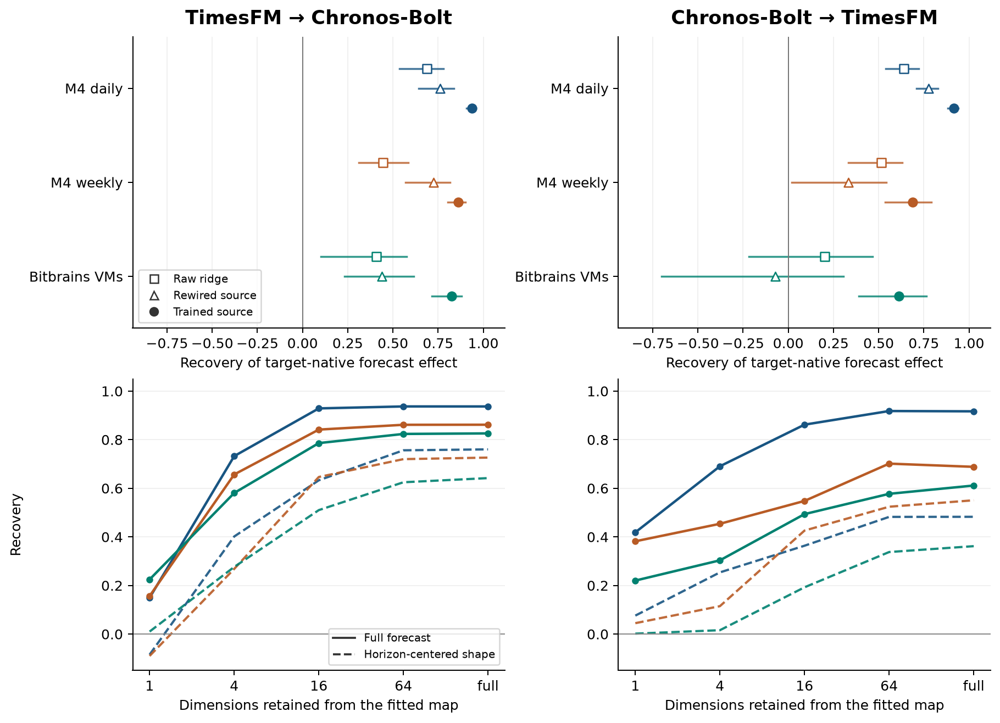

# Which hidden changes transport between TimesFM and Chronos-Bolt?

A linear map fitted on 384 ordinary M4 daily histories transported local hidden changes between TimesFM 2.5 and Chronos-Bolt-small. The target forecast often responded nearly as it did to the target model’s own hidden change, even on fresh series from another domain. This held in one case where the map predicted the target’s full hidden displacement worse than a zero vector. A trained source improved transfer over architecture and input controls, particularly on the hourly virtual-machine series. When asked to reproduce a fixed source intervention’s own effect, the same bridge lost most horizon-shape and background-specific agreement.

## What was measured

Both sites receive representations of the final 32 observations at the middle block. We concatenated two 16-step Bolt patches and used one 32-step TimesFM patch, preserving chronological order. A ridge map learned from paired clean states relates the two spaces. It uses the model activations from the training histories and has no access to target forecast labels. On each test history we measure the change in a source activation, apply the linear part of the map, and add and subtract the resulting vector while running the target model on the original history. The difference between those two target median forecasts, divided by two, is the intervened response. Every metric uses the first 16 forecast steps in units of the clean history’s standard deviation. [Original protocol](PROTOCOL.md)

For the target-native reference, apply the target’s own activation change at that site and take the corresponding forecast difference. Recovery is one minus the squared forecast error divided by the target-native response energy. A score of one means the entire response was recovered. A score of zero is attained by leaving the target alone. Removing each forecast’s mean across leads measures shape agreement. Removing each perturbation’s across-series mean separately at every lead measures background-specific agreement. [Follow-up protocol](FOLLOWUP.md)

## The difference between matching a waveform and matching its effect on different series

On the first study’s four waveform families, the dense bridge recovered .960/.958 of Bolt’s native response energy on 128 daily/128 weekly M4 series and .927/.942 of TimesFM’s. A train-estimated response template requiring zero target calls scored .936/.897 toward Bolt and .870/.858 toward TimesFM. Each family has a large stereotyped response.

The dense edits also carried history-dependent information. After subtracting each waveform’s mean across series, recovery remained .466/.613 toward Bolt and .461/.605 toward TimesFM. Giving each target history another series’ source edit for the same waveform reduced those scores to −1.104/−.636 and −.036/.147. The receiver/model, history, forecast scale and waveform family were held fixed in this donor test. Pair bootstraps account for dependence between each pair of swapped series. [Bolt results](results/timesfm_to_bolt_controls.json) · [TimesFM results](results/bolt_to_timesfm_controls.json)

## Transfer on observed changes in real histories

We next took pairs of real adjacent windows ending one or four observations on either side of the central time. There was no fixed artificial waveform. The clean map stayed frozen. Each test item was new to this experiment and disjoint from the comparison cohorts used in the sibling behavioral study at selection time. Values in brackets are 95% paired-cluster bootstrap intervals for the native forecast recovery.

| Source → patched target | Fresh test items | Native forecast recovery | Horizon-centered shape | Raw-history ridge | Source-native forecast as predictor | Full hidden-delta recovery |
|---|---:|---:|---:|---:|---:|---:|
| TimesFM → Bolt | 160 M4 daily | .937 [.909, .958] | .760 | .688 | .759 | .635 |
| TimesFM → Bolt | 70 M4 weekly | .862 [.804, .902] | .726 | .445 | .578 | .526 |
| TimesFM → Bolt | 128 Bitbrains VMs | .826 [.715, .881] | .642 | .409 | .290 | .318 |
| Bolt → TimesFM | 160 M4 daily | .917 [.882, .942] | .483 | .641 | .802 | .013 |
| Bolt → TimesFM | 70 M4 weekly | .688 [.535, .791] | .551 | .514 | .685 | −.207 |
| Bolt → TimesFM | 128 Bitbrains VMs | .611 [.389, .765] | .362 | .203 | .596 | −.464 |

The raw-history control fits the same clean target hidden states directly from input values and routes its predicted change through the same target model. A map fitted after shuffling the training pairs scored between −.036 and .065. Swapping source histories on the correctly trained bridge harmed performance in all six cells. Recovery for the *source* forecast as reference is a different comparison, .831/.644/.537 for transported edits into Bolt and .770/.681/.494 into TimesFM across the three domains. [All natural-window results for Bolt](results/timesfm_to_bolt_natural.json) · [All natural-window results for TimesFM](results/bolt_to_timesfm_natural.json)

The upper panels show recovery with original, linearly encoded raw-input, and independently rewired source features. Whiskers are conditional 95% series-bootstrap intervals. The lower panels show target-native recovery as more principal dimensions of the training-fitted destination states are retained. Solid lines use the full median forecast. Dashed lines remove its horizon mean. Colors identify daily M4 (blue), weekly M4 (orange) and Bitbrains VMs (green).

## What pretraining and dimensionality contributed

Fresh untrained encoders captured a substantial share of daily transfer. Two independently initialized Bolt sources scored .818 on average toward pretrained TimesFM on daily M4, .095 on weekly M4, and −.043 on Bitbrains. Two default random TimesFM sources scored .812/.720/.280 toward pretrained Bolt. Their middle-block input equals their first-block input exactly because the library initializes the relevant normalization scales to zero. Setting those scales to one raised effective clean-state rank from about 3 to 27 and yielded lower scores of .457/.272/.237. These controls expose how far an input representation and target-specific regression can already go. [Random-source protocol](RANDOM_SOURCE_PROTOCOL.md)

Independently permuting the rows and columns of each trained source matrix preserved its singular values and disrupted the learned connections between successive layers. The original trained source beat this control in both directions on every cohort. Trained minus mean-rewired gains were .175/.136/.387 toward Bolt and .140/.356/.683 toward TimesFM, with positive lower bounds in all six paired comparisons. Two rewires per architecture limit inference about the entire distribution of rewired networks. [Bolt-target rewiring control](results/timesfm_to_bolt_rewired.json) · [TimesFM-target rewiring control](results/bolt_to_timesfm_rewired.json)

Rank one captured 51% of clean fitted destination variance into Bolt, yet yielded only .150/.157/.225 of native forecast-effect energy in the three cohorts. Sixteen dimensions yielded .929/.842/.786. Into TimesFM, rank sixteen reached .862/.548/.494, and rank 64 reached .918/.701/.577. Recovery of horizon shape generally required more dimensions. Random subspaces drawn in proportion to fitted-state covariance also recovered substantial responses at moderate and large rank, making high-dimensional success alone weak evidence for uniquely privileged axes. [Rank protocol](RANK_PROTOCOL.md) · [Bolt-target rank curves](results/timesfm_to_bolt_rank.json) · [TimesFM-target rank curves](results/bolt_to_timesfm_rank.json)

## Can a source intervention reproduce its own effect in the other model?

The target-native endpoint has a common input change to identify counterpart edits. For a stricter test, we chose four principal directions and four mean waveform contrasts from the training **source** states alone. Each direction was fixed across series. We measured how adding and subtracting each vector affected the source forecast and how its transported version affected the target forecast on the same unmodified history. Each group gives its four axes equal weight. The held-out histories were 128 additional daily M4 series and 96 Shenzhen taxi locations. [Source-direction protocol](SOURCE_AXES_PROTOCOL.md)

| Source → patched target | Sources of the held-out histories | Source-effect recovery for four named axes | Source-effect recovery for four principal axes | Signed cosine for named axes |
|---|---|---:|---:|---:|
| TimesFM → Bolt | M4 daily | .693 [.635, .742] | .058 [−.103, .182] | .864 |
| TimesFM → Bolt | Shenzhen taxi | −.411 [−1.156, .295] | −.722 [−3.404, .132] | .541 |
| Bolt → TimesFM | M4 daily | .542 [.44, .63] | −1.343 [−2.32, −.82] | .85 |
| Bolt → TimesFM | Shenzhen taxi | .244 [−.13, .54] | −.292 [−5.28, .25] | .59 |

Across all eight direction × group × domain cells, matching the source direction beat transplanting the other three axes in its group at the same destination norm. Nevertheless, the mean source forecast response on 96 training items outperformed the bridge in seven cells. Macroscopic forecast direction sometimes survived, but all eight point estimates for recovery of within-horizon shape were negative, as were all eight after removing the axis-specific mean response across histories. Some individual axes did travel. The ramp recovered .80/.59 toward Bolt on daily/taxi and .62/.60 toward TimesFM. A short pulse recovered .36/−2.74 and .40/.01. Weak source denominators make several PCA estimates unstable, particularly in taxi regions sharing the same time period. These results distinguish agreement on naturally elicited recipient changes from faithful transfer of a specified source intervention. [Detailed Bolt-target results and per-axis intervals](results/timesfm_to_bolt_axes.json) · [TimesFM-target results](results/bolt_to_timesfm_axes.json)

## Scope

The intervened forecast is causal within the frozen recipient under the chosen internal edit. Held-out transfer shows that sufficiently related coordinates drive a similar local forecast response. It leaves open whether the models implement the same computation or whether a single SAE feature corresponds to that change. The observed-window protocol perturbs every input position through a shift, while the internal patch is localized to the final 32-step representation. Its reference forecasts are counterfactual model outputs, so high recovery does not imply improved forecasting accuracy. Some M4 or Bitbrains data can have been present during pretraining; independence here concerns fitting the alignment and evaluating it on fresh series. Each VM is one resampling unit conditional on the observation period. One VM contributed 23–26% of squared response energy. Median per-VM recovery was .624 toward Bolt and .413 toward TimesFM. [Reproduction commands and archive schema](README.md)
